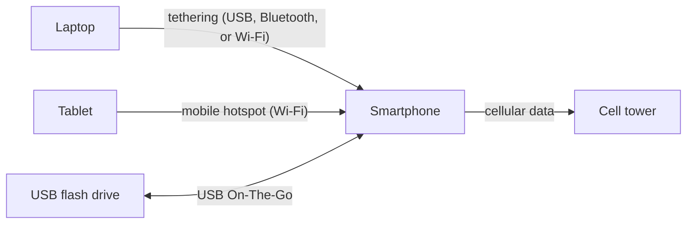
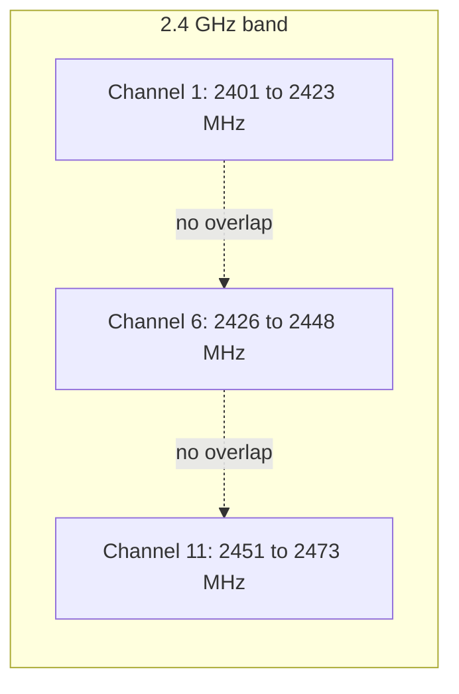
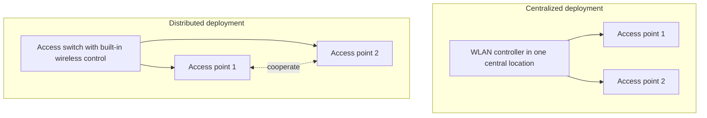
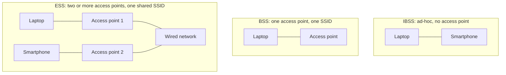
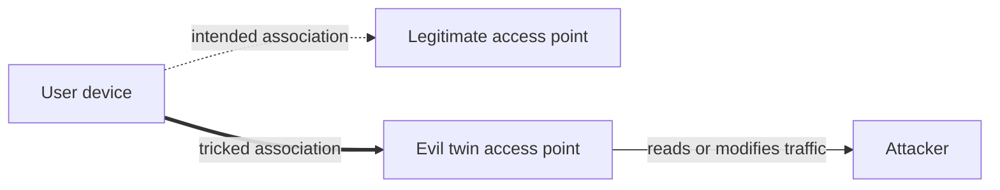

# Chapter 07: Wireless, Mobile, and IoT Security

## Abstract

Wireless networks move data through radio waves, and every wireless design choice shapes an organization's attack surface. The chapter opens with radio frequency fundamentals and a comparison of eight wireless technologies, from infrared at 315 to 344 GHz down to GPS at 50 bit/s. The WLAN lifecycle follows: 2.4 GHz and 5 GHz channel plans, IEEE 802.11 standards from 802.11b at 11 Mbps to 802.11ax at 11 Gbps, site surveys, WLAN controllers, and service sets. Security coverage includes WPA, WPA2 with CCMP, and WPA3 with GCMP-256 and SAE, five WLAN authentication options, and attacks such as evil twins, on-path interception, deauthentication, and jamming. Bluetooth attacks come next, then embedded systems, IoT devices, and SCADA systems. The final sections address mobile device deployment models (BYOD, COPE, COBO, CYOD), management platforms (MDM, EMM, UEM, MAM), virtual desktop and mobile infrastructure, mobile threats, and application installation risks such as sideloading, jailbreaking, and rooting.

## Objectives

- Describe radio frequency, wavelength, bands, and channels, and compare narrowband, wideband, broadband, and baseband signals.
- Compare infrared, Bluetooth, Wi-Fi, cellular, RFID, NFC, GPS, and ZigBee by range, frequency band, and bandwidth.
- Describe cellular network components, SIM and eSIM cards, carrier locking, and the GSM, CDMA, LTE, and 5G generations.
- Explain the roles of the IEEE and the Wi-Fi Alliance, Bluetooth pairing, and tethering, mobile hotspot, and USB On-The-Go sharing.
- Compare the 2.4 GHz and 5 GHz bands, channel widths, channel overlap, bonded channels, and the four U-NII bands.
- Compare legacy and modern IEEE 802.11 standards and the Wi-Fi Alliance generation names, and describe channel bonding, MIMO, and MU-MIMO.
- Describe site surveys, WLAN controller deployments, service sets and identifiers, and guest access controls such as geofencing and captive portals.
- Compare legacy WLAN security mechanisms with WPA2 and WPA3, and describe five WLAN authentication options.
- Describe spoofing, rogue access points, evil twins, on-path attacks, deauthentication, and jamming, and the role of a wireless intrusion prevention system.
- Describe bluejacking, bluesnarfing, and bluebugging, and explain how discoverable mode enables Bluetooth attacks.
- Describe embedded systems, custom and over-the-air firmware, real-time operating systems, and the security considerations for the Raspberry Pi, Arduino, and FPGA.
- Describe IoT device types, six IoT security considerations, common IoT attacks, and SCADA components.
- Compare the BYOD, COPE, COBO, and CYOD deployment models and the MDM, EMM, UEM, and MAM management platforms.
- Describe VDI and VMI, mobile security controls and threats, messaging technologies, and the risks of sideloading, jailbreaking, and rooting.

## Content

### 1. Radio Waves and Signals

Wireless technology sends data between devices as radio waves. A radio wave is artificially generated energy that radiates electrical current into open space. Two measurements describe a radio wave:

- **Frequency:** how often the wave occurs, measured as events per second.
- **Wavelength:** the distance the wave travels, measured in meters or feet.

Radio frequency (RF) identifies a wave's frequency numerically. One gigahertz (GHz) equals one billion events per second. A band is a span of radio frequencies. Wi-Fi, for example, operates in the 2.4 GHz and 5 GHz bands. A single radio wave has a starting RF, a center RF, and an ending RF, and the center RF serves as the channel. Most wireless technologies operate between 10 MHz and 6 GHz.

Wireless signals are electromagnetic waves that travel through the air. A signal forms when electric energy passes through a piece of metal, such as an antenna, and produces waves. Signal power and the environment determine how far the waves travel. Concrete, wood, and metal walls, and even lakes between sender and receiver, reduce the traveled distance. The signal's frequency determines the transmission type.

Four signal types exist:

- **Narrowband signal:** occupies a narrow frequency range with small bandwidth.
- **Wideband signal:** occupies a large bandwidth.
- **Broadband:** wide bandwidth transmission that generates an analog carrier frequency carrying multiple digital signals or channels. Cable TV travels over broadband. For internet access, broadband means any dedicated connection faster than dial-up.
- **Baseband:** the frequency range a signal occupies before modulation. A baseband radio processor (BP), also called a baseband processor, is a network interface controller chip that manages the radio functions. A synthesized tune and a microphone's audio output both use baseband signals.

### 2. Wireless Technologies Compared

An application's bandwidth, range, and reliability needs determine the appropriate wireless technology. Four technologies dominate:

- **Infrared (IR):** sends data over a high frequency infrared connection. An IR wave cannot pass through an obstacle, so IR requires a line of sight between the connected devices.
- **Bluetooth:** a low power, short range technology that pairs two devices, often connecting a device to peripherals. A computer connecting to a wireless keyboard is one example.
- **Wi-Fi:** uses a router to connect devices to each other and to the internet. Wi-Fi is the most common wireless technology in home and office networks.
- **Cellular:** uses cell towers to reach mobile devices such as smartphones and tablets. A carrier, such as AT&T or Verizon, provides the network, and all cellular data crosses infrastructure that an outside organization manages.

Table 7.1: Common wireless technologies.

| Technology | Range | Frequency bands | Bandwidth | Examples |
| --- | --- | --- | --- | --- |
| IR | 3 to 30 feet | 315 to 344 GHz | Up to 16 Mbit/s | TV remote control |
| Bluetooth | 30 feet | 2.4 GHz | Up to 2.1 Mbit/s | Wireless headphones, fitness tracker |
| Wi-Fi | 150 feet | 2.4 GHz, 5 GHz | Up to 9.6 Gbit/s | Laptop, smart TV |
| Cellular | 10 miles | 800 MHz to 40 GHz | Up to 10 Gbit/s | 5G cellular data, mobile hotspot |

Other technologies serve narrower functions or carry lower bandwidth:

- **Radio frequency identification (RFID):** uses a tag and a reader to identify and track objects. A physical tag attaches to or embeds in an object, and a reader in range receives the tag's data.
- **Near-field communication (NFC):** connects two devices in close proximity. NFC builds on RFID, but each device can act as tag or reader, so data flows in either direction.
- **Global Positioning System (GPS):** a satellite system for mapping and navigation. A GPS receiver calculates position from the signals of multiple satellites.
- **ZigBee:** a low-cost, low-power technology for machine-to-machine (M2M) and internet of things (IoT) networks, common in home automation. ZigBee consumes less power than Wi-Fi, while Wi-Fi carries higher bandwidth.

Table 7.2: Other wireless technologies.

| Technology | Range | Frequency bands | Bandwidth | Examples |
| --- | --- | --- | --- | --- |
| RFID | 3 to 300 feet | 125 kHz, 13.56 MHz, 860 to 960 MHz | Up to 848 Kbit/s | Hotel room key, pet microchip |
| NFC | 4 inches | 13.56 MHz | Up to 424 Kbit/s | Contactless payment, digital business card |
| GPS | 13,000 miles | 1575.42 MHz, 1227.6 MHz | 50 bit/s | Google Maps, geofencing |
| ZigBee | 10 to 333 feet, best under 40 feet | 2.4 GHz (global), 868 MHz (Europe), 915 MHz (America) | Up to 250 Kbit/s | Wireless network sensors, light bulb and switch |

### 3. Cellular, Wi-Fi, and Bluetooth Connectivity

#### **Cellular**

A cellular network is a wireless network divided into small geographic areas called cells, with central towers for communication and wireless devices attached. A subscriber identity module (SIM) card is a smart card that stores the identification data linking a cellular phone to one carrier's network. An eSIM replaces the physical card with a chip embedded in the device. A carrier can lock a device to that carrier's network only, and carrier unlocking frees the device to work with any carrier.

A site survey identifies which cellular standard meets an organization's BYOD and mobility needs. Four generations exist:

- **Global system for mobile communications (GSM):** a European-developed protocol suite used by the second generation (2G).
- **Code division multiple access (CDMA):** the channel access method behind the third generation (3G).
- **Long term evolution (LTE):** the wireless broadband standard for the fourth generation (4G).
- **Fifth generation (5G):** the newest cellular broadband standard.

#### **Wi-Fi**

A WLAN needs technical standards, networked devices, and product certifications working together so devices from different vendors interoperate. The Institute of Electrical and Electronics Engineers (IEEE) advances technology by developing technical standards, and the IEEE 802 LAN/MAN Standards Committee defines WLAN technology in the IEEE 802.11 standard. The Wi-Fi Alliance, a network of companies, certifies that products implement an IEEE standard correctly. A "Wi-Fi certified" device has passed that verification.

#### **Bluetooth**

Bluetooth connects a main device to one or more peripherals over short range in the unlicensed 2.4 GHz band. Other technologies in the same band, including Wi-Fi and some wireless keyboards and mice, can interfere with Bluetooth. Pairing establishes a trusted connection between two Bluetooth devices, and paired devices exchange data over encrypted communication. Unpaired, unencrypted transfers also occur, for example when a user sends a contact as a one-time transfer.

#### **Sharing devices**

Mobile devices share resources in three ways:

- **Mobile hotspot:** a telecom provider service that supplies localized Wi-Fi internet access.
- **Tethering:** connecting a device without Wi-Fi to a device that has connectivity, by cable or wireless. A user can tether a laptop to a smartphone, and smartphones can share mobile data over Wi-Fi, Bluetooth, or USB.
- **USB On-The-Go (USB OTG):** a specification that lets a USB device act as a host for attached USB devices, such as flash drives, digital cameras, mice, and keyboards. Devices switch roles: a phone can read removable media as the host, then appear as a mass storage device when connected to a computer.

The three sharing methods put the phone in a different role each time:

### 4. WLAN Bands and Channels

#### **2.4 GHz band**

The 2.4 GHz band is the lower frequency, longer wavelength WLAN band. The IEEE 802.11 standard defines 14 channels in the band. Channel width measures in megahertz (MHz) the distance between a channel's starting RF and ending RF, where one megahertz equals one million events per second. Each 2.4 GHz channel is 22 MHz wide.

Table 7.3: 2.4 GHz band channels.

| Channel | Starting RF (MHz) | Center RF (MHz) | Ending RF (MHz) |
| --- | --- | --- | --- |
| 1 | 2401 | 2412 | 2423 |
| 2 | 2406 | 2417 | 2428 |
| 3 | 2411 | 2422 | 2433 |
| 4 | 2416 | 2427 | 2438 |
| 5 | 2421 | 2432 | 2443 |
| 6 | 2426 | 2437 | 2448 |
| 7 | 2431 | 2442 | 2453 |
| 8 | 2436 | 2447 | 2458 |
| 9 | 2441 | 2452 | 2463 |
| 10 | 2446 | 2457 | 2468 |
| 11 | 2451 | 2462 | 2473 |
| 12 | 2456 | 2467 | 2478 |
| 13 | 2461 | 2472 | 2483 |
| 14 | 2473 | 2484 | 2495 |

Each channel's 22 MHz span overlaps the neighboring channels, and that channel overlap causes interference when nearby access points use the same channel or an overlapping channel. Channel 3 spans 2411 to 2433 MHz, which overlaps channel 1's span of 2401 to 2423 MHz. Only channels 1, 6, 11, and 14 avoid overlap, and authorization differs by region. The United States authorizes channels 1 through 11, the European Union authorizes channels 1 through 13, and Japan authorizes all 14. Some 802.11 standards permit a bonded channel, which aggregates at least two adjacent channels.

The three universally authorized non-overlapping channels divide the band cleanly:

#### **5 GHz band**

The 5 GHz band is the higher frequency, shorter wavelength WLAN band. The band holds 25 channels, each 20 MHz wide, and none of the 25 overlap. The channels sit inside unlicensed national information infrastructure (U-NII) bands, which the United States Federal Communications Commission (FCC) defined for WLAN and wireless ISP use. Four U-NII bands serve WLANs:

- **U-NII 1:** channels 36, 40, 44, and 48.
- **U-NII 2 (U-NII 2A):** channels 52, 56, 60, and 64.
- **U-NII 2 extended (U-NII 2C):** channels 100 through 144.
- **U-NII 3:** channels 149 through 165.

Adjacent 5 GHz channels bond into widths of 40 MHz, 80 MHz, and 160 MHz, and a bonded access point adopts an intermediate channel number based on the width. Some channels cannot bond because the result would interfere with a non-WLAN channel or band. Channel 165 sits at the end of U-NII 3 next to channel 169, which belongs to U-NII 4.

Table 7.4: 5 GHz band organization and bonded channel availability.

| U-NII band | Channels | 40 MHz | 80 MHz | 160 MHz |
| --- | --- | --- | --- | --- |
| 1 | 36, 40, 44, 48 | Yes | Yes | Yes |
| 2A | 52, 56, 60, 64 | Yes | Yes | No |
| 2C | 100 to 144 | Yes | Yes | Yes |
| 3 | 149 to 165 | Yes | Yes | No |

Channel numbering follows the band structure. Channel 36 opens the 5 GHz band because U-NII channels begin at 5180 MHz. The 2.4 GHz band starts at channel 1 because authorized WLAN RF begins at 2401 MHz, and the band lies outside U-NII. The 5 GHz channel numbers step by four because each 20 MHz channel spans four increments of 5 MHz, so channel 36 centers on 5180 MHz and channel 40 centers on 5200 MHz.

### 5. IEEE 802.11 Standards

The IEEE updates the 802.11 standards with each technological advance and folds older amendments into roll-ups so legacy devices keep working.

Table 7.5: 802.11 standard roll-ups.

| Standard | Contents |
| --- | --- |
| 802.11-1997 | Original IEEE 802.11 standard |
| 802.11-2007 | Roll-up of 1997 to 2003 amendments |
| 802.11-2012 | Roll-up of 1997 to 2007 amendments |
| 802.11-2016 | Roll-up of 1997 to 2012 amendments |
| 802.11-2020 | Roll-up of 1997 to 2018 amendments |

Vendors still reference three legacy standards in documentation and interfaces:

- **802.11a:** 54 Mbps on the 5 GHz band.
- **802.11b:** 11 Mbps on the 2.4 GHz band.
- **802.11g:** 54 Mbps on the 2.4 GHz band, backward compatible with 802.11b.

Modern standards narrow the bandwidth gap between wired LANs and WLANs:

- **802.11n:** 600 Mbps on both the 2.4 GHz and 5 GHz bands.
- **802.11ac:** about 7 Gbps on the 5 GHz band.
- **802.11ax:** 11 Gbps on the 2.4 GHz and 5 GHz bands.

Table 7.6: Wi-Fi Alliance generation names.

| IEEE standard | Wi-Fi Alliance name |
| --- | --- |
| 802.11n | Wi-Fi 4 |
| 802.11ac | Wi-Fi 5 |
| 802.11ax | Wi-Fi 6, Wi-Fi 6E |

Modern standards also added three specifications:

- **Channel bonding:** aggregates at least two adjacent WLAN channels to raise throughput between devices.
- **Multiple Input Multiple Output (MIMO):** uses at least two receiving antennas and one transmitting antenna per band to improve RF signal quality and bandwidth.
- **Multi-User MIMO (MU-MIMO):** an enhanced MIMO that improves signal quality and bandwidth on a device-by-device basis.

### 6. WLAN Design and Deployment

#### **Site surveys**

A site survey evaluates RF behavior so the WLAN supports roaming, simplifies association, and satisfies security requirements. Roaming is a wireless device's ability to maintain association without interruption, and association is the device's ability to find and join a WLAN. Surveys run before, during, and after equipment deployment, combining hardware, software, and established procedures. A Wi-Fi analyzer is the software tool that evaluates RF behavior during a survey, either as a standalone tool or inside a survey application suite. Most analyzers produce a heat map, a visual representation of the WLAN's coverage area.

#### **WLAN controllers**

A Wireless LAN (WLAN) controller is a network device that controls Wi-Fi access points in an enterprise network. Advanced controllers add security capabilities such as intrusion prevention, and smaller networks may run without a controller. Two deployment types exist:

- **Centralized deployment:** on-site controllers installed in one central location consolidate the wireless network, easing upgrades and enabling advanced wireless functions. Centralized deployment suits buildings and networks close together.
- **Distributed deployment:** an access switch converges wired and wireless roles, performing both switching and wireless control. Access points carry independent distributed intelligence yet cooperate on control mechanisms.

The two deployments differ in where the wireless control logic lives:

Table 7.7: Pre-deployment security configuration.

| Step | Task | Explanation |
| --- | --- | --- |
| 1 | Disable default settings and passwords | Attackers exploit standard preconfigured passwords and weak protocols to gain device access |
| 2 | Update firmware and install software patches | Updates may fix vulnerabilities found after the device was packaged |
| 3 | Set up an isolated VLAN for remote management | Isolation blocks unauthorized access to management functions and adds a layer of security |

#### **Service sets and identifiers**

A site survey identifies the infrastructure a service set requires and the configurations for that infrastructure. A service set is a group of wireless devices. Three types exist:

- **Independent basic service set (IBSS):** a service set without a wireless access point, also called ad-hoc.
- **Basic service set (BSS):** a service set with at least one access point configured with a single SSID.
- **Extended service set (ESS):** a service set with at least two access points configured with the same SSID.

The three service set types differ in access point count and SSID use:

Each service set has a service set identifier (SSID), a logical name for the set. Three related identifiers exist:

- **Basic service set identifier (BSSID):** the access point's MAC address, which uniquely identifies the access point. The SSID scopes packets to the WLAN, while the BSSID anchors user association. A laptop moved from one room to another keeps the same SSID but adopts the BSSID of the newly associated access point.
- **Independent service set identifier (IBSSID):** the SSID of an IBSS. Two or more devices use an IBSS to share or transfer files without an access point's network.
- **Extended service set identifier (ESSID):** the name assigned to every BSS in a network with multiple access points.

#### **Guest access**

A site survey identifies guest access requirements so the deployment applies the right security configuration. A user or device counts as a guest when temporary WLAN access is needed but isolation from the rest of the WLAN infrastructure is required. Most WLANs advertise as "open", yet an open WLAN can still impose association requirements. Two control approaches exist:

- **Geofencing:** uses GPS or RFID to draw a virtual perimeter around a geographic boundary, controlling access by a device's physical location.
- **Captive portal:** a basic website a user must open before association. The portal can require viewing a page, accepting an acceptable use policy, and entering credentials.

### 7. WLAN Security Standards

#### **Legacy standards**

Legacy WLAN security standards persist for backward compatibility with older devices. Legacy protection beats no protection, but a deployment should rely on modern standards whenever possible. Three legacy mechanisms exist:

- **MAC filtering:** controls device access by MAC address.
- **Temporal Key Integrity Protocol (TKIP):** an IEEE 802.11 and Wi-Fi Alliance encryption protocol that used a unique 128-bit key.
- **Wi-Fi Protected Access (WPA):** a Wi-Fi Alliance security certification combining PSK with TKIP or with the Advanced Encryption Standard (AES).

#### **Modern standards**

Modern standards avoid the weaknesses of legacy mechanisms, and newer WPA versions build stronger encryption into the original design.

WPA2 is the second version of the Wi-Fi Alliance security certification, combining PSK or 802.1X/EAP with AES. AES is a block cipher with a key length of 128, 192, or 256 bits. Counter Mode CBC-MAC Protocol (CCMP), also called AES CCMP, provides the encryption for WPA2 networks and replaced TKIP.

WPA3 improves on WPA2 in three ways:

- Uses 256-bit Galois/Counter Mode Protocol (GCMP-256).
- Uses 384-bit Hashed Message Authentication Mode to transfer encryption keys.
- Uses the Wi-Fi Device Provisioning Protocol (DPP) to grant system access without transmitting the password.

WPA3 comes in three forms:

- **Wi-Fi Enhanced Open:** encrypts with opportunistic wireless encryption (OWE), which protects communication between each pair of endpoints while allowing network access without a password.
- **WPA3-Personal:** uses passphrase-based authentication with a familiar user experience and stronger resistance to brute force cracking through Simultaneous Authentication of Equals (SAE). SAE is a secure key exchange protocol that generates a key unique to each authentication, replacing the Pre-Shared Key (PSK) method from earlier WPA versions.
- **WPA3-Enterprise:** the enterprise form of WPA3.

### 8. WLAN Authentication and Attacks

#### **Authentication**

WLAN authentication verifies the identity of a user, a device, or both before allowing association. Authentication can occur locally on the access point, or the access point can forward the user's claim to a centralized server. Five primary options exist:

- **Pre-shared key (PSK):** a shared credential for device authentication.
- **Extensible Authentication Protocol (EAP):** a framework that transports different authentication protocol types.
- **IEEE 802.1X:** the IEEE standard for port-based access control.
- **Remote Authentication Dial-In User Service (RADIUS):** a networking protocol for centralized authentication, authorization, and accounting (AAA).
- **Terminal Access Controller Access-Control System Plus (TACACS+):** a Cisco proprietary protocol for centralized authentication, authorization, accounting, and auditing (AAAA).

#### **Spoofing**

Spoofing is impersonating another user or device to gain access to systems, steal data, steal money, or spread malware. Two wireless spoofing forms exist:

- **Rogue AP:** an access point within range of a WLAN that the WLAN's owner does not control. A rogue AP is not inherently malicious, though the term usually describes an access point engaged in malicious activity.
- **Evil twin attack:** an attacker presents a fake access point and tricks a user's device into associating with the fake.

An evil twin intercepts the association the user intended for a legitimate access point:

A wireless intrusion prevention system (WIPS) mitigates spoofing by monitoring the WLAN. A WIPS can detect an evil twin, quarantine the evil twin, and block devices from associating with the evil twin.

#### **On-path attacks**

An on-path attack places the attacker between two parties to eavesdrop on or modify their communication, with both parties unaware of the interception. An on-path attack can serve as a vector for other attacks. An attacker can intercept and modify a user's DNS query as part of a DNS poisoning attack, which redirects the user to a malicious website. A secure channel, a communication channel that guarantees data authenticity and data confidentiality, mitigates on-path attacks.

#### **Deauthentication**

Authentication proves a user's claim to an identity, through a shared password or a unique login credential. An authenticated user holds full association with a WLAN and access to protected network resources. A deauthentication attack invalidates a user's authentication, letting the attacker hijack the user's authenticated session or deny service to the WLAN.

#### **Jamming**

Jamming uses a high power signal to drown out the legitimate communication signal. Jamming is neither difficult nor expensive. As a denial of service technique, jamming floods transmission channels with useless packets to interrupt communication between legitimate nodes, and jamming can enable a channel-based on-path attack against WPA's Temporal Key Integrity Protocol (TKIP).

### 9. Bluetooth Security

Three Bluetooth attacks exist:

- **Bluejacking:** an attacker sends an unsolicited prank message to a nearby Bluetooth-enabled device.
- **Bluesnarfing:** an attacker connects to a Bluetooth device and downloads files without the user's knowledge, sometimes changing files as well. Bluesnarfing rides on the Object Exchange protocol (OBEX), the protocol that transfers information such as pictures and contacts over Bluetooth.
- **Bluebugging:** an attacker takes control of a target device to eavesdrop or forward calls to the attacker's device. The name comes from the eavesdropping, or bugging, capability.

Bluetooth attacks are easy to prevent because the attacks often depend on discoverable mode. A discoverable device broadcasts a message to nearby devices containing the device's MAC address and name. Keeping a device out of discoverable mode blocks the attacks that rely on the broadcast.

### 10. Embedded Systems

An embedded system is a specialized computer system built into a larger system to control specific functions of the larger system, with hardware and software dedicated to a specific task.

Two firmware categories matter for security:

- **Custom firmware (aftermarket firmware):** an unofficial new or modified firmware version created by third parties to add features or expose hidden functionality. Video game consoles commonly run custom firmware.
- **Over-the-air (OTA) firmware:** wireless delivery of new software or firmware to mobile or embedded devices. OTA can add features after a device ships, improve functionality over time, and respond quickly to bugs and security vulnerabilities.

Many embedded applications operate under time constraints. A real-time operating system (RTOS) prioritizes data processing so the system responds to changes within a limited time frame, performing repeated tasks inside tight time boundaries. A baseband processor (BP), the network interface controller chip that manages an antenna's radio functions, runs an RTOS as firmware. iPhones use baseband processors.

Three common embedded systems illustrate how capabilities shape the security considerations.

The Raspberry Pi is a single-board computer that performs typical PC functions on a less capable microprocessor and runs Linux. Networking vulnerabilities are the main exposure. An attacker with physical access can modify the operating system easily. Administrators can harden the Linux installation to reduce the risk.

Image: [Laserlicht, Wikimedia Commons](https://commons.wikimedia.org/wiki/File:Raspberry_Pi_4_Model_B_-_Side.jpg), CC BY-SA 4.0.

The Arduino is a microcontroller that runs a single program at a time from onboard storage, with standard USB input and output and optional networking. The USB interface can be exploited, and adding networking grows the attack surface. The limited capabilities bound the damage an attack can cause.

Image: [SparkFun Electronics, Wikimedia Commons](https://commons.wikimedia.org/wiki/File:Arduino_Uno_-_R3.jpg), CC BY 2.0.

A Field Programmable Gate Array (FPGA) is a reconfigurable computing device built around a pre-programmable integrated circuit customized for a specialized function, and the circuit can be reprogrammed later. An attacker could reprogram an FPGA, and the limited capabilities of FPGAs constrain the threat.

Image: [Raimond Spekking, Wikimedia Commons](https://commons.wikimedia.org/wiki/File:FRITZ!Box_7490_-_board_-_Xilinx_Spartan_XC3S100E-4157.jpg), CC BY-SA 4.0.

### 11. Internet of Things

The Internet of Things (IoT) covers internet-connected devices and systems used in sensing and automation applications. Google Nest and the Ring Video Doorbell are IoT devices, and embedded systems make up the majority of IoT devices in use. Facility automation applies IoT devices such as sensors to automate routine tasks at a facility, for example a security camera.

Three common IoT device types exist:

- **Sensor:** measures a physical property, such as temperature or humidity, and counts as an IoT device when reporting measurements over the internet to a central location.
- **Smart device:** an internet-connected device capable of data processing and user customization through installed apps and other software. A smartphone is a smart device.
- **Wearable:** a device worn by an individual, sometimes with smart device capabilities. A smartwatch is a wearable.

Table 7.8: IoT device security concerns.

| Sensors | Smart devices | Wearables |
| --- | --- | --- |
| Measurements are vulnerable to attack. Some HVAC sensors communicate with insecure building protocols | Dangerous when lost or stolen. Exposed to Bluetooth attacks. Traffic separation reduces exposure | Network data exposure needs review and mitigation. Data exposure to third parties. Banned by the US military because of GPS capability |

A security professional can control the hardware and software of traditional computing devices such as PCs and servers, but employees and visitors bring IoT devices into the workplace outside the organization's control. Six security considerations exist:

- **Data handling and storage:** an IoT device may send data to the cloud for storage and processing, so proper vendor data handling matters.
- **Networking:** data in transit is vulnerable, and limited device capabilities can restrict data encryption.
- **Limited hardware and software capabilities:** IoT devices are simpler than PCs, so security capabilities are limited.
- **Weak defaults:** vendor devices can ship with default passwords and backdoors.
- **Lack of support and software upgrades:** vendors may deliver inconsistent patches, and missing vendor support becomes a persistent problem.
- **Proprietary hardware and software:** an organization can harden standard IT equipment, but proprietary vendor components resist that management.

Four attack types dominate IoT:

- **Man-In-The-Middle (MitM) attack:** the attacker eavesdrops on or modifies communication between two parties.
- **Eavesdropping attack:** the attacker intercepts data in transit.
- **Firmware hijacking:** the attacker exploits outdated firmware to take over a device.
- **Botnet:** a network of devices under attacker control, short for robot network, used to launch further attacks such as a DDoS attack.

### 12. SCADA and ICS

Supervisory Control and Data Acquisition (SCADA) is a type of Industrial Control System (ICS) that controls and monitors distributed industrial systems. A SCADA system can run an urban water supply and collect data on consumer usage and overall system performance. A SCADA system combines embedded systems, sensors, controllers, actuators, control terminals, and networks. Two component types exist:

- **Remote Telemetry Unit (RTU):** also called a Remote Terminal Unit or Remote Telecontrol Unit, collects data from sensors in an industrial facility or across a wide geographic area. A water meter at a consumer's residence is an RTU in a water distribution system.
- **Programmable Logic Controller (PLC):** serves industrial control and monitoring applications by using sensor input to drive outputs based on programmed parameters. PLCs control valves in a water distribution system based on flow rate.

A SCADA control loop moves from measurement to physical action:

### 13. Mobile Device Deployment Models

Organizations must decide which employee devices may connect to the organization's network and how to manage, enforce, and monitor device security. Four deployment models exist:

- **Bring your own device (BYOD):** a policy allowing employees to use personally owned devices for work. Applying enterprise security to employee devices is harder than applying the same controls to organizational devices, because the organization does not own the device and must respect the user's privacy for personal information. BYOD raises employee satisfaction and productivity and removes the cost of buying additional hardware.
- **Corporate-owned, personally-enabled (COPE):** the organization provides the device for primarily organizational use, and the employee may also use the device personally. A company-provided iPhone used for work and personal tasks is COPE.
- **Corporate-owned, business-only (COBO):** the organization provides the device for organizational use only, prohibiting personal use. Kiosk tablets used by a business at large often run under COBO.
- **Choosing your own device (CYOD):** a policy letting employees pick from a list of devices the organization specifies. Employees gain freedom of choice while the devices stay under established IT management, and the organization can monitor personal information on a managed device.

### 14. Mobile Device Management and Virtualization

#### **Management platforms**

Early solutions managed only devices and ignored applications and content, and newer methods replaced the device-only approach.

Mobile device management (MDM) is a cloud-based or on-premise model that lets an organization view endpoints and monitor user behaviors and business-critical data on those endpoints. An organization should reach the organization's devices, integrations, reports, apps, and secure documents easily. MDM software delivers five benefits:

- **Reduced IT administration:** MDM performs repetitive tasks such as configuring and testing each new mobile device.
- **Improved end-user productivity:** MDM gets end users onto corporate networks faster.
- **Reduced IT risk:** cybersecurity requirements apply systematically instead of relying on users to manage updates manually.
- **Enterprise growth:** MDM can manage thousands of users.
- **Optimized spending:** MDM identifies unused or missing devices, limiting device purchases.

Enterprise mobility management (EMM) distributes, organizes, and controls the mobile devices used in enterprise mobility, such as cell phones, smartphones, tablets, and laptops. EMM covers application management, endpoint management, and BYOD, scales to large deployments, and adds security features driven by AI analytics.

Unified endpoint management (UEM) secures, manages, and identifies computers, mobile devices, and other endpoints across the whole IT environment. UEM pushes updates and enterprise applications to devices, applies security policies, and removes all applications and data from a lost or stolen device.

Mobile application management (MAM) controls the applications on devices that access organizational data, such as Outlook, SharePoint, and OneDrive.

#### **Virtualization**

Employees resist organizational monitoring and management of employee-owned devices, and organizations worry about vulnerable data stored on those devices. Virtualization addresses both concerns.

Virtual Desktop Infrastructure (VDI) uses virtual machines to provide and manage virtual desktops. The user picks a preferred desktop OS, the IT team supplies the current version, and each end-user connects to the virtual server through a broker that redirects the connection to the virtual desktop environment. IT updates one image instead of every end-user device, and data stays on the organization's servers, so a lost or stolen device cannot cause a data breach. Two VDI types exist:

- **Client-based mobile VDI:** installs a mobile VDI client application on each mobile device, giving access to applications and data through a virtualized interface.
- **Browser-based mobile VDI:** uses a web browser to reach a web-based VDI client, with no client application on the device.

A broker connects each end-user to a virtual desktop while data stays on the organization's servers:

Virtual Mobile Infrastructure (VMI) runs mobile apps on a mobile operating system virtual machine located on a remote server. VMI applies the same principles that let VDI run desktop applications, so VMI is also called Mobile VDI.

### 15. Mobile Device Security

Mobile device security lets an IT department remotely manage users and devices, providing security and management for every mobile device connected to a network.

A MicroSD HSM is a hardware security module loaded on a microSD card. The module provides security services through hardware-based crypto engines, including encryption, key generation and key life cycle management, digital signatures, and authentication.

Other mobile device security types exist:

- **EMM platform:** gives IT real-time insight to stop potential threats.
- **Email security:** detects, blocks, and addresses threats quickly and provides end-to-end data encryption.
- **Endpoint protection:** alerts security teams to detected threats quickly so mobile devices follow security standards.
- **VPN:** lets remote users and branch offices reach corporate applications and resources securely.
- **PKI:** authenticates users. Mobile PKI provides trusted encryption and identity.

Table 7.9: Mobile device security threats.

| Threat | Example |
| --- | --- |
| Data leakage | Riskware apps become a problem when users grant broad permissions. Grant only the permissions an app needs to function |
| Unsecured Wi-Fi | Free Wi-Fi networks are usually unsecured. Never use free Wi-Fi for confidential or personal services such as banking or credit card access |
| Network spoofing | Access points advertise common SSIDs to attract connections. Attackers obtain information when a user supplies the same password combination |
| Phishing attacks | Mobile users are more susceptible because email apps display less information on smaller screens |
| Spyware | Monitors and records user actions without knowledge or permission. A stalkerware app tracks a device's location |
| Broken cryptography | App developers use weak encryption algorithms, implement strong encryption incorrectly, or leave back doors open |

### 16. Mobile Applications and Messaging

#### **Geotagging**

Geotagging appends geographic coordinates to media based on a mobile device's location. Geotags can attach to photos, videos, websites, text messages, and QR codes, and the tags reveal where individuals are when engaging with a website and how individuals move throughout the day. Organizations analyze geotag data to deliver specialized offers and messaging.

#### **Messaging technologies**

- **SMS:** sends text messages over a cellular network without mobile data or Wi-Fi, which helps when internet connectivity is limited.
- **MMS:** sends messages and multimedia content, such as pictures, audio files, and contact cards, over a cellular network. A phone's built-in messaging app can send MMS.
- **RCS:** Android's built-in messaging application, converting native texting apps into a live chat platform. RCS requires an internet connection and supports pictures, videos, location, emojis, and payment alerts.
- **iMessage:** Apple's instant messaging service for iOS devices such as iPhones, iPads, and MacBooks. iMessage requires cellular data or Wi-Fi, sends large media files faster than MMS, and supports content formats similar to RCS.

#### **Application installation**

- **Sideloading:** installs an application the device's operating system developer has not approved. Google's default configuration blocks sideloaded apps, but a settings change allows apps from third-party sources.
- **Jailbreaking:** circumvents a device's security features by increasing user permissions, allowing application installs from third-party sources. Apple restricts devices to the official App Store, so jailbreaking is the option for third-party apps on an Apple device.
- **Rooting:** modifies device software to provide root access and superuser privileges. Rooting resembles the Android version of jailbreaking but gives Android users more freedom.

The Apple App Store for iOS and the Google Play Store for Android are the two largest mobile app distribution channels, and over 300 third-party app stores exist worldwide.

## Summary

This chapter defined radio waves, frequency, wavelength, radio frequency, bands, and channels, and compared narrowband, wideband, broadband, and baseband signals. The chapter compared eight wireless technologies by range, frequency, and bandwidth: infrared at 3 to 30 feet and up to 16 Mbit/s, Bluetooth at 30 feet and up to 2.1 Mbit/s, Wi-Fi at 150 feet and up to 9.6 Gbit/s, cellular at 10 miles and up to 10 Gbit/s, RFID, NFC at 4 inches, GPS at 50 bit/s, and ZigBee at up to 250 Kbit/s. The chapter described cellular networks with SIM and eSIM cards and the GSM, CDMA, LTE, and 5G generations, the roles of the IEEE and the Wi-Fi Alliance, Bluetooth pairing, and tethering, mobile hotspot, and USB On-The-Go sharing. The chapter examined the 2.4 GHz band with 14 channels of 22 MHz and only four non-overlapping channels, and the 5 GHz band with 25 non-overlapping channels of 20 MHz across four U-NII bands, then compared legacy 802.11a/b/g standards with 802.11n at 600 Mbps, 802.11ac at about 7 Gbps, and 802.11ax at 11 Gbps. The chapter covered site surveys, WLAN controllers in centralized and distributed deployments, service sets and the SSID, BSSID, IBSSID, and ESSID identifiers, and guest access through geofencing and captive portals. Security coverage included the legacy MAC filtering, TKIP, and WPA mechanisms, WPA2 with AES and CCMP, and WPA3 with GCMP-256, 384-bit key transfer, DPP, OWE, and SAE, plus five authentication options: PSK, EAP, IEEE 802.1X, RADIUS, and TACACS+. The chapter described spoofing through rogue access points and evil twins, on-path attacks, deauthentication, jamming, and the Bluetooth attacks bluejacking, bluesnarfing, and bluebugging. The chapter then covered embedded systems, custom and over-the-air firmware, real-time operating systems, IoT device types with six security considerations and four common attacks, and SCADA systems with RTUs and PLCs. The chapter closed with the BYOD, COPE, COBO, and CYOD deployment models, the MDM, EMM, UEM, and MAM management platforms, VDI and VMI virtualization, mobile security controls and six threat categories, the SMS, MMS, RCS, and iMessage messaging technologies, and the installation risks of sideloading, jailbreaking, and rooting.

## Useful References and Resources

- IEEE 802.11-2020, "IEEE Standard for Information Technology, Telecommunications and Information Exchange between Systems, Local and Metropolitan Area Networks, Specific Requirements, Part 11: Wireless LAN MAC and PHY Specifications," the current roll-up of the 802.11 WLAN standard.
- Wi-Fi Alliance, "WPA3 Specification," the certification requirements for WPA3-Personal, WPA3-Enterprise, and Wi-Fi Enhanced Open, covering SAE, GCMP-256, and OWE.
- Wi-Fi Alliance, "Wi-Fi CERTIFIED 6," the certification program for 802.11ax products and the Wi-Fi 6 and Wi-Fi 6E generation names.
- NIST Special Publication 800-153, "Guidelines for Securing Wireless Local Area Networks (WLANs)," covering WLAN security configuration, wireless intrusion prevention, and WLAN attack mitigation.
- NIST Special Publication 800-121 Revision 2, "Guide to Bluetooth Security," covering Bluetooth pairing, encryption, and the bluejacking, bluesnarfing, and bluebugging attacks.
- Bluetooth Special Interest Group, "Bluetooth Core Specification," the specification of Bluetooth operation in the 2.4 GHz band and the pairing process.
- FCC, 47 CFR Part 15 Subpart E, "Unlicensed National Information Infrastructure Devices," the United States rules for the U-NII bands used by 5 GHz WLANs.
- RFC 3748, "Extensible Authentication Protocol (EAP)," and IEEE 802.1X-2020, "Port-Based Network Access Control," covering the EAP framework and port-based access control for WLAN authentication.
- RFC 2865, "Remote Authentication Dial In User Service (RADIUS)," and RFC 8907, "The Terminal Access Controller Access-Control System Plus (TACACS+) Protocol," covering the two centralized authentication protocols.
- RFC 8110, "Opportunistic Wireless Encryption," the specification of OWE used by Wi-Fi Enhanced Open, and RFC 7664, "Dragonfly Key Exchange," the basis for SAE in WPA3-Personal.
- NIST Special Publication 800-124 Revision 2, "Guidelines for Managing the Security of Mobile Devices in the Enterprise," covering mobile device management and enterprise deployment models.
- NISTIR 8228, "Considerations for Managing IoT Cybersecurity and Privacy Risks," covering IoT security considerations and risk mitigation.
- NIST Special Publication 800-82 Revision 3, "Guide to Operational Technology (OT) Security," covering SCADA and industrial control system security.
