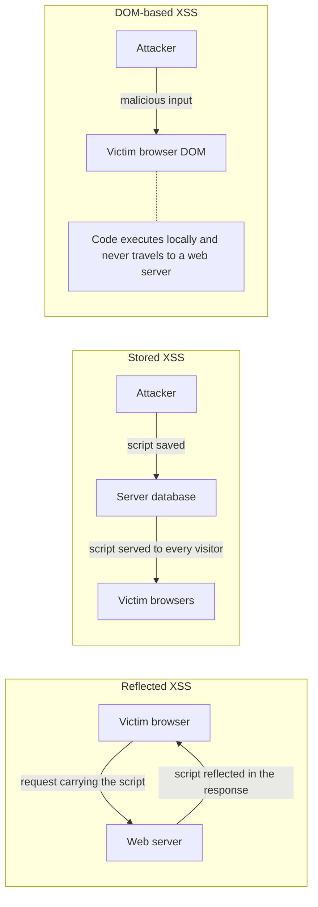
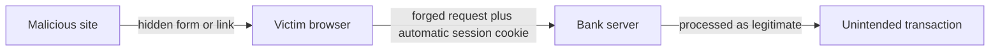
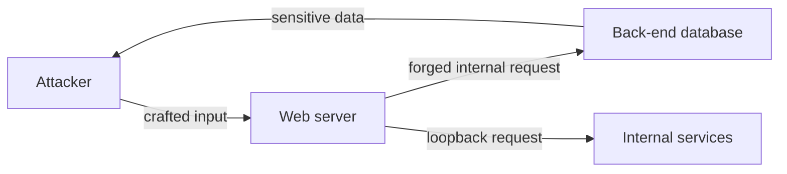
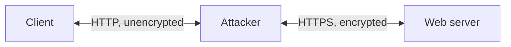
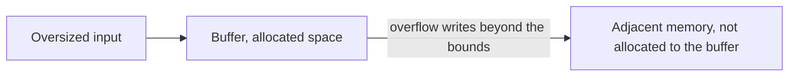
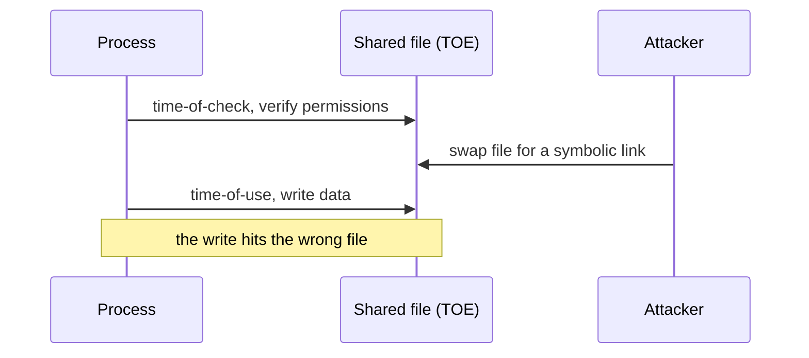
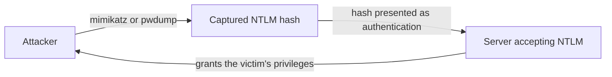

# Chapter 08: Application Attacks

## Abstract

Applications fail in predictable ways when user input, memory, credentials, and driver code go uncontrolled. The chapter begins with web application attacks: cross-site scripting in reflected, stored, and DOM-based forms, cross-site and server-side request forgeries, SQL, XML, LDAP, and DLL injection, directory traversal, API attacks, and SSL stripping. The chapter then examines software-level weaknesses: buffer overflows, integer overflows, memory leaks, pointer dereferencing, memory injection, race conditions with time-of-check to time-of-use errors, and resource exhaustion. The chapter closes with credential and privilege attacks: replay and session replay attacks, pass the hash against NTLM authentication, driver manipulation through shimming and refactoring, brute force and spraying password attacks, default credentials, and vertical and horizontal privilege escalation. Each section pairs attack mechanics with concrete defenses, from output encoding and synchronizer tokens to timestamps, Kerberos, and multi-factor authentication.

## Objectives

- Describe cross-site scripting, compare reflected, stored, and DOM-based XSS, and apply four mitigations.
- Compare cross-site request forgery and server-side request forgery, and describe CSRF defenses such as synchronizer tokens and double-submit cookies.
- Describe injection attacks against SQL, XML, LDAP, and DLL targets and the role of input validation.
- Describe directory traversal with dot-dot-slash sequences and API attacks, and the defenses for each.
- Describe downgrade attacks and SSL stripping mechanics, and explain the loss of confidentiality, integrity, and authenticity.
- Compare buffer overflows, integer overflows, memory leaks, pointer dereferencing, and memory injection, and describe prevention for each.
- Describe race conditions and time-of-check to time-of-use errors, synchronization defenses, and resource exhaustion attacks.
- Describe replay and session replay attacks, timestamp and sequence number defenses, and the pass the hash attack against NTLM.
- Describe driver shimming and refactoring attacks.
- Compare vertical and horizontal privilege escalation, brute force and spraying attacks, and the risk of default credentials.

## Content

### 1. Cross-Site Scripting

Cross-site scripting (XSS) is a web server security vulnerability that lets an attacker inject client-side scripts into the web pages a server delivers. Message boards, online forums, and any web page accepting user uploads give an attacker a place to plant a malicious script. The attack fires when a browser downloads a page carrying the injected script and executes the script, which can then read session tokens, cookies, and other sensitive information the browser retains for that website. Attackers commonly write malicious XSS code in JavaScript.

Three XSS attack types exist:

- **Reflected cross-site scripting (non-persistent XSS):** the injected script returns to a client inside the response to the client's own HTTP request. Activation requires a crafted link pointing at a vulnerable website, and attackers earn the click through shortened URLs on attacker-controlled websites or through phishing emails.
- **Stored cross-site scripting (persistent XSS):** the malicious script sits in the web server's back-end database and goes out to every client requesting the affected pages. A stored attack is self-contained inside the web application and needs no induced HTTP request.
- **DOM-based cross-site scripting:** the source and destination of the attack both live in the client browser. The document object model (DOM) is the standard object model and programming interface for HTML, defining how to get, change, add, and delete HTML elements. The attacker inserts malicious code into DOM objects, and the browser executes the code without sending anything to a web server.

Table 8.1: Cross-site scripting attacks.

| XSS type | Attack source | Vulnerability source |
| --- | --- | --- |
| Reflected | Client | Server and client |
| Stored | Server | Server |
| DOM-based | Client | Client (DOM) |

The three XSS types differ in where the script lives and where the script executes:

Four practices prevent XSS:

- **Input validation and sanitization:** validate user input to block malicious code, allowing only alphanumeric characters where appropriate.
- **Output encoding:** escape and encode any data displayed to users, converting characters such as `<` and `>` into the HTML entities `&lt;` and `&gt;` so browsers never read the characters as HTML or JavaScript. Functions such as `htmlspecialchars()` perform this encoding for characters including `<`, `>`, and `"`.
- **Content Security Policy (CSP):** a strong CSP limits which scripts can execute on a page.
- **Secure frameworks:** web frameworks with built-in XSS protection encode output automatically.

### 2. Request Forgeries: CSRF and SSRF

A request to a web application can be forged to trick the application into performing an unintended action. Two request forgery types exist: cross-site request forgery and server-side request forgery.

#### **Cross-site request forgery**

A cross-site request forgery (CSRF), also called client-side request forgery or XSRF, sends a forged request to a web application on behalf of an authenticated user, exploiting the application's trust in that user. A banking web application illustrates the attack: the application stores an authentication token on the user's device at login, and when the user never logs out, the token remains available for an attacker to run a banking transaction without the user's knowledge.

CSRF needs two conditions: the user must hold an authenticated session on the target site, and the site must rely solely on cookies or other automatic session tokens to verify actions. The browser attaches cookies and session identifiers to every request automatically, so the target server has no reason to doubt a forged request. Attack vectors include hidden forms, image tags, and JavaScript that triggers a request silently. The attacker never needs the victim's credentials, only a visit to a malicious page or a click on a link.

CSRF defenses embed a secret that the attacker cannot guess or read:

- **Synchronizer tokens and double-submit cookies:** a secret token embedded in each request. Since the token never travels automatically, a malicious site cannot generate a valid one.
- **POST-only actions:** requiring state-changing actions through POST requests raises the bar for forged requests.
- **Re-authentication prompts:** sensitive actions can demand extra confirmation, such as re-entering a password.

A CSRF attack turns the victim's browser into the delivery mechanism:

#### **Server-side request forgery**

A server-side request forgery (SSRF) sends forged requests from a web application's server to other servers. The attacker tricks the server into making an unauthorized request, using the server to reach or modify internal resources shielded from external networks, or to reach the server's other services through the loopback interface. An attacker can, for example, send a forged request that pulls user account information from a back-end database server. Defenses validate outbound destinations, allow-list permitted hosts, and block requests to internal networks and the loopback interface.

SSRF turns the web server into the attacker's proxy:

### 3. Injection Attacks: SQL, XML, LDAP, and DLL

An injection attack, also called an input validation attack, inserts malicious input into a program or database query. The malicious input can carry code, scripts, and operating system commands, and the attack exploits the vulnerabilities that inadequate validation of user input creates. The injection family includes SQL injection, DLL injection, LDAP injection, and XML injection.

- **SQL injection (SQLi):** an attacker enters crafted input into an application's user input fields so that processing the input produces a syntactically correct SQL statement. SQL injection works against any SQL database but most often targets database-driven websites that accept user input. Validating user input before constructing SQL statements blocks the attack, and prepared statements with bound parameters give stronger protection by keeping user data out of the SQL statement structure.
- **XML injection:** Extensible Markup Language (XML) defines rules for encoding documents in a text-based format, describing and structuring data for storage and transport in a form readable by humans and computers. An XML injection inserts malicious content into an XML document, distorting the logic of the application that processes the document.
- **LDAP injection:** Lightweight directory access protocol (LDAP) accesses and maintains distributed directory information services over an IP network. A directory service shares information about users, systems, services, and applications, and LDAP commonly provides a central store for usernames and passwords. An LDAP injection exploits input validation flaws in applications that build LDAP statements from user input, manipulating the statements executed on an LDAP server. Consequences include arbitrary LDAP commands, viewing and modifying LDAP data, and bypassing LDAP authentication.
- **DLL injection:** forces a running process to load a malicious dynamic link library, so the library's code executes with the process's own privileges.

### 4. Directory Traversal and API Attacks

#### **Directory traversal**

A root directory is the directory on a web server's file system that web users can access. The Microsoft Internet Information Services (IIS) web server uses `C:\Inetpub\wwwroot` as the root directory. Directory traversal, also called path traversal or backtracking, is a web application vulnerability that lets unauthorized users reach files outside the root directory. The attack uses the `../` sequence to walk up the file system, earning the alternate name dot-dot-slash attack, and a vulnerable server can expose file contents far beyond the intended directories.

Two methods prevent directory traversal: deny the web server program any access to files outside the web root directory, and keep the web root off the system disk, where a system disk is any media holding part or all of an operating system.

#### **API attacks**

An application programming interface (API) is a set of functions and protocols for building and integrating applications and data sets, letting applications communicate with one another. A web server's API, for example, connects an application to a social platform, a database, or a device. APIs attract attacks because APIs provide entry points into an application and access to application data. An API attack exploits vulnerabilities in an application's API to disrupt the services the API enables or to reach the data the API stores and retrieves. An attacker can, for example, launch a denial-of-service attack against a web server through the server's API.

### 5. SSL Stripping and Downgrade Attacks

A downgrade attack tries to shift client-server communication to a less secure encryption method. Secure Sockets Layer stripping (SSL stripping), also called SSL downgrading or HTTP downgrading, downgrades an attempted HTTPS connection between a web server and a client to a plain HTTP connection. HTTP provides no data confidentiality, integrity, or authenticity, and SSL stripping qualifies as an on-path (man-in-the-middle) attack.

The attacker intercepts the web server's redirect response to the client's HTTP request, then holds an HTTP connection with the client and an HTTPS connection with the web server. The client unknowingly speaks unencrypted HTTP to the attacker for the whole session, while the attacker speaks HTTPS to the server.

Cryptographic vulnerabilities make downgrade attacks possible. Weaknesses in encryption algorithms, key management, or protocol implementations compromise the confidentiality, integrity, and authenticity of sensitive data. Mitigations include secure cryptographic configurations, current software and protocol versions, secure key exchange and authentication, and proactive remediation of weak keys and outdated encryption protocols.

### 6. Memory Vulnerabilities

#### **Buffer overflow**

A data buffer is a memory region that temporarily stores data while the data moves between memory locations, such as a buffer holding a user's input to a program. A buffer overflow, or buffer overrun, is a programming error condition in which the data to be stored exceeds the buffer size, spilling the excess into adjacent memory locations that the buffer does not own. Improper input handling, a program's insufficient validity checking of user input, enables the condition. Programs should verify that input fits the allocated buffer and block access to memory beyond buffer bounds. A buffer overflow that overwrites executable code can produce incorrect output, memory access errors, or unexpected termination.

Oversized input writes past the buffer into adjacent memory:

#### **Integer overflow**

A data type specifies how a program intends to use a piece of data, and most languages support floating-point numbers, integers, characters, and Booleans. An integer overflow occurs when the result of an integer operation exceeds the maximum, or falls below the minimum, of the integer type storing the result. A 16-bit integer variable holds values from -32,768 to 32,767, so storing a result larger than 32,767 in such a variable overflows. Integer overflows cause incorrect computations. Checking for overflow after every operation that could overflow prevents the condition, and languages such as Python adjust a variable's allocated space automatically at run time to accommodate larger results.

#### **Memory leak**

Memory management controls and coordinates a computer's memory. An operating system allocates two memory types to a program:

Table 8.2: Stack and heap memory.

| Memory type | Stores | Allocation | Managed by |
| --- | --- | --- | --- |
| Stack (temporary memory) | Local variables | Static | Operating system |
| Heap (dynamic memory) | Global variables | Dynamic | Programmer |

Heap memory stays allocated until released. A memory leak occurs when a program allocates heap memory and never deallocates the memory after the need passes, a failure of programmer-side memory management that shrinks available memory and degrades performance. In C, every `malloc()` needs a matching `free()`, and smart pointers can automate the pairing. Garbage-collected languages such as Java handle cleanup automatically, yet lingering references can still pin objects in memory as logical memory leaks. Long-running applications such as servers suffer most: unreleased memory accumulates, the operating system swaps data to disk, available memory runs out, and in severe cases the operating system terminates the program, risking data loss and system instability.

#### **Pointer dereferencing**

A pointer is a program variable that stores a memory address, referencing a location in memory. Pointer dereferencing, or object dereferencing, obtains the value stored at the referenced location. Pointers speed up a program because copying and dereferencing a pointer costs less than copying and accessing the underlying data. Dereferencing a pointer with an invalid address or a NULL value crashes the program, and the crash can leave the computer in a state that grants a user unauthorized access to resources. Error handling, the process of responding to and recovering from error conditions, should cover invalid pointer dereferences.

#### **Memory injection**

Memory injection manipulates an application's memory to execute malicious code, gain unauthorized access, extract sensitive data, or disrupt behavior. Injecting code into a web application's memory, for example, can expose sensitive user data or hand control of the application to the attacker.

### 7. Race Conditions and Resource Exhaustion

#### **Race conditions**

A race condition occurs when multiple concurrently executing processes access a shared resource at the same time. The shared resource is the target of evaluation (TOE), which can be a file, a memory location, or a program variable. Multi-threaded programs and programs on multi-core CPUs face race conditions because multiple processes execute concurrently, and the outcome depends on the timing of execution when no synchronization controls access.

Time-of-check to time-of-use (TOCTOU) is a class of software errors caused by race conditions. Time-of-check (TOC) is the moment a process checks the TOE's state, and time-of-use (TOU) is the moment the process uses the TOE. A TOCTOU error occurs when the TOE's state changes between TOC and TOU in a way that invalidates the check, leaving the process computing on an unexpected state. A file permission check illustrates the danger: the application verifies write permission at TOC, and an attacker swaps the file for a symbolic link to a critical system file before TOU, so the application overwrites a system file the permissions never allowed. TOCTOU errors resist detection because the errors surface only under specific timing, such as heavy system load. Defenses include synchronization mechanisms such as locks, mutexes, and semaphores, a shorter window between check and use, and atomic operations that check and act in a single step.

A TOCTOU attack exploits the gap between the check and the use:

#### **Resource exhaustion**

A resource exhaustion attack, also called a resource starvation attack, slows or disables an application by consuming the application's limited resources: memory, CPU, file system storage, and database connection pool entries. A CPU exhaustion attack, for example, consumes every allocated CPU cycle and destroys the application's responsiveness and availability. Resource exhaustion is a denial-of-service attack that blocks legitimate users and applications, and the attack succeeds when an application fails to control the allocation and maintenance of resources. A memory leak in an application can serve the attacker by draining memory until the application and the host operating system slow down.

Attackers target four resource types:

- **CPU cycles:** floods of computationally expensive requests leave no capacity for legitimate tasks.
- **Memory (RAM):** requests that allocate memory without releasing memory exhaust the system until other applications fail to allocate.
- **Disk space:** continuous generation of large files fills storage and blocks applications from writing data or logs.
- **Network bandwidth:** excessive traffic congests the bandwidth available to legitimate users.

Partial or malformed requests that never complete also tie up resources, because the system allocates capacity for processing that never finishes.

### 8. Replay Attacks and Pass the Hash

#### **Replay attacks**

A replay attack, also called a repeat attack or playback attack, intercepts a data transmission and maliciously repeats or delays the transmission. The replay attack belongs to the man-in-the-middle family. An attacker who intercepts a user's login credentials can replay the credentials later to authenticate as the user. Replay works because a receiver treats identical messages at different times as equally valid. Appending a timestamp or sequence number to each message defeats the attack, since the receiver discards any message carrying a repeated timestamp or sequence number.

A session ID is a unique number a web application assigns to an authenticated user, valid for the duration of the session. A session replay attack uses a captured session ID to impersonate the user and perform fraudulent transactions or activity.

#### **Pass the hash**

New technology LAN manager (NTLM) is a challenge-response authentication protocol. An NTLM credential combines a domain name, a username, and a password hash, and the password itself never travels to the system or service. Pass the hash authenticates to a server or service with a captured NTLM password hash, removing the need to brute-force the hash back to a cleartext password. The attack exploits an implementation weakness in NTLM: the password hash stays static from session to session until the user changes the password. Any server or service accepting NTLM authentication is a target.

A typical attack proceeds in stages. The attacker gains initial access through malware, phishing, or a vulnerability, then extracts stored password hashes from memory or disk with tools such as `mimikatz` or `pwdump`. The attacker passes a captured hash to another system that trusts the credential, and the receiving system accepts the hash as valid proof, granting the privileges of the hash's owner. The attack enables lateral movement, and reused passwords widen the blast radius because one hash opens many systems. Domain administrator hashes are the top prize, since a single administrator hash can expose every system in the domain.

Pass the hash skips the password entirely:

Mitigations include:

- **Multi-factor authentication (MFA):** a captured hash alone no longer suffices.
- **Kerberos over NTLM:** moving to Kerberos reduces NTLM exposure.
- **Restricted administrative privileges and network segmentation:** limits the value and reach of any single hash.
- **Credential Guard:** isolates hashed credentials from unauthorized processes.
- **Monitoring and auditing:** watches authentication activity for unauthorized hash use and suspicious lateral movement.

### 9. Driver Manipulation

A device driver is a program that controls a hardware device connected to a computer, such as a keyboard, printer, webcam, or mouse. The driver provides a software interface that lets an operating system or application use the device's functions, the way a Windows printer driver lets Windows applications print documents. Manipulating a driver enables attacks against the computer. Two driver manipulation methods exist:

- **Driver shim attack (shimming):** a driver shim is a software library that intercepts and modifies calls to a device driver, normally to provide backward compatibility with older devices. Windows 10, for example, supports Windows 8 drivers through shims. A shim attack inserts malicious code into the shim, and the code executes whenever the operating system makes a driver call.
- **Refactoring attack:** refactoring is a set of techniques that improve a program's internal structure, such as reduced complexity or better readability, without changing the program's behavior. A refactoring attack adds malicious code to a device driver while preserving the driver's expected behavior. A refactored printer driver still prints documents, but can also forward every print job to a remote printer under the attacker's control.

### 10. Privilege Escalation and Password Attacks

#### **Privilege escalation**

Every computer account carries a set of access rights or privileges, such as viewing, editing, or printing files, or running a web browser. Privilege escalation gains privileges beyond those assigned to an account, enabling unauthorized actions such as installing malware on a computer where program installation is forbidden. The escalation exploits vulnerabilities in application programs, flaws in account permissions, or errors in operating system configuration files. Two types exist:

- **Vertical privilege escalation:** a lower-privilege user or application gains the privileges of a higher-privilege user or application, potentially reaching administrative privileges. An Internet banking user who reaches the site's administrative functions demonstrates vertical escalation.
- **Horizontal privilege escalation:** a user or application gains the privileges of another user or application at the same level. An Internet banking user who opens another customer's account demonstrates horizontal escalation.

#### **Password attacks**

Two password attack methods target user accounts:

- **Brute force attack:** attempts every possible character combination until the attack finds the account's password.
- **Spraying attack:** attempts one default or common password against many accounts.

#### **Default credentials**

Default credentials are pre-configured usernames and passwords set by manufacturers or developers to provide initial access for setup, configuration, and administration. The `admin` and `password` pair is a classic example. Widely known default credentials expand an organization's attack surface and ease unauthorized access, lateral movement, and privilege escalation. Replacing default credentials promptly with unique, strong alternatives removes the risk.

## Summary

This chapter examined application attacks across three layers. The web layer covered cross-site scripting in reflected, stored, and DOM-based forms with defenses of input validation, output encoding, Content Security Policy, and secure frameworks. The web layer also covered cross-site request forgery with synchronizer tokens, double-submit cookies, and re-authentication prompts, server-side request forgery reaching internal resources through a trusted server, SQL, XML, LDAP, and DLL injection, directory traversal with dot-dot-slash sequences, API attacks, and SSL stripping, a downgrade attack that leaves a client on unencrypted HTTP while the attacker holds the HTTPS side. The software layer covered buffer overflows, integer overflows bounded by ranges such as -32,768 to 32,767 for 16-bit integers, memory leaks on programmer-managed heap memory, pointer dereferencing crashes, memory injection, race conditions with time-of-check to time-of-use errors and synchronization defenses, and resource exhaustion across CPU, memory, disk, and bandwidth. The identity layer covered replay and session replay attacks defeated by timestamps and sequence numbers, pass the hash against static NTLM password hashes with tools such as `mimikatz` and `pwdump`, driver shimming and refactoring, brute force and spraying password attacks, default credentials such as `admin` and `password`, and vertical and horizontal privilege escalation.

## Useful References and Resources

- OWASP Top 10 (2021), "A03: Injection" and "A07: Identification and Authentication Failures," the community ranking of web application risks covering injection and credential attacks.
- OWASP, "Cross Site Scripting Prevention Cheat Sheet," covering output encoding and Content Security Policy defenses.
- OWASP, "Cross-Site Request Forgery Prevention Cheat Sheet," covering synchronizer tokens and double-submit cookies.
- OWASP, "Server Side Request Forgery Prevention Cheat Sheet," covering defenses against forged server-side requests.
- CWE-79, "Improper Neutralization of Input During Web Page Generation (Cross-site Scripting)," the standard weakness entry for XSS.
- CWE-352, "Cross-Site Request Forgery (CSRF)," and CWE-918, "Server-Side Request Forgery (SSRF)," the standard weakness entries for the two request forgeries.
- CWE-89, "Improper Neutralization of Special Elements used in an SQL Command (SQL Injection)," CWE-91, "XML Injection (aka Blind XPath Injection)," and CWE-90, "Improper Neutralization of Special Elements used in an LDAP Query (LDAP Injection)," the standard weakness entries for injection attacks.
- CWE-120, "Classic Buffer Overflow," CWE-190, "Integer Overflow or Wraparound," CWE-401, "Missing Release of Memory after Effective Lifetime," and CWE-476, "NULL Pointer Dereference," the standard weakness entries for memory vulnerabilities.
- CWE-362, "Concurrent Execution using Shared Resource with Improper Synchronization (Race Condition)," CWE-367, "Time-of-check Time-of-use (TOCTOU) Race Condition," and CWE-400, "Uncontrolled Resource Consumption," covering race conditions and resource exhaustion.
- CWE-22, "Improper Limitation of a Pathname to a Restricted Directory (Path Traversal)," the standard weakness entry for directory traversal.
- RFC 6797, "HTTP Strict Transport Security (HSTS)," the mechanism that forces HTTPS and defeats SSL stripping.
- Microsoft Learn, "Microsoft Defender Credential Guard," the documentation of credential isolation against pass the hash attacks.
- CWE-307, "Improper Restriction of Excessive Authentication Attempts," and CWE-798, "Use of Hard-coded Credentials," covering brute force defenses and default credential risk.
