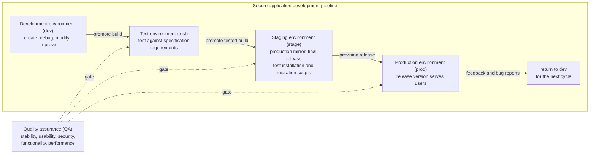
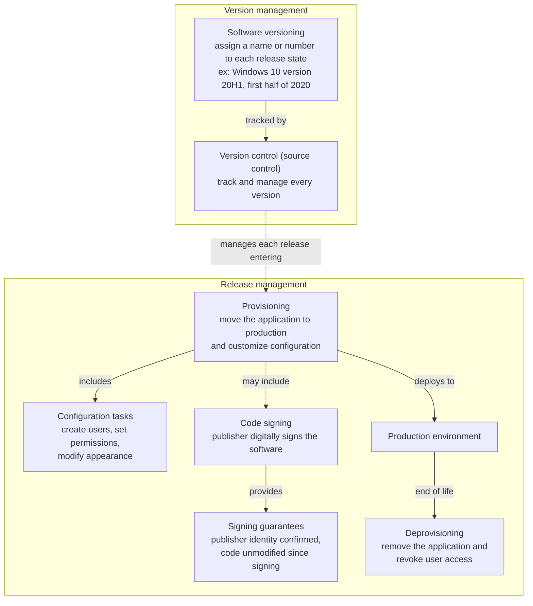
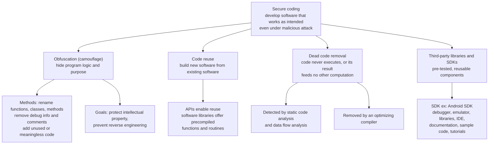
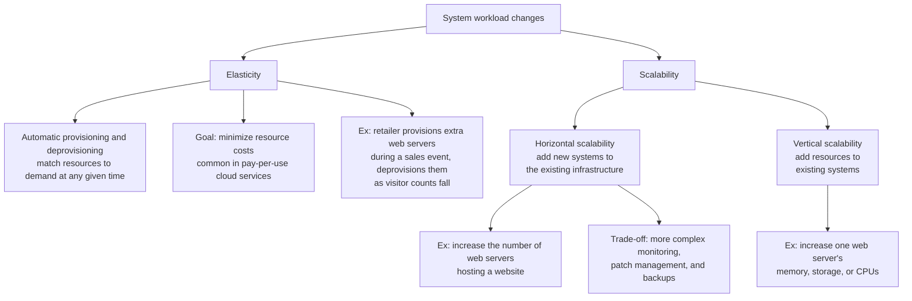
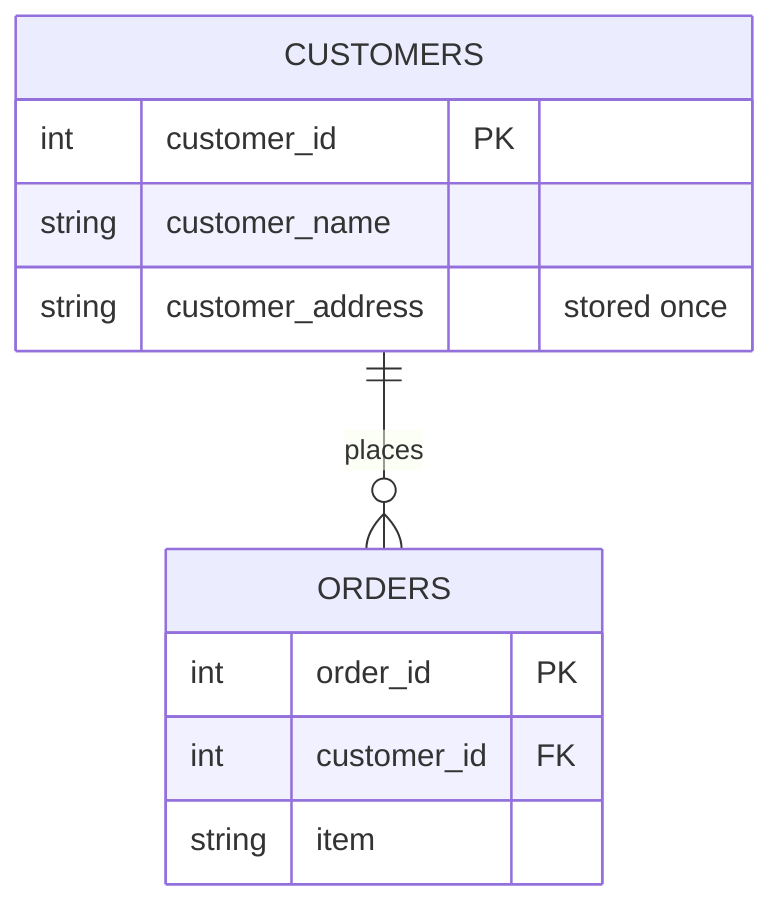
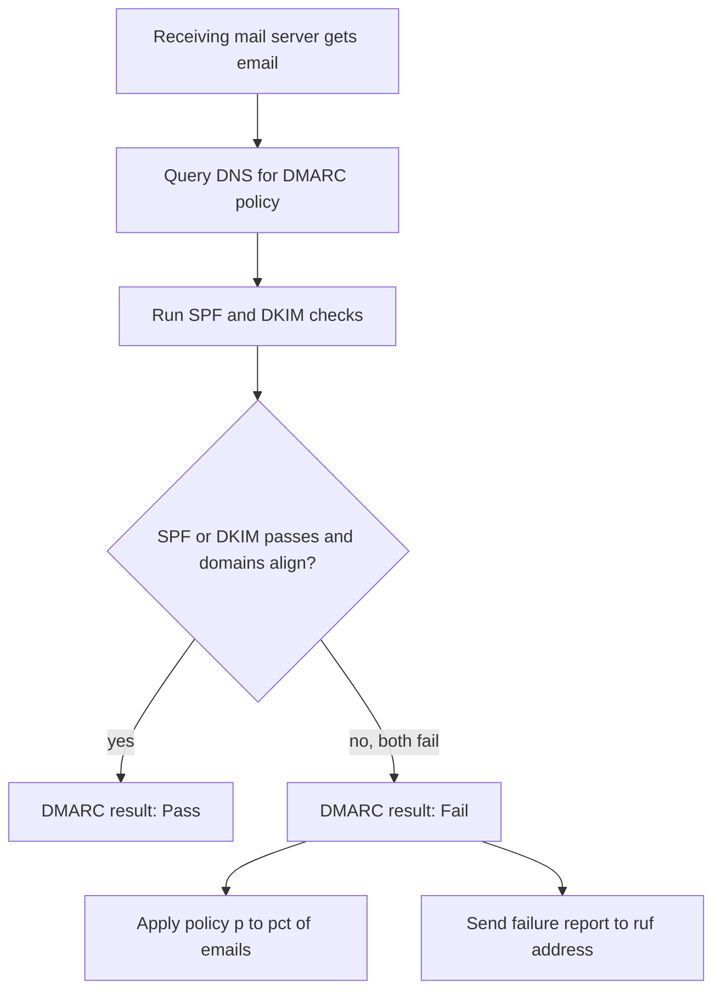

# Chapter 09: Secure Application Development

## Abstract

Secure application development spans the full life of software, from the hardware and tools used to write code to the monitoring of a deployed release. The chapter defines four environments (development, test, staging, and production) and the quality assurance process that gates movement between them. Provisioning, code signing, and version control manage how software reaches users and how each release state gets tracked. Secure coding techniques reduce vulnerability risk through obfuscation, code reuse, dead code removal, vetted third-party libraries and SDKs, and sandboxing of untrusted code. Elasticity and scalability let systems absorb changing workloads, and software diversity limits how far a single vulnerability can spread. Database defenses include normalization, stored procedures with parameterized queries, column-level and record-level encryption, and salted password hashing. Code review splits into dynamic and static analysis, with fuzzing as an automated dynamic technique and package monitoring for third-party dependencies. DevOps automation ties the life cycle together through five continuous practices: integration, delivery, deployment, validation, and monitoring. The chapter closes with web application security through the OWASP Top 10 (2021), input validation on server and client, secure cookies, and email authentication through SPF, DKIM, and DMARC.

## Objectives

- Describe the four application environments (development, test, staging, production) and the role of quality assurance.
- Describe provisioning, deprovisioning, code signing, software versioning, and version control.
- Apply secure coding techniques: obfuscation, code reuse, dead code removal, third-party libraries, SDKs, and sandboxing.
- Compare elasticity and scalability, distinguish horizontal from vertical scalability, and explain how software diversity limits vulnerability exploits.
- Apply database security measures: normalization, stored procedures, parameterized queries, column-level and record-level encryption, hashing, and salting.
- Compare dynamic and static code analysis, describe fuzzing, and describe package monitoring for dependencies.
- Describe DevOps and the five continuous practices: integration, delivery, deployment, validation, and monitoring.
- List the OWASP Top 10 (2021) risks and apply input validation with allow lists, block lists, server-side validation, and client-side validation.
- Describe secure cookies and email authentication with SPF, DKIM, DMARC, and email gateways.

## Content

### 1. Application Environments

An environment is the collection of hardware and software used to build an application. Hardware resources include servers, desktops, and mobile devices. Software tools include an integrated development environment (IDE) plus debugging and performance evaluation utilities. Secure application development uses four environments:

- **Development environment (dev):** the environment where developers create, debug, modify, and improve an application.
- **Test environment (test):** the environment where an application gets tested against the application's specification requirements.
- **Staging environment (stage):** a pre-production environment that mirrors production and holds the final release version. Teams use staging to test installation, configuration, and migration scripts and procedures.
- **Production environment (prod or live):** the environment where the release version runs and serves the application's users.

Quality assurance (QA) is the process of testing an application's stability, usability, security, functionality, and performance to confirm the application meets user requirements.

The four environments form a promotion pipeline. Code originates in dev, advances through test and stage, and reaches prod only after QA validates the release at each promotion. Feedback and bug reports from production flow back to dev to start the next cycle:



### 2. Sandboxing

Sandboxing is a security practice that creates a separate, isolated environment, called a sandbox, for testing and executing untrusted or unknown code, applications, or files without harming the main system or network. A sandbox emulates a production environment while adding restrictions and monitoring capabilities.

A sandbox supports controlled analysis and execution of potentially malicious code, which helps identify and understand threats. A sandbox is typically disposable. Teams create, use, and discard the environment as needed, which reduces the likelihood of persistent threats.

### 3. Provisioning, Code Signing, and Version Control

**Provisioning** is the process of moving an application to a production environment and customizing the application's configuration. Configuration tasks include creating users, setting permissions, and modifying application appearance. Provisioning may include code signing.

**Code signing** is the act of digitally signing software by the software's publisher. Code signing confirms the publisher's identity and guarantees the code was not modified or corrupted after signing.

**Deprovisioning** is the process of removing an application from a production environment. Deprovisioning also covers removing user access to applications, systems, and data within a network. Example: an organization deprovisions an employee's account when the employee leaves.

**Software versioning** is the process of assigning names or numbers to unique states of released software. A new release may add functionality, fix bugs, and improve performance. Example: Microsoft labels Windows 10 versions as YYH1 or YYH2, where YY is the year and H1 or H2 is the half-year. Windows 10 version 20H1 shipped in the first half of 2020. Different versions can be in use at the same time. Version control, also called source control, is the practice of tracking and managing a software's versions.

Five concepts connect around the production release. Provisioning delivers a versioned release to production, version control tracks that release, and deprovisioning removes the release at end of life:



### 4. Secure Coding Techniques

Secure coding, also called secure programming, is the practice of developing software in a way that minimizes the risk of creating vulnerabilities. The goal is software that functions as intended even under malicious attack. Example: allocating enough memory for user input prevents buffer overflows. Secure coding techniques include obfuscation, code reuse, dead code removal, and use of third-party libraries and SDKs.

#### **Obfuscation and camouflage**

Obfuscation, or camouflage, modifies code appearance to make code difficult to read and understand. Obfuscation leaves program functionality unchanged while hiding the program's logic and purpose. Uses include protecting intellectual property and preventing reverse engineering. Techniques include renaming functions, classes, and methods to less descriptive names, removing debug information and comments, and adding unused or meaningless code.

#### **Code reuse and dead code**

Code reuse, also called software reuse, builds new software from existing software. Code reuse cuts redundancy, development time, and resource use by drawing on components already created in a development process. APIs provide one mechanism for code reuse. Example: a software library is a collection of precompiled functions, routines, and other resources for use in a new program.

Dead code is code that never executes at run time, or code that executes but whose result feeds no other computation. Examples include a method that never gets called and code skipped because of a branch. Dead code wastes program memory and computation time. Static code analysis and data flow analysis detect dead code. An optimizing compiler removes dead code.

#### **Third-party libraries and SDKs**

A third-party library is a reusable software component developed by an entity other than the original publisher of a software development platform. Third-party libraries save development time and cost through component-oriented development and let developers integrate pre-tested, reusable code into new software.

A software development kit (SDK) packages a collection of software development tools for a specific hardware platform and operating system combination. Example: the Android SDK includes a debugger, a handset emulator, libraries, an IDE, documentation, sample code, and tutorials.

Four techniques branch from secure coding. Each technique carries its own methods, goals, or supporting tools:



### 5. Elasticity, Scalability, and Software Diversity

#### **Elasticity and scalability**

**Elasticity** is the degree to which a system adapts to workload changes by automatically provisioning and deprovisioning resources. The goal is matching available resources to demand at any given time, which minimizes resource costs. Elasticity is common in pay-per-use cloud services. Example: when visitors to a retailer's web server surge during a sales event, the platform provisions additional web servers to meet demand, then deprovisions the servers as visitor counts fall.

**Scalability** is the measure of a system's ability to handle increased demands. Example: a growing start-up provisions additional servers for new employees. Two scalability types exist:

- **Horizontal scalability:** adds new systems to an existing infrastructure. Example: increasing the number of web servers hosting a website. Horizontal scalability raises the complexity of administrative tasks such as monitoring, patch management, and backups.
- **Vertical scalability:** adds resources to existing systems. Example: increasing a web server's memory, storage, or CPUs.

Elasticity and scalability differ in trigger and direction. Elasticity reacts automatically in both directions, while scalability addresses growth through one of two approaches:



#### **Software diversity**

A software vulnerability can be exploited in every running instance of the software. Example: a Microsoft Word vulnerability that grants administrative access to system resources is exploitable on every computer running Word. When every instance of a software differs, one vulnerability cannot be widely exploited. **Software diversity** is the practice of creating diversity within the development process to reduce the extent of vulnerability exploits.

A compiler creates software diversity by generating different binary executable files for a program through randomization of implementation aspects. A program's behavior changes when functions and processes change, even with identical output. Example: a diversifying compiler randomizes the allocation of program variables into registers and the memory layout order of program functions. Randomness at the executable level makes each compilation produce a unique binary. Different binaries may not share the same vulnerability, so an exploit that works on one instance fails on others.

### 6. Database Security

Applications use databases to store data, process transactions, and provide content. Data exposure is the intentional or unintentional disclosure of information to an unauthorized user or application, and database security measures prevent exposure. Measures include normalization, stored procedures, encryption, salting, and hashing.

#### **Normalization**

Database normalization is the process of organizing data in a relational database. Normalization creates tables and establishes relationships between tables in a way that removes data redundancies and improves data integrity. Example: normalization keeps a customer address field in one table instead of repeating the field across tables. Normalization improves security by preventing data inconsistencies and update anomalies.

A concrete before-and-after shows the effect. Before normalization, one orders table repeats the customer address on every order row:

Table 9.1: Orders table before normalization.

| order_id | customer_name | customer_address | item |
| --- | --- | --- | --- |
| 101 | A. Rahman | 12 Oak St | Keyboard |
| 102 | A. Rahman | 12 Oak St | Mouse |
| 103 | J. Lee | 9 Pine Ave | Monitor |

The address "12 Oak St" occupies 2 rows. An address change requires updating 2 rows, and missing one row creates an update anomaly with 2 conflicting addresses for 1 customer.

After normalization, the database splits the data into 2 tables. The customers table stores each address once, and the orders table references the customer through a foreign key:

Table 9.2: Customers and orders tables after normalization.

| customers.customer_id | customers.customer_name | customers.customer_address |
| --- | --- | --- |
| 1 | A. Rahman | 12 Oak St |
| 2 | J. Lee | 9 Pine Ave |

| orders.order_id | orders.customer_id | orders.item |
| --- | --- | --- |
| 101 | 1 | Keyboard |
| 102 | 1 | Mouse |
| 103 | 2 | Monitor |

The address now occupies 1 row. An address change requires updating 1 row instead of 2, and the database cannot hold 2 conflicting addresses for the same customer:



#### **Stored procedures**

A **stored procedure** is a group of SQL statements created to perform a specific task. The procedure is compiled and stored in the database and may operate on multiple tables. Stored procedures improve security because a user or application can run only the operations the procedure implements. Access rights attach to the stored procedure, not to the underlying tables.

A stored procedure supports **parameterized queries**. A parameterized query uses placeholders for parameters, and the parameter values arrive at execution time. Parameterized queries minimize SQL injection risk by removing the need to build SQL queries from user input. Data rules live in the database instead of the application.

A contrast shows why parameterization matters. An application that concatenates user input into a query string exposes the database to injection:

```sql
-- Vulnerable: query string built from user input
"SELECT * FROM customers WHERE customer_name = '" + userInput + "'"
```

An attacker who enters `' OR '1'='1` turns the query into a condition that is always true. Against the 2-row customers table from Table 9.2, the modified query returns all 2 rows instead of the 1 requested row.

A parameterized query replaces the input with a placeholder, and the value arrives separately at execution time:

```sql
-- Parameterized: placeholder, value supplied at execution
SELECT * FROM customers WHERE customer_name = @name;
```

The same attacker input `' OR '1'='1` now acts as an ordinary name value. The database searches for a customer whose name equals the string `' OR '1'='1`, finds 0 matching rows, and the injection fails.

A stored procedure packages the parameterized query inside the database:

```sql
CREATE PROCEDURE GetCustomerByName
    @name NVARCHAR(100)
AS
BEGIN
    SELECT customer_id, customer_name, customer_address
    FROM customers
    WHERE customer_name = @name;
END;
```

The application calls the procedure with `EXEC GetCustomerByName @name = 'A. Rahman';`. The database administrator grants the application EXECUTE rights on GetCustomerByName and no SELECT rights on the customers table. The application can run this 1 operation and nothing else against the table.

#### **Database encryption**

Database encryption protects sensitive data through selective encryption methods. Selective encryption targets the most sensitive or vulnerable data elements instead of encrypting the entire dataset. The approach cuts computational overhead and storage requirements while protecting critical information. Two selective encryption methods exist:

- **Column-level encryption (columnar encryption):** encrypts a specified table column or columns. Example: a customer database encrypts the social security number column and leaves less sensitive columns, such as names and addresses, unencrypted.
- **Record-level encryption:** encrypts all instances of a specified table record. Example: a healthcare database encrypts each patient's medical history, including diagnoses and treatment plans.

Table 9.3: Comparison of column-level and record-level database encryption methods.

| Feature | Column-level encryption | Record-level encryption |
| --- | --- | --- |
| Description | Encrypts specific columns within a table | Encrypts entire records within a table |
| Performance impact | Lower computational overhead from targeted encryption | Higher overhead from encrypting full records, but more efficient than full database encryption |
| Security considerations | Fits databases with mixed sensitivity levels across columns | Fits records where most or all data is sensitive |
| Example | Retail databases encrypt only columns with credit card details | Financial databases encrypt entire records to secure all transaction details |

#### **Secure storage techniques**

Stored authentication data such as **passwords** needs protection against credential exposure after a database compromise. **Hashing** provides one defense. Hashing transforms a variable-length string into a fixed-size value called a hash. Hashing is a one-way process, so the original string cannot be derived from the hash. Databases therefore store password hashes instead of passwords. During authentication, the system computes the hash of the user-entered password and compares the computed hash with the stored hash. Matching hashes validate the password and authenticate the user.

**Salting** strengthens hashing. Salting adds a unique string of characters, called a salt, to a password before hashing. Salting protects against brute-force attacks that use rainbow tables. A rainbow table is a precomputed table of hashes for common passwords, and the table lets an attacker quickly find the plaintext password for a precomputed hash value.

A worked example uses SHA-256 and the password "BlueRiver42". SHA-256 converts the 11-character password into a fixed 64-character hexadecimal hash. The database stores the hash, never the password. At login, the system hashes the entered password and compares the result with the stored hash. Equal hashes authenticate the user.

Table 9.4: Stored hashes for two users who chose the same password, with and without salts.

| User | Password | Salt | Stored SHA-256 hash |
| --- | --- | --- | --- |
| 1 | BlueRiver42 | none | d1a1e2a67abde6cd76d104c66f42c419d581af6de56b31243ce5317da2c2d445 |
| 2 | BlueRiver42 | none | d1a1e2a67abde6cd76d104c66f42c419d581af6de56b31243ce5317da2c2d445 |
| 1 | BlueRiver42 | x7Fk29 | 48d1f230b88113fe0298a62fa0aedca0bd9e68ed4ec4eb5598549d043bba8be8 |
| 2 | BlueRiver42 | qW3mZ8 | bede5bca5cfc72da44c9bfa95127d5e07dc4295060dd1512371107fb4f12ddf0 |

The unsalted rows expose the weakness. Both users chose "BlueRiver42", so both rows store the identical hash d1a1...d445. An attacker who matches that hash in a rainbow table learns the password for 2 accounts from 1 lookup.

The salted rows close the weakness. User 1 hashes "x7Fk29BlueRiver42" and user 2 hashes "qW3mZ8BlueRiver42", so the 2 stored hashes differ even though the 2 passwords match. A rainbow table holds no precomputed entry for "x7Fk29BlueRiver42", so the attacker loses the table shortcut and must brute-force each account separately, 2 attacks instead of 1 lookup.

**The hash algorithm choice matters as much as the salt.** SHA-256 illustrates hashing mechanics well, but plain SHA-256 is the wrong choice for production password storage because SHA-256 is fast by design. A benchmark on a single CPU core computed 2,356,210 salted SHA-256 hashes per second, and GPU rigs reach billions of guesses per second against raw SHA-256. A salt blocks rainbow tables but does nothing against brute force when each guess costs microseconds.

Password-specific algorithms fix the speed problem with a configurable work factor, and some add memory hardness that resists GPU and ASIC attacks. Four accepted choices exist:

- **Argon2id:** the current OWASP first choice. Memory-hard, so GPUs and ASICs gain little advantage. OWASP suggests 19 MiB memory, 2 iterations, and 1 degree of parallelism.
- **bcrypt:** a long-standing standard with a tunable cost factor. OWASP suggests a work factor of 10 or more.
- **scrypt:** memory-hard like Argon2, but older and less flexible.
- **PBKDF2-HMAC-SHA256:** the NIST-approved option (SP 800-63B), common in regulated environments. PBKDF2 slows down only through iteration count, so OWASP recommends 600,000 iterations.

The work factor changes the attack math by orders of magnitude. The same benchmark measured PBKDF2-HMAC-SHA256 at 600,000 iterations at 14 hashes per second on one CPU core, roughly 168,000 times slower per guess than plain SHA-256. A legitimate login still completes in 71 milliseconds, so the slowdown costs the defender nothing and costs the attacker everything.

SHA-256 remains the right tool where speed is a feature: integrity checks, code signing, and checksums. Password storage is the one context where speed helps the attacker.

### 7. Code Review and Package Monitoring

A code review is the process of systematically examining code to improve code quality. A review examines **correctness**, **readability**, and **understandability**. Two code review methods exist:

- **Dynamic code analysis (dynamic analysis):** examines code during execution. Dynamic analysis is commonly automated and uses test inputs that aim to cover all possible outputs.
- **Static code analysis (static analysis or source code analysis):** examines code without execution. Static analysis checks code against a set of coding rules and can be manual or automated. Manual code review is static analysis performed by one or more human reviewers.

Codebase security also requires managing dependencies and third-party libraries. Package monitoring is the practice of systematically tracking and managing elements within a software project. Regular package monitoring covers updating dependencies, validating licenses, and mitigating known vulnerabilities. Package monitoring identifies and addresses risks from third-party dependencies to maintain codebase integrity and security. Example: package monitoring keeps a web application's MySQL database on the latest release, which prevents security vulnerabilities and optimizes performance.

Table 9.5: Comparison of code review methods.

| Aspect | Dynamic code analysis | Static code analysis |
| --- | --- | --- |
| Purpose | Identifies runtime issues and bugs | Checks code against coding rules |
| Inputs | Test inputs to observe runtime behavior | Source code |
| Methods | Analyzes code behavior during runtime | Checks code structure and syntax |
| Tools | Code profilers, debuggers | Static analysis tools, code analyzers |
| Benefits | Improves runtime performance and reliability | Enhances code quality and maintainability |

### 8. Fuzzing

A dynamic code analysis tool may use fuzzing to find errors. Fuzzing, also called fuzz testing, is an automated software testing technique that finds bugs and vulnerabilities by feeding invalid and random data into software. The goal is confirming that software handles unexpected inputs. A fuzzer is a program that automatically generates random data for software testing. Random inputs let a fuzzer find input combinations that developers did not test.

The fuzzing process:

1. Identify the software under test, known as the target system.
2. Identify input data for testing.
3. Convert the input data into fuzzed (randomized) data.
4. Start testing with the generated fuzzed data.
5. Examine software behavior with the fuzzed data.
6. Log identified software defects for analysis and fixing.

### 9. Automation and DevOps

Development operations (DevOps) is a set of practices and tools that automate and integrate software development and IT operations. DevOps improves the coding, building, testing, releasing, deploying, and monitoring elements of a software development life cycle (SDLC) and enables faster, more frequent deployments.

DevOps tools automate manual and repetitive SDLC tasks, commonly through scripts written in a language such as Python. Automation appears in five continuous practices:

- **Continuous integration:** frequently merging new and modified code from multiple developers into a single software project, verifying that different software components work together correctly.
- **Continuous delivery:** frequently releasing new software that is ready for deployment into a stage environment.
- **Continuous deployment:** frequently deploying new software into a production environment.
- **Continuous validation:** frequently verifying that new and existing software is tested, including new code tested against existing code.
- **Continuous monitoring:** frequently monitoring released software to detect errors, security risks, and compliance issues.

The six SDLC elements form a repeating cycle, and each continuous practice automates one transition in that cycle:

```mermaid
flowchart LR
    CODE["Coding"] -->|"continuous integration<br/>merge new code"| BUILD["Building"]
    BUILD -->|"continuous integration<br/>verify components work together"| TEST["Testing"]
    TEST -->|"continuous validation<br/>new code tested with existing code"| REL["Releasing"]
    REL -->|"continuous delivery<br/>release ready for stage"| DEP["Deploying"]
    DEP -->|"continuous deployment<br/>deploy into production"| MON["Monitoring"]
    MON -.->|"continuous monitoring<br/>errors, security risks,<br/>compliance issues"| LOOP["feed the next<br/>coding cycle"]
```



### 10. OWASP and Input Validation

#### **OWASP**

The Open Web Application Security Project (OWASP) is a non-profit foundation that publishes methodologies, documentation, tools, and technologies for raising awareness and improving web application security. Web application security (**Web AppSec**) is the set of practices and technologies for creating secure web applications. Web AppSec addresses security concerns around the World Wide Web, HTTP, and web application software.

The OWASP Top 10 is a regularly updated list of the 10 most common web application security risks. Rankings reflect the frequency of discovered defects, the severity of the vulnerabilities, and the magnitude of potential impacts. Most organizations use the OWASP Top 10 as a checklist and an internal development standard.

Table 9.6: OWASP Top 10 (2021).

| Rank | Vulnerability |
| --- | --- |
| 1 | Broken access control |
| 2 | Cryptographic failures |
| 3 | Injection |
| 4 | Insecure design |
| 5 | Security misconfiguration |
| 6 | Vulnerable and outdated components |
| 7 | Identification and authentication failures |
| 8 | Software and data integrity failures |
| 9 | Security logging and monitoring failures |
| 10 | Server-side request forgery |

#### **Input validation**

Input validation is a secure coding technique that ensures only valid input enters software. Valid input is correct both syntactically (valid syntax) and semantically (valid meaning). Input validation prevents injection attacks such as **SQL**, **XML**, and **LDAP** injection by admitting only valid input into a query or application. Two input validation methods exist:

- **Allow list (white list):** accepts only input matching a set of known good values.
- **Block list (deny list):** rejects input containing known bad values. Firewalls also use block lists to stop network communications from specific IP addresses.

#### **Input validation in web applications**

Web applications validate input on the server, on the client, or both.

**Server-side validation** runs on the server after input arrives. Server-side validation applies when server resources are required to validate input and uses a scripting language such as **ASP.NET** or **PHP**. Client input should never be trusted, so server-side validation should run on all input.

**Client-side validation** runs on the client before input travels to the server. Client-side validation applies when server resources are not required and uses **HTML5 attributes** or **JavaScript**. Client-side validation is less secure than server-side validation because a client can modify input after validation completes. Input can also change in transit or at an intermediary proxy. Client-side validation is faster than server-side validation because the validation response does not travel to a server and back.

#### **Secure cookies**

A cookie is a data file that stores information about a user's web browsing session, such as authentication verification or shopping cart contents. Intercepting an authentication cookie can give an attacker access to a user's account. A secure cookie carries the Secure attribute, which requires transmission over secure channels such as HTTPS. Encrypted channels increase cookie confidentiality.

### 11. Email Security

An attacker can use email as an attack vector by posing as a legitimate sender. Example: an attacker sends an email that appears to come from Amazon and asks the recipient for credit card information. Three authentication protocols and one protective server counter this threat.

#### **Sender policy framework**

Sender policy framework (SPF) is an email authentication method that ensures the sending mail server is authorized to send email for the sender's domain. SPF works through an **SPF TXT** record in the domain's DNS record that lists authorized email senders. SPF reduces phishing risk where attackers impersonate a trusted domain.

#### **DomainKeys identified mail**

SPF verifies an authorized mail server but does not confirm the authenticity of email content. DomainKeys identified mail (**DKIM**) is an email authentication method that uses digital signatures to verify an email was sent and authorized by the owner of the sending domain. DKIM implementation adds the domain's public key to the domain's DNS records and embeds a DKIM-Signature header in every sent email. The receiving mail server verifies the digital signature in the DKIM-Signature header with the domain's public key.

DKIM verifies the sender's identity and the integrity of message content. DKIM mitigates spoofing, tampering, and phishing attacks that rely on forged sender information.

#### **Domain-based message authentication, reporting, and conformance**

**SPF** and **DKIM** verify an email's sending domain, but a receiving server that rejects every SPF or DKIM failure may reject legitimate email. Domain owners also receive no notice of authentication failures. Domain-based message authentication, reporting, and conformance (**DMARC**) is an email authentication protocol that verifies sender identities, specifies actions for authentication failures, and provides reports on email delivery and integrity. DMARC builds on SPF and DKIM verification to enforce email security policies. A DMARC record includes:

- **p:** the requested action for an email failing the DMARC check: reject, quarantine, or none.
- **pct:** the percentage of received emails subject to the policy.
- **rua:** addresses for aggregate reports.
- **ruf:** addresses for failure reports.

Example: an ABC Tech employee emails a customer. The receiving mail server queries DNS for ABCTech.com's DMARC policy. The policy directs the server to quarantine 50% of failing emails from ABCTech.com and to send failure reports to <reports@ABCTech.com>. The server runs SPF and DKIM checks and records the domain used for each. If both checks fail, the DMARC result is "Fail." In this case DKIM passed, so the server compares the DKIM d tag with the email's header-from domain. The domains match, so the DMARC result is "Pass." Because SPF failed, the server sends a failure report to <reports@ABCTech.com>.



#### **Email gateway**

An email gateway is a server that processes an organization's incoming and outgoing email to protect internal servers. The gateway scans incoming email, rejects unwanted messages, and forwards the rest to the organization's internal server.

## Summary

This chapter covered secure application development across the full software life cycle. The life cycle begins with 4 environments, development, test, staging, and production, with quality assurance gating each promotion across 5 aspects: stability, usability, security, functionality, and performance. Sandboxing isolates untrusted code in a disposable environment. Provisioning moves a release to production with configuration tasks and optional code signing, deprovisioning removes the release and user access, and version control tracks every release state, labeled by schemes such as Windows 10 version 20H1. Secure coding techniques covered obfuscation for hiding program logic, code reuse through APIs and libraries, dead code removal through static analysis and optimizing compilers, and third-party libraries and SDKs. Elasticity provisions and deprovisions resources automatically to match demand, while scalability handles growth through horizontal expansion, adding systems at the cost of more complex administration, or vertical expansion, adding memory, storage, or CPUs to existing systems. Software diversity randomizes executables at compile time so one vulnerability cannot exploit every instance. Database security covered normalization, which cut the example address storage from 2 rows to 1 and eliminated update anomalies, stored procedures with parameterized queries, which turned an injection that returned all 2 rows into 0 matching rows, column-level and record-level encryption, and salted password hashing, where 2 users with the same password stored 2 different hashes, plus the benchmark case for Argon2id, bcrypt, scrypt, or PBKDF2 over plain SHA-256, which ran 2,356,210 guesses per second against 14. Code review splits into dynamic analysis during execution and static analysis against coding rules, with fuzzing feeding random inputs and package monitoring tracking dependencies. DevOps automation ties the cycle together through 5 continuous practices: integration, delivery, deployment, validation, and monitoring. Web application security closed with the OWASP Top 10 (2021), allow list and block list input validation on server and client, and secure cookies transmitted only over HTTPS. Email security covered SPF for authorized senders, DKIM for signed content, and DMARC for policy and reporting, with the example policy quarantining 50% of failing mail, plus the email gateway that scans traffic before internal servers.

## Useful References and Resources

- NIST Special Publication 800-218, "Secure Software Development Framework (SSDF) Version 1.1," the federal baseline for secure development practices, environments, and toolchain security.
- OWASP Top 10 (2021), the community ranking of the 10 most common web application security risks, led by broken access control, cryptographic failures, and injection.
- OWASP Cheat Sheet Series, "SQL Injection Prevention Cheat Sheet," covering parameterized queries and stored procedures as injection defenses.
- CWE-89, "Improper Neutralization of Special Elements used in an SQL Command (SQL Injection)," the standard weakness entry for the injection attack defeated by parameterized queries.
- OWASP Cheat Sheet Series, "Password Storage Cheat Sheet," the source of the Argon2id, bcrypt, scrypt, and PBKDF2 parameter recommendations cited in this chapter.
- NIST Special Publication 800-63B-4, "Digital Identity Guidelines: Authentication and Authenticator Management," the federal requirements for salted, iterated password hashing.
- RFC 9106, "Argon2 Memory-Hard Function for Password Hashing and Proof-of-Work Applications," the specification of the memory-hard algorithm recommended by OWASP.
- OWASP Cheat Sheet Series, "Input Validation Cheat Sheet," covering allow list validation and server-side checks.
- MDN Web Docs, "Set-Cookie header," the reference for the Secure attribute that restricts cookies to encrypted channels.
- OWASP Foundation, "Fuzzing," the community overview of fuzz testing techniques and tools.
- RFC 7208, "Sender Policy Framework (SPF) for Authorizing Use of Domains in Email, Version 1," the specification behind the SPF TXT record in DNS.
- RFC 6376, "DomainKeys Identified Mail (DKIM) Signatures," the specification for signed email content verified through DNS public keys.
- RFC 7489, "Domain-based Message Authentication, Reporting, and Conformance (DMARC)," the specification for the p, pct, rua, and ruf policy record fields.
