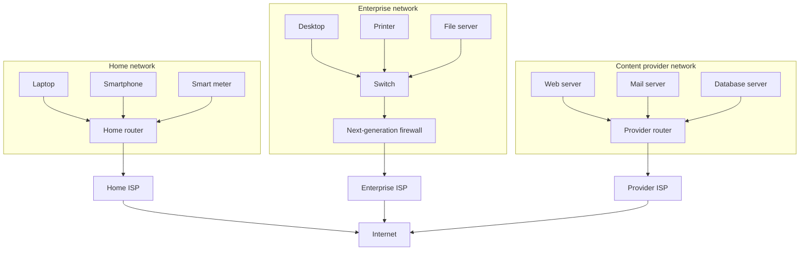
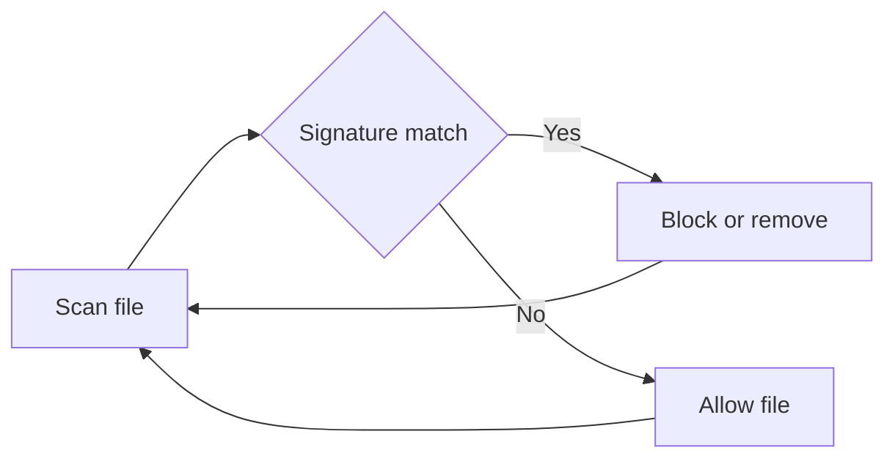
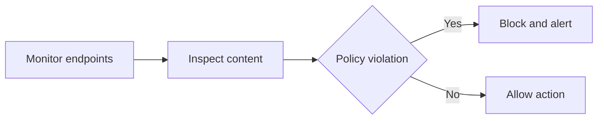
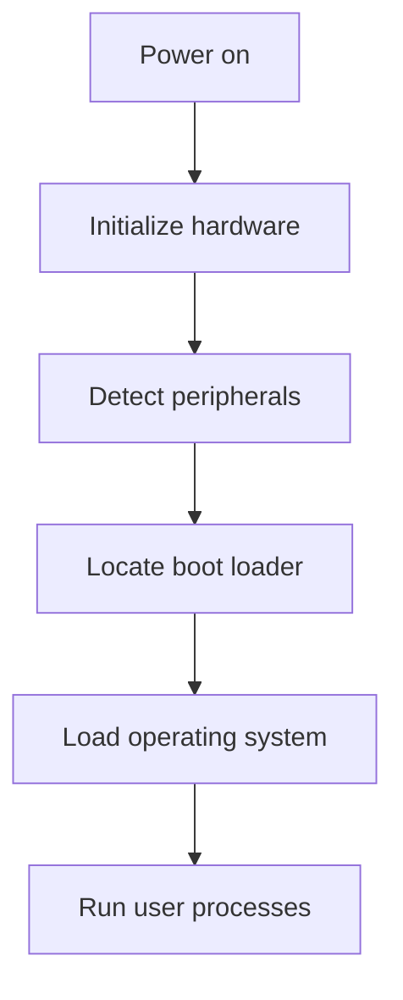
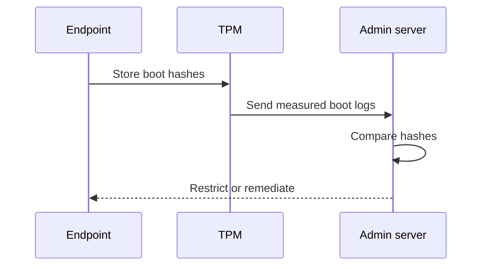

# Chapter 10: Endpoint Security

## Abstract

Endpoints such as laptops, servers, smartphones, printers, and smart meters mark the boundary where users and organizational data meet a network. Endpoint protection combines anti-malware software, endpoint detection and response (EDR), data loss prevention (DLP), next-generation firewalls, and host-based intrusion systems against attacks on each device class. Hardening adds full disk and self-encrypting drive encryption, registry access control, port and service reduction, and disciplined patch management. Boot integrity rests on UEFI, secure boot, measured boot, and a hardware root of trust. Readers gain the skill to match controls to each endpoint class and to shrink the attack surface of a device fleet.

## Content

### 1. Endpoint classes and unified management

An **endpoint** is a hardware device at the end of a wired or wireless network connection. Laptops, desktops, smartphones, printers, file servers, sensors, and smart meters all qualify as endpoints. Every endpoint carries firmware and an operating system, and most endpoints run application programs. Attackers target endpoints to reach data stored or in process on the device, or to pivot from the device into the wider network.

Endpoints fall into two physical groups. Wired devices include desktops, printers, file servers, and database servers. Wireless devices include laptops, tablets, smartwatches, and smartphones.

Endpoints group into separate networks such as home networks, enterprise networks, and content provider networks, and each network reaches the internet through its own internet service provider.



Figure 1. Home, enterprise, and content provider networks each connect through a separate internet service provider, and the internet carries traffic between every network.

**Unified endpoint management (UEM)** is a collection of software tools for controlling and securing endpoints from a single management console. UEM manages devices regardless of operating system or device type. Administrators use UEM to install firmware and software updates, apply security policies, and remotely erase all applications and data from lost or compromised endpoints.

Several commercial UEM products exist, and each product targets a different mix of device types and organization sizes.

| UEM product | Vendor | Management focus |
| --- | --- | --- |
| Microsoft Intune | Microsoft | Cloud-based management integrated with Microsoft 365 |
| Workspace ONE | Omnissa | Desktop, mobile, and rugged devices |
| IBM MaaS360 | IBM | Cloud management with threat analytics |
| Ivanti Neurons for MDM | Ivanti | Mobile-first device management |
| ManageEngine Endpoint Central | ManageEngine | Small and mid-size organizations |
| Jamf Pro | Jamf | Apple devices running macOS, iOS, iPadOS, or tvOS |

**Endpoint protection**, also called **endpoint security**, names the set of technologies defending an endpoint against attack. The set spans antivirus and anti-malware software, EDR, DLP, next-generation firewalls (NGFW), host-based firewalls, and host-based intrusion detection and prevention systems (HIDS and HIPS).

**Endpoint detection and response (EDR)**, also known as **endpoint threat detection and response (ETDR)**, combines endpoint monitoring and log analysis with contextual information from correlated network events. Correlation across sources gives analysts more evidence for detecting and responding to security incidents than endpoint logs alone provide.

Distinct endpoint classes carry distinct weaknesses. IoT devices such as smart meters run on limited computational power and lack standardized security protocols, so engineers rely on custom-designed firmware updates and frequent vulnerability scans for those devices.

| Endpoint | Security measures | Example |
| --- | --- | --- |
| IoT devices | Customized firmware updates | Automatic firmware updates for smart home security cameras |
| Mobile devices | Data encryption, authentication protocols | AES encryption of sensitive data, biometric authentication for company email |
| Servers | Access control, regular security updates | Access limited to authorized personnel, security patches applied within 24 hours of release |
| Workstations | Endpoint security solution, patch management | Endpoint security software installed and kept current on employee workstations |

### 2. Malware defenses and network filtering

**Malware**, short for **malicious software**, names any software designed to damage a computing device. The family includes computer viruses, worms, ransomware, spyware, adware, and Trojan horses. **Anti-malware** software detects and removes malware from a device.

A **computer virus** is a malware type modifying the way a legitimate program operates. A virus attaches to another program, replicates, and spreads from one computer to another. An **antivirus** program detects and removes computer viruses. The antivirus engine scans an endpoint continuously, comparing each file against signatures of known viruses. A signature match triggers action: the antivirus blocks installation of the virus, or detects and removes a virus already present on the endpoint.

The antivirus scan cycle runs as a repeating loop of scan, compare, and act.



Figure 2. An antivirus engine blocks or removes a file whose signature matches a known virus and allows every other file.

A **next-generation firewall (NGFW)** combines packet filtering with additional technologies for detecting and blocking network attacks. An NGFW enforces security policies at the application, port, and protocol levels. An NGFW also inspects encrypted traffic, detects and removes malware, and performs **deep packet inspection (DPI)**. DPI lets the firewall examine the data inside each packet and block malicious packets. Many NGFW models act on real-time information from threat intelligence services, which extends protection to new threats.

Several commercial NGFW products exist, and each product combines packet filtering with a different mix of inspection and threat intelligence features.

| NGFW product | Vendor | Notable capability |
| --- | --- | --- |
| Palo Alto Networks Next-Generation Firewall | Palo Alto Networks | Application identification with threat intelligence |
| FortiGate | Fortinet | Firewall and SD-WAN on one appliance |
| Cisco Secure Firewall | Cisco | Talos threat intelligence integration |
| Check Point Quantum | Check Point | Consistent policy across network and cloud |
| Sophos Firewall | Sophos | Coordinated response with endpoint agents |
| SonicWall firewalls | SonicWall | Deep packet inspection of encrypted traffic |

### 3. Data loss prevention and host-based controls

#### **Data loss prevention**

**Data loss prevention (DLP)** names the technologies and processes preventing accidental or intentional deletion, exposure, or transfer of sensitive organizational data. The main goal of DLP is compliance with laws and regulations governing the personal, financial, and medical information of customers. Governing regulations include the **Health Insurance Portability and Accountability Act (HIPAA)**, the **Payment Card Industry Data Security Standard (PCI-DSS)**, and the **General Data Protection Regulation (GDPR)**.

DLP performs four main functions:

1. data classification and tagging,
2. data policy management and enforcement,
3. data monitoring, and
4. report generation.

DLP sensors monitor endpoints and internal networks, running content inspection and contextual analysis on data to catch activity violating organizational data policies. A detected violation triggers protective action. In one case, DLP stops an employee from emailing a customer social security number. In another case, DLP stops deletion of a file holding sensitive financial information.

The DLP decision path moves from monitoring through inspection to enforcement.



Figure 3. DLP blocks and alerts on policy violations and allows compliant activity.

Several commercial DLP products exist, and each product monitors different channels with a different inspection method.

| DLP product | Vendor | How the product works |
| --- | --- | --- |
| Microsoft Purview DLP | Microsoft | Scans Microsoft 365 mail, files, and chats against policies and shows policy tips or blocks sharing |
| Symantec DLP | Broadcom | Runs network, endpoint, and storage sensors with content fingerprinting |
| Forcepoint DLP | Forcepoint | Adjusts enforcement to user behavior risk scores |
| Proofpoint Information Protection | Proofpoint | Inspects email and cloud channels and ties alerts to user risk |
| Endpoint Protector | CoSoSys | Endpoint agents control USB devices, email, and cloud uploads |
| Sensitive Data Protection | Google Cloud | Discovers and classifies sensitive data in cloud storage |

#### **Host-based controls**

- A **host-based firewall** runs on a single host and controls inbound and outbound network traffic for the host. The firewall can restrict traffic to a specific application and can detect and prevent malware installation. Most modern operating systems ship with a host-based firewall. **Windows Defender Firewall** is one example.
- A **host-based intrusion detection system (HIDS)** runs on a host and detects threats against the host. A HIDS monitors and analyzes running processes, network traffic, and log files. A security information management (SIM) system running on a host is one HIDS example. A **host-based intrusion prevention system (HIPS)** adds prevention: a HIPS detects and stops threats on the host.

| Capability | HIDS | HIPS |
| --- | --- | --- |
| Detect threats to the host | Yes | Yes |
| Prevent threats on the host | No | Yes |

Deploy a HIPS where the host needs active prevention and a HIDS where monitoring and alerting suffice.

### 4. Disk encryption and registry protection

#### **Disk encryption**

An endpoint stores data locally on a partitioned disk holding one or more volumes. Encryption provides confidentiality and prevents unauthorized access, and administrators can apply encryption to a single file or to an entire partition, volume, or disk. **Linux Unified Key Setup (LUKS)** encrypts Linux volumes.

Two disk encryption methods exist. **Full disk encryption (FDE)** secures all drive data through encryption, with implementation in hardware or software. The FDE encryption key comes from an authentication token based on a user password or PIN. A **self-encrypting drive (SED)** is a **hard disk drive (HDD)** or **solid state drive (SSD)** with encryption circuitry built into the drive. A SED is a hardware-only form of FDE. The drive stays transparent to operating systems, applications, and users, and the drive encrypts and decrypts data automatically without separate disk encryption software. SEDs use the **Advanced Encryption Standard (AES)** with 128-bit or 256-bit keys. The factory sets the SED encryption key, and the drive controller stores the key.

**Opal** is a set of security specifications for SEDs, published by the **Trusted Computing Group (TCG)** Storage Workgroup. Opal defines a hierarchy of security management standards guarding data against theft and tampering. Opal applies hardware-based encryption to HDDs, SSDs, and optical drives. An Opal-compliant SED requires user authentication at bootup before the drive releases data.

#### **Registry protection**

The Windows **registry** is a hierarchical database storing configuration settings and options. The kernel, device drivers, services, the security accounts manager (SAM), and third-party programs all write settings to the registry. Stored information includes user passwords, file permissions, the document types an application can create, and recently opened files. Administrators secure the registry by blocking unauthorized users from registry editing tools such as regedit. A Group Policy setting controls the restriction: "User Configuration\Administrative Templates\System\Prevent access to Registry editing tools" in the default Group Policy Object (GPO).

Users view and edit the registry through the **Registry Editor**, opened by running regedit from the Run dialog. The editor displays five root hives. **HKEY_LOCAL_MACHINE (HKLM)** holds system-wide settings for the kernel, drivers, and services. **HKEY_CURRENT_USER (HKCU)** holds settings for the signed-in user. Before any edit, the operator exports the target key through the File menu to create a backup file for restoration.

Administrators also read and write the registry from the command line with reg.exe or with PowerShell, which exposes the registry as a drive.

```powershell
# Export a key as a backup file
reg export "HKCU\Software\MyApp" C:\backup\myapp.reg

# Read a value
reg query "HKLM\SOFTWARE\Microsoft\Windows\CurrentVersion" /v ProgramFilesDir

# Create a value with type REG_DWORD and data 1
reg add "HKCU\Software\MyApp" /v Setting1 /t REG_DWORD /d 1

# Read the same value with PowerShell
Get-ItemProperty -Path 'HKCU:\Software\MyApp' -Name 'Setting1'
```

Edits under HKLM apply to every user and take effect immediately, so a wrong change can stop Windows from booting.

### 5. Ports, services, and default credentials

#### **Operating system ports and services**

An **operating system port** is a 16-bit unsigned number uniquely identifying a network application or service on a host. Port numbers run from 0 to 65,535 across three ranges.

| Port type | Range | Example |
| --- | --- | --- |
| Well-known | 0 to 1,023 | TCP port 80 for HTTP |
| Registered | 1,024 to 49,151 | TCP port 3,389 for Windows RDP |
| Private or dynamic | 49,152 to 65,535 | Any application can claim one |

**Well-known ports** serve common services under reservation. **Registered ports** hold an **Internet Assigned Numbers Authority (IANA)** registration for a specific use. Any application can use a **private port**, also called a **dynamic port**.

Secure versions of common protocols replace cleartext traffic with encrypted sessions on reserved ports.

| Protocol | Port | Transport |
| --- | --- | --- |
| **Secure Shell (SSH)** | 22 | TCP |
| **HTTPS** | 443 | TCP |
| **DNS over HTTPS (DoH)** | 443 | TCP |
| **DNS over TLS (DoT)** | 853 | TCP and UDP |
| **SMTPS** | 465 | TCP |
| **SMTP with STARTTLS** | 587 | TCP |
| **POP3S** | 995 | TCP |
| **IMAPS** | 993 | TCP |
| **FTPS (implicit mode)** | 990 | TCP |
| **SSH File Transfer Protocol (SFTP)** | 22 | TCP |
| **Secure Real-time Transport Protocol (SRTP)** | Negotiated by call signaling | UDP |
| **LDAPS** | 636 | TCP |
| **SNMPv3** | 161 | UDP |
| **Syslog over TLS** | 6,514 | TCP |
| **Network Time Security (NTS)** key establishment | 4,460 | TCP |
| **IPsec** key exchange (IKE) | 500 | UDP |

**Secure/Multipurpose Internet Mail Extensions (S/MIME)** encrypts and signs the message content instead of the connection, so S/MIME carries no port of its own and rides on SMTP, POP3S, or IMAPS. IPsec protects packets with two protocols carrying IP protocol numbers instead of ports: **Encapsulating Security Payload (ESP)** uses protocol 50 and **Authentication Header (AH)** uses protocol 51.

Authentication protocols verify user and device identities, and some protocols run inside another protocol instead of claiming a port.

| Protocol | Port | Operation |
| --- | --- | --- |
| **Password Authentication Protocol (PAP)** | None, runs inside PPP | Sends credentials in cleartext |
| **Challenge Handshake Authentication Protocol (CHAP)** | None, runs inside PPP | Answers a challenge with a hash |
| **Kerberos** | 88 | Issues tickets over TCP and UDP |
| **Extensible Authentication Protocol (EAP)** with **IEEE 802.1X** | None on the LAN | Carries credentials in EAPOL frames |
| **RADIUS** | 1,812 and 1,813 | Authenticates and accounts over UDP |
| **TACACS+** | 49 | Separates authentication, authorization, and accounting over TCP |
| **Security Assertion Markup Language (SAML)** | 443 | Passes XML assertions over HTTPS |
| **OpenID Connect** | 443 | Adds an identity layer over HTTPS |
| **OAuth 2.0** | 443 | Delegates authorization over HTTPS |

Each IP address carries both TCP and UDP ports. An **open port** accepts data packets. A **closed port** rejects or ignores data packets. Attackers and defenders alike run network scanners such as Nmap for **port enumeration**, the process of identifying open ports on a host and determining which services use those ports.

Every network service sends and receives data through a port, and each open port exposes the vulnerabilities of the service behind the port. Two moves shrink the attack surface.

1. Close or filter unused ports with a firewall.
2. Disable unnecessary services.

#### **Default credentials**

Default passwords and leftover software widen the attack surface further. Devices and software often arrive with default passwords, and those passwords are public knowledge. Changing every default password to a strong, unique alternative prevents access by unauthorized parties. Unnecessary software raises risk and consumes resources. Regular audits find unused programs, and removal of those programs shrinks the attack surface and frees system resources.

### 6. Software updates and patch management

Software updates remove security vulnerabilities, fix errors, add features, and improve performance. Three update types exist.

- A **software patch**, or **patch**, is a set of code changes updating, improving, or fixing a program. **Patching** is the process of applying patches for continuous improvement in functionality, performance, security, or usability. One example: a patch adds new features to a word processor.
- A **hotfix**, also called a **quick-fix engineering (QFE) update**, addresses one specific problem. Vendors develop and release hotfixes quickly for recently found problems, and a hotfix typically serves as a temporary measure until a full release arrives. One example: a hotfix resolves a buffer overflow creating an exploitable vulnerability.
- A **service pack** bundles patches and hotfixes into a single package, bringing a system up to date through one update process. A service pack installation runs simpler and less error-prone than dozens of individual patch installations. A Windows service pack includes every hotfix and patch released since the previous service pack.

**Patch management** is the process of distributing and applying updates, including monitoring patch availability for timely application of critical fixes. Automation speeds deployment of security patches and cuts the odds of running outdated software. An **auto-update** option downloads and installs patches, hotfixes, and service packs without user intervention. Two conditions block patching: vendors discontinue support for old products, and some systems cannot shut down for updates.

**Third-party software** means any software outside the operating system. Bitdefender Antivirus, for instance, counts as third-party software on Microsoft Windows. Third-party programs need the same update discipline, delivered through **third-party updates** from each manufacturer. Modern operating systems such as Windows and Linux scan for missing patches, then download and install patches, hotfixes, and operating system updates.

**OS vulnerabilities** span buffer overflows, privilege escalations, unpatched security flaws, and configuration errors. A **buffer overflow** occurs when a buffer receives more data than the buffer can hold, which can execute malicious code or crash the system. Because the OS manages all hardware and software resources, exploitation of an OS vulnerability can expose data, corrupt the system, or hand an attacker full compromise.

| Vulnerability category | Impact | Example |
| --- | --- | --- |
| System | Privilege escalation, code execution | Windows API flaws, Linux system call vulnerabilities |
| Memory | Code execution, memory corruption | Stack and heap overflows |
| Network | Network compromise, protocol manipulation | Windows TCP/IP stack exploits |
| Configuration | Unauthorized access, privilege escalation | Improper registry settings, misconfigured Linux permissions |
| Authentication | Credential exposure, privilege escalation | Credential theft in Windows, authentication bypass in Linux |

A **malicious software update** looks legitimate but carries harmful code, exploiting trust in the update process. Distribution channels include phishing emails, infected downloads, compromised update servers, and exploited vulnerabilities. An installed malicious update can create backdoors, steal sensitive data, disable security features, or grant remote control of the system.

### 7. Boot integrity and the root of trust

A secure boot process prevents malware installation before the operating system loads. **Unified extensible firmware interface (UEFI)** is a specification defining a software interface between an operating system and platform firmware. The interface consists of data tables with platform-related information plus boot and runtime service calls for the boot loader and the operating system. A **boot loader**, or **bootstrap loader**, is the program loading an operating system into computer memory. UEFI replaces the legacy **Basic Input/Output System (BIOS)**, the program in non-volatile memory running start-up procedures at power-on.

UEFI improves on BIOS with security features, faster boot times, and graphical interfaces with mouse support for pre-boot configuration. UEFI networking enables remote configuration, diagnostics, and troubleshooting. UEFI can load from a hard disk or solid-state drive, from non-volatile memory, or from a network share.

The UEFI boot sequence runs in five ordered steps.



Figure 4. UEFI initializes hardware, finds a boot loader, and hands control to the operating system in five steps.

Boot integrity means only verified software participates in the boot process, and UEFI supplies two methods.

- **Secure boot** loads and executes only programs trusted by the system manufacturer. The system keeps a signature database of valid programs and executes only boot programs carrying a valid signature. The system manufacturer updates the database. Windows Server, Windows 10, and Linux distributions such as Ubuntu and Fedora support secure boot.
- **Measured boot** computes a hash of each boot program and stores each hash in a **trusted platform module (TPM)**. **Boot attestation** sends the measured boot logs from the TPM to a remote administrative server. The server compares each software hash in the boot chain against the hash of a valid boot program. A mismatch lets the server restrict system access to resources or take remedial action.

Boot attestation follows a fixed exchange between the endpoint and the administrative server.



Figure 5. The administrative server compares each boot hash from the TPM against valid values and restricts the endpoint on a mismatch.

Secure boot and measured boot can run together on the same system for stronger boot security.

The **root of trust (RoT)** is the set of highly reliable hardware, firmware, and software components performing critical security functions. A **hardware root of trust (HRoT)** lives entirely in hardware. An HRoT starts the system with immutable code beyond the reach of malware. The root of trust anchors a **chain of trust**: the system validates the signature of each firmware piece before execution, and after all validated firmware runs, control passes to the UEFI secure boot process.

Hardware itself carries risk. Outdated firmware holds known vulnerabilities open to exploitation. End-of-life hardware stops receiving security updates and grows more exposed over time. Legacy hardware kept for compatibility or cost may lack modern security features. Hardware lifecycle management answers with three practices: regular firmware updates, timely replacement of end-of-life hardware, and security evaluation before deploying legacy hardware.

## Summary

- An endpoint includes firmware, an operating system, and applications, spanning wired devices such as file servers and wireless devices such as smartphones.
- SEDs encrypt drive data with AES using 128-bit or 256-bit keys, and the drive controller stores the factory-set key.
- Servers need security patches within 24 hours of release, with access limited to authorized personnel.
- Open ports expose services, so closing or filtering unused ports across the 0 to 65,535 range shrinks the attack surface.
- Choose a HIPS over a HIDS when a host needs active prevention rather than detection alone.
- DLP enforces HIPAA, PCI-DSS, and GDPR compliance by blocking policy-violating transfers such as an email carrying a social security number.
- A service pack bundles all patches and hotfixes released since the previous service pack into one installation.
- Secure boot executes only manufacturer-signed programs, while measured boot records hashes in a TPM for remote attestation.

## Useful References and Resources

- Broadcom. Symantec Data Loss Prevention. <https://www.broadcom.com/products/cybersecurity/information-protection/data-loss-prevention>
- Check Point. Quantum next-generation firewall. <https://www.checkpoint.com/quantum/next-generation-firewall/>
- Cisco. Secure Firewall. <https://www.cisco.com/site/us/en/products/security/firewalls/index.html>
- CoSoSys. Endpoint Protector. <https://www.endpointprotector.com/>
- European Union. General Data Protection Regulation (GDPR).
- Forcepoint. Forcepoint Data Loss Prevention. <https://www.forcepoint.com/product/dlp-data-loss-prevention>
- Fortinet. FortiGate next-generation firewall. <https://www.fortinet.com/products/next-generation-firewall>
- Google Cloud. Sensitive Data Protection. <https://cloud.google.com/sensitive-data-protection>
- IBM. MaaS360 documentation. <https://www.ibm.com/docs/en/maas360>
- Internet Assigned Numbers Authority (IANA). Port number assignments.
- Ivanti. Ivanti Neurons for MDM. <https://www.ivanti.com/products/ivanti-neurons-for-mdm>
- Jamf. Jamf Pro. <https://www.jamf.com/products/jamf-pro/>
- ManageEngine. Endpoint Central. <https://www.manageengine.com/products/desktop-central/>
- Microsoft. Microsoft Intune documentation. <https://learn.microsoft.com/en-us/intune/intune-service/>
- Microsoft. Microsoft Purview data loss prevention. <https://learn.microsoft.com/en-us/purview/dlp-learn-about-dlp>
- Nmap. Network exploration and security auditing scanner.
- Omnissa. Workspace ONE documentation. <https://docs.omnissa.com/>
- Palo Alto Networks. Next-generation firewalls. <https://www.paloaltonetworks.com/network-security/next-generation-firewall>
- Payment Card Industry Security Standards Council. Payment Card Industry Data Security Standard (PCI-DSS).
- Proofpoint. Information Protection. <https://www.proofpoint.com/us/products/information-protection>
- SonicWall. Firewalls. <https://www.sonicwall.com/products/firewalls>
- Sophos. Sophos Firewall. <https://www.sophos.com/en-us/products/next-gen-firewall>
- Trusted Computing Group Storage Workgroup. Opal security specifications for self-encrypting drives.
- United States Congress. Health Insurance Portability and Accountability Act (HIPAA).
