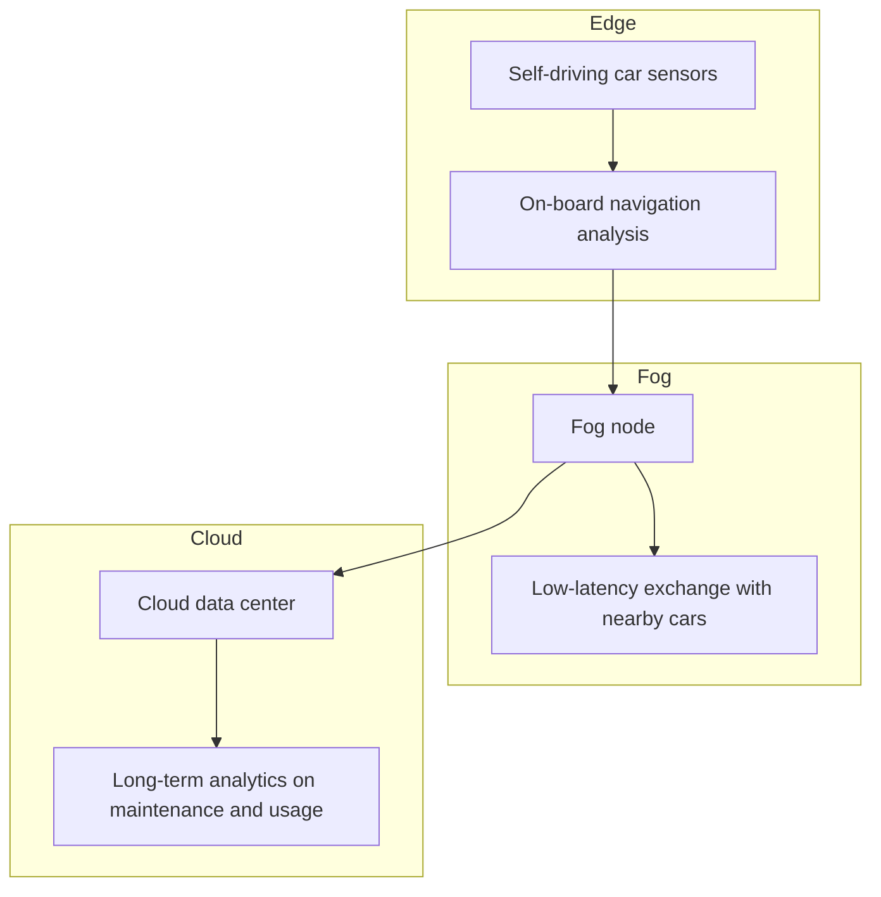
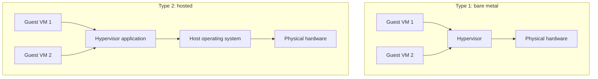
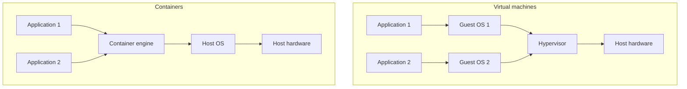
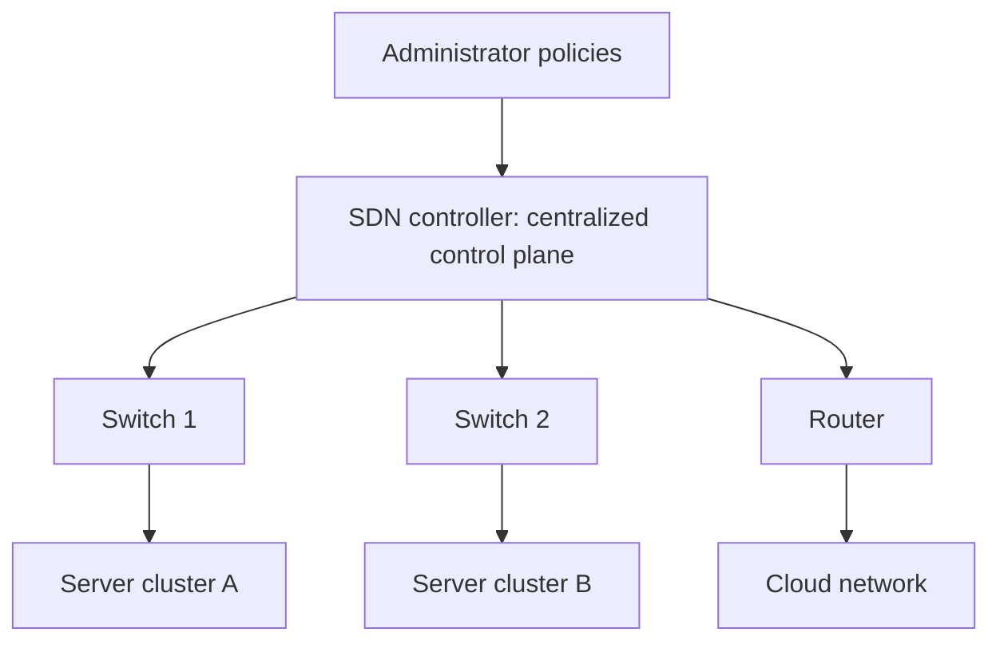
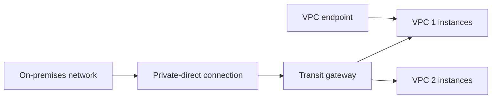
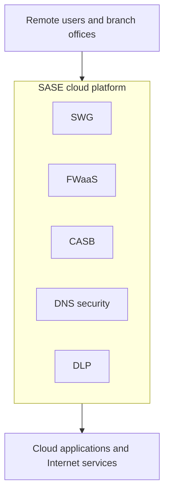

# Chapter 11: Cloud Security

## Abstract

Cloud computing delivers IT resources on demand over the Internet through three service models (IaaS, PaaS, SaaS) and four deployment models (public, private, hybrid, community). Virtualization forms the foundation, since hypervisors divide one physical host into isolated guest machines. Containers, serverless platforms, and microservices change how teams build and run applications on that foundation. Software-defined networking and infrastructure as code replace manual network configuration with machine-readable definition files. Cloud providers protect resources with security groups, hardware security modules, VPC endpoints, and transit gateways, while a responsibility matrix divides duties between provider and customer. Security solutions such as CASB, SWG, NGFW, FWaaS, and SASE enforce organizational policy between users and cloud services.

## Content

### 1. Cloud service models

Cloud computing is a model where IT resources are available on demand over the Internet. A cloud service provider is the entity that delivers those resources. Microsoft, for example, provides the Azure cloud service.

Three service models exist:

- Infrastructure as a Service (IaaS) supplies infrastructure components on demand: networking, storage, servers, and virtualization. Google Compute Engine is the IaaS offering inside Google Cloud Platform.
- Platform as a Service (PaaS) adds an operating system, middleware, and runtime on top of the IaaS components, giving developers the hardware and software tools to build and deploy applications. Google App Engine hosts web applications in Google-managed data centers.
- Software as a Service (SaaS) delivers a complete application over the Internet. The provider manages access, security, availability, and performance. Gmail is a SaaS email service.

Anything as a Service (XaaS) names the broader category of products, tools, and technologies sold as services over the Internet. A Communications as a Service provider, for example, sells Voice over IP and video conferencing.

### 2. Cloud deployment models, fog, and edge

A deployment model describes the architecture, scalability, ownership, and control of a cloud, plus how users reach the services. Four deployment models exist:

- Public cloud: the provider provisions infrastructure for the general public on the provider's own premises, usually as pay-per-use. Amazon Web Services (AWS), Google Cloud Platform, and Microsoft Azure are public clouds.
- Private cloud: one organization gets exclusive use, on-premises or off-premises, managed by the organization or a third party. A virtual private cloud (VPC) places private cloud infrastructure inside a public cloud.
- Hybrid cloud: standardized or proprietary technology binds private and public infrastructure so data and applications move between them. An organization can keep sensitive client data on a private cloud and run a business intelligence application on a public cloud, joined by a hybrid cloud.
- Community cloud: several organizations with shared computing concerns, such as regulatory compliance, performance, or security requirements, share the infrastructure. The member organizations or a managed service provider own and operate it.

Fog computing places nodes between the cloud and end devices. A fog node is a non-end device with computing, storage, and network connectivity. Processing data near end devices cuts cloud latency and supports near real-time decisions. Data travels to the cloud only for storage and long-term analytics.

Edge computing performs most data processing on the end devices themselves. This reduces the data sent to nodes or the cloud, which raises application responsiveness, lowers bandwidth use, and improves latency. Manufacturers use edge computing when sensors monitor production lines and run real-time analytics to catch defects.

Applications combine all three models. A self-driving car analyzes navigation data on board (edge), exchanges low-latency data with nearby cars through fog nodes (fog), and sends data to the cloud for long-term analytics on maintenance and usage patterns (cloud).

Figure 1. A self-driving car processes navigation data at the edge, exchanges data with nearby cars through fog nodes, and sends data to the cloud for long-term analytics.

### 3. Regions and availability zones

A region is the physical location of a provider's cluster of data centers. AWS operates over 20 regions across North America, South America, Europe, China, Asia Pacific, South Africa, and the Middle East. An availability zone (AZ) is a smaller group of data centers inside a region. AWS operates over 80 AZs, including Ohio, Rio de Janeiro, Cape Town, London, Bahrain, and Beijing.

Regions differ in performance, cost, and latency. Each region stays isolated from the others for fault tolerance and service stability, and each AZ carries its own fault tolerance and disaster recovery design. No two availability zones share a data center.

### 4. Virtualization and hypervisors

Virtualization uses software to create a simulated version of a physical computing resource. Virtualization forms the foundation of cloud computing, since virtual machines use physical computer hardware more efficiently. A virtual machine (VM) is a virtualized computer system built from three components:

- Hypervisor (virtual machine monitor): the software or firmware that virtualizes the host hardware platform.
- Host machine: the physical machine on which the hypervisor runs.
- Guest machine: a VM created on the host.

A guest machine runs its own operating system behind logical isolation, a feature that makes the guest behave as an independent machine. A Windows 11 computer, for example, can host an Ubuntu Linux VM that runs Ubuntu software.

Two hypervisor types exist. A type 1 hypervisor (native or bare metal) runs directly on the host hardware and replaces the traditional operating system. Xen, Kernel-based Virtual Machine (KVM), and Windows Server Hyper-V are type 1 hypervisors. A type 2 hypervisor (hosted) runs as an application on an existing operating system and reaches the hardware through the host OS. Oracle VirtualBox and VMware Player are type 2 hypervisors. VMware ESXi is another common type 1 product, and VMware Workstation and Parallels Desktop are additional type 2 products for workstations.

Figure 2. A type 1 hypervisor runs directly on physical hardware, while a type 2 hypervisor runs as an application on the host operating system and reaches the hardware through that OS.

| Consideration | Type 1 | Type 2 |
| --- | --- | --- |
| Use | System built for virtualization | Adding virtualization to a traditional computer |
| Deployment | Server | Workstation |
| Performance | Better logical isolation for VMs | Adequate logical isolation for VMs |
| Cost | More expensive than type 2 | Less expensive than type 1 |

Table 1. Trade-offs between type 1 and type 2 hypervisors.

Virtualization faces both traditional and virtualization-specific exploits. Malware, a traditional exploit, infects hosts and guests alike. Two virtualization-specific exploits stand out:

- VM escape: a process breaks out of the guest's logical isolation and interacts with the host. A successful escape lets an attacker create, delete, or modify guest machines.
- VM sprawl: an attacker creates enough VMs to consume the host's available resources, often after a VM escape.

Resource reuse adds further risk. Hosts and guests share memory, I/O devices, and system components to improve efficiency. Weak isolation lets a compromised VM read or alter another VM's resources. A flaw in a shared memory mechanism, for example, can expose sensitive data or allow malicious code injection into other VMs.

Mitigation applies traditional techniques to both host and guest. Patch management on an Ubuntu guest and a Windows 11 host counters malware. Updating the host's virtual machine monitor counters virtualization-specific exploits. VM lifecycle management, the procedures for creating, maintaining, monitoring, and decommissioning a VM, also limits exposure.

### 5. Containers, serverless, and microservices

A container packages everything an application needs to run: code, libraries, system tools, and configurations. The package decouples the application from the underlying hardware, so the same container runs on virtual machines, physical servers, on-premises data centers, and public clouds. A container engine manages container execution. Docker is a container engine.

A virtual machine virtualizes hardware, while a container engine virtualizes the operating system. Containers skip the OS boot and library loading, so they stay lighter and more efficient than VMs. The trade-off is OS specificity: a containerized Windows application runs only on Windows.

Figure 3. Each VM boots a full guest operating system on top of a hypervisor, while containers share the host operating system through a container engine.

A container orchestration tool deploys, scales, and manages containers across a cluster of hosts. Kubernetes, Docker Swarm, and Amazon Elastic Container Service (ECS) are orchestration tools.

Serverless is a cloud model where the provider automatically provisions, schedules, and scales computing resources. AWS Lambda, Microsoft Azure Functions, and Google Cloud Functions are serverless services.

Microservices split one application into small, independently deployable services. Each service carries its own technology stack, database, and data model, and services communicate through APIs. This design supports automated, iterative delivery methods such as continuous integration/continuous deployment (CI/CD) and DevOps. Teams deploy microservices inside containers for real-time systems. Traffic control systems and e-banking systems rely on the high availability, light weight, and scalability of microservices.

### 6. Software-defined networking

Infrastructure as code (IaC) manages and provisions data centers through machine-readable definition files rather than hardware configuration or interactive tools. Definition files use scripts or declarative definitions. The desired state feature declares the final target state of the infrastructure instead of a step-by-step configuration sequence. AWS CloudFormation is an IaC product. Terraform, Ansible, and Microsoft Azure Resource Manager are other IaC tools.

An overlay network is a virtual network layer built on top of physical network infrastructure. Software-defined networking (SDN) is an overlay technology that centralizes a network's management and control planes. Centralization gives administrators granular traffic management, efficient resource allocation, and fast adjustment to changing conditions. SDN also speeds the deployment of virtualized network functions. An SDN controller programs network devices through protocols such as OpenFlow. Cisco Application Centric Infrastructure (ACI) and VMware NSX are commercial SDN products.

Figure 4. SDN moves the control plane from individual devices into a central controller, which programs the data plane of every switch and router.

A software-defined wide area network (SD-WAN) applies SDN to a multilocation network. SD-WAN embeds encryption, intrusion prevention systems, and firewalls into the network architecture, so consistent, automated security policies hold at every location and protect data in transit.

Software-defined visibility (SDV) delivers network traffic visibility to any monitoring device regardless of the device's physical location. Cloud applications integrate through APIs, and attackers can send malformed data through those APIs. Many SDV products inspect API calls to SDN components, assess cloud applications for vulnerabilities, and flag deviations from best practices. Microsoft Cloud App Security, for example, evaluates a cloud application's account permissions, auditing, and data scanning.

### 7. Security controls for storage, network, and compute

Compute names the collective cloud resources behind a customer's processing needs. CPU, GPU, and RAM are compute resources. Four resource types exist. A virtual CPU (vCPU) is a portion of a host's CPU. Virtual RAM (vRAM) is a portion of a host's RAM. Virtual networking supplies a network to a guest machine. Cloud storage holds customer data under the provider's management.

Dynamic resource allocation (DRA) provisions and deprovisions resources automatically as demand changes. A retailer's web servers scale up during a sales event and scale down as visitor counts fall, keeping the cloud scalable and cost-efficient.

Providers deliver high availability by linking zones with high-bandwidth, low-latency, redundant network connections. Physical separation of zones protects services against earthquakes, tornados, fire, and sabotage.

Each cloud resource, such as a VM, pairs with a resource policy and a hardware security module. A resource policy lists the resource's authorized users, systems, and actions. A hardware security module (HSM) is a tamper-resistant external device or plug-in card that supplies cryptographic services. Providers use HSMs to store device certificates, cryptographic keys, and passwords, and sell HSM services to customers for secrets management. AWS CloudHSM and Azure Dedicated HSM are provider HSM services, and AWS Key Management Service (KMS) and Azure Key Vault manage customer keys and secrets. Cloud resources also support auditing, which lets customers measure control effectiveness and demonstrate regulatory compliance. AWS CloudTrail logs API calls for audit trails, and AWS Config records resource configurations over time.

Access controls include security groups and instance awareness. A security group binds several cloud users to a resource policy and acts as a virtual firewall for the resource. One security group, for example, disables TCP port 23 to block telnet connections. Instance awareness recognizes individual cloud instances so the correct policy applies to each one, which matters when an organization runs several hundred instances of a service like Microsoft OneDrive.

Virtual networks reuse on-premises controls. A virtual firewall matches a physical firewall's protections, and network segmentation splits a virtual network into smaller subnetworks for access control. Two connection devices serve private links:

- VPC endpoint: a virtual device that connects to a VPC's instances without public IP addresses.
- Transit gateway: a network transit hub that interconnects on-premises networks and VPCs, acting as a virtual router that scales with traffic volume.

Both devices form part of a private-direct connection, a private link rather than an Internet-based link between an on-premises network and a provider's VPC. AWS Direct Connect and Azure ExpressRoute are private-direct connection services. Many providers sell a VPN add-on that encrypts private-direct connections.

Figure 5. A transit gateway routes traffic between an on-premises network and multiple VPCs, and a VPC endpoint reaches instances without public IP addresses.

A cloud responsibility matrix maps which party owns each duty under each service model. AWS secures the underlying cloud infrastructure, while Netflix secures the Netflix applications and data stored on AWS.

| Responsibility | IaaS | PaaS | SaaS | Examples |
| --- | --- | --- | --- | --- |
| Infrastructure | Provider | Provider | Provider | Physical servers, networking hardware |
| Application and data | Customer | Customer | Provider | Operating system, application software |
| Security and compliance | Shared | Shared | Provider | Security protocols, compliance audits |
| Backup and disaster recovery | Shared | Provider | Provider | Data backup solutions, disaster recovery plans |
| Identity and access management | Shared | Provider | Provider | User authentication, access controls |

Table 2. Cloud responsibility matrix by service model.

This division removes overlaps and gaps that create vulnerabilities, streamlines troubleshooting, and supports regulatory compliance.

Cloud environments carry three recurring vulnerability classes. Misconfigured resources expose sensitive data. Insecure APIs give attackers a path into cloud service management interfaces. Shared technology vulnerabilities, such as flaws in hypervisors and networking hardware, cause isolation failures that compromise the security and integrity of cloud resources.

Countermeasures include regular security audits, penetration testing, and incident response plans sized for the scalability and distribution of cloud resources. API security and strict access controls, including multi-factor authentication, role-based access control, and regular access reviews, keep unauthorized personnel away from sensitive infrastructure and data.

### 8. Cloud security solutions

A cloud access security broker (CASB) sits between an organization's infrastructure and the cloud provider's infrastructure and enforces the organization's security policies on cloud access. Policies cover authentication, authorization, encryption, logging, alerting, and malware detection and prevention. Netskope, Microsoft Defender for Cloud Apps, and Palo Alto Networks Prisma SaaS are CASB products. A CASB delivers four functions:

- Visibility: tracks who uses cloud services and how, recording details such as access time and device IP address when a device reaches the company database.
- Compliance: controls data leaving the organization and meets regulatory requirements.
- Data security: monitors data and applies access control by location, IP address, browser, operating system, and device type.
- Threat protection: raises alerts on detected threats.

A next generation secure web gateway (SWG) is an on-premises appliance or cloud service deployed between users and the Internet. Operating at the application layer, an SWG performs URL filtering, malware detection, malicious content inspection, data loss prevention (DLP), application control, and filtering of Internet-bound traffic. Zscaler Internet Access is a cloud-based SWG.

A next generation firewall (NGFW) exceeds a traditional firewall's capabilities. Like a traditional firewall, an NGFW splits a network into trusted and untrusted zones, which shrinks the attack surface and stops threats from crossing zones. NGFW capabilities add intrusion prevention (IPS), deep packet inspection (DPI), threat intelligence, and application control. Palo Alto Networks and Fortinet FortiGate sell NGFW products.

Firewall as a service (FWaaS), also called a cloud firewall, delivers NGFW capabilities from the cloud. FWaaS filters traffic to block unauthorized access into or out of a virtual network, and customers reach it over the Internet like SaaS or IaaS.

| Firewall type | Cost frequency | Cost based on | OSI layer operation | Security model |
| --- | --- | --- | --- | --- |
| FWaaS | Monthly | Volume of traffic filtered | 1-7 | Virtual wall across platforms, infrastructure, and applications |
| NGFW | Upfront and monthly | Equipment plus employee maintenance and setup | 1-7 | Virtual wall around internal network |
| Traditional | Upfront and monthly | Equipment plus employee maintenance and setup | 1-4 | Virtual wall around internal network |

Table 3. FWaaS, NGFW, and traditional firewalls compared. FWaaS charges monthly by filtered traffic volume and operates at OSI layers 1 through 7, while a traditional firewall covers layers 1 through 4.

Cloud-native security replaces the traditional perimeter approach. A cloud-native architecture dissolves the perimeter and builds security into the assets themselves, across every layer from OS to container to application. A cloud-native security control comes from the cloud environment itself, while a third-party security control comes from an external source or exists on-premises. Cloud-native controls include:

- Visibility and audits: audits satisfy compliance and legal requirements, and visibility identifies and logs network access.
- High availability: server clusters in separate geographic areas provide resiliency. When a storm in the northeast United States cuts power, servers in California take over the load.
- DevOps integration: security enters the DevOps process so infrastructure and applications stay free of vulnerabilities. Two DevOps practices are microservices, which build one application from small services, and infrastructure as code, which uses the cloud's API-driven model. Secret management handles API keys, database credentials, IAM permissions, SSH keys, and certificates.
- Mitigation: enforcement across the cloud's data, network, and compute resources.

Secure access service edge (SASE) converges WANs and network security services into a single cloud service model. One SASE platform hosts multiple security services, including SWG, FWaaS, CASB, DNS security, and DLP. Prisma SASE and Zscaler Zero Trust Exchange are SASE platforms.

Figure 6. SASE converges WAN connectivity and security services such as SWG, FWaaS, CASB, DNS security, and DLP into one cloud platform.

Cloud infrastructure hardening reduces vulnerabilities and attack risk through several technical measures. Regular vulnerability assessments identify weaknesses. Timely security patches block known exploits. Network segmentation divides cloud environments into smaller isolated segments, limiting the damage of any single incident. Authentication and authorization protocols control access. Encryption protects data confidentiality and integrity at rest and in transit, across both cloud and on-premises systems.

## Summary

- Cloud computing offers 3 service models: IaaS supplies infrastructure components (Google Compute Engine), PaaS adds an operating system, middleware, and runtime (Google App Engine), and SaaS delivers a complete application with provider-managed security, availability, and performance (Gmail).
- Four deployment models exist: public clouds such as AWS, Google Cloud Platform, and Azure serve the general public, private clouds serve one organization, hybrid clouds bind private and public infrastructure, and community clouds serve organizations with shared computing concerns.
- Fog computing places nodes between the cloud and end devices, edge computing processes data on the devices themselves, and a self-driving car combines edge navigation, fog-based exchange with nearby cars, and cloud analytics in one application.
- AWS operates over 20 regions and over 80 availability zones, and no 2 availability zones share a data center.
- A virtual machine consists of 3 components: a hypervisor, a host machine, and a guest machine. Type 1 hypervisors such as Xen, KVM, and Hyper-V run on bare metal, while type 2 products such as VirtualBox and VMware Player run as applications on a host operating system.
- VM escape breaks a guest's logical isolation, and VM sprawl exhausts host resources. Counter both by patching host and guest, updating the virtual machine monitor, and applying VM lifecycle management.
- Containers virtualize the operating system rather than hardware, so containers skip the OS boot but stay OS-specific. Docker is a container engine, and Kubernetes orchestrates container clusters.
- Serverless shifts provisioning, scheduling, and scaling to the provider (AWS Lambda, Azure Functions, Google Cloud Functions), and microservices split applications into API-connected services that support CI/CD and DevOps.
- IaC tools such as AWS CloudFormation and Terraform declare a desired state in machine-readable definition files. SDN centralizes management and control planes, SD-WAN extends SDN across multilocation networks, and SDV delivers traffic visibility to any monitoring device.
- Security groups act as virtual firewalls, for example disabling TCP port 23 to block telnet, and instance awareness applies the correct policy across several hundred running instances. HSMs store certificates, cryptographic keys, and passwords in tamper-resistant hardware.
- VPC endpoints reach instances without public IP addresses, transit gateways interconnect on-premises networks and VPCs, and private-direct connections such as AWS Direct Connect and Azure ExpressRoute bypass the Internet.
- The responsibility matrix assigns infrastructure to the provider in all 3 service models and assigns applications and data to the provider only in SaaS.
- FWaaS operates at OSI layers 1 through 7 with a monthly cost based on filtered traffic volume, while a traditional firewall covers layers 1 through 4 with upfront and monthly costs.
- A CASB delivers 4 functions: visibility, compliance, data security, and threat protection. SASE converges WAN, SWG, FWaaS, CASB, DNS security, and DLP into a single cloud platform.
- Cloud hardening combines regular vulnerability assessments, timely patches, network segmentation, authentication and authorization protocols, and encryption of data at rest and in transit.

## Useful References and Resources

- NIST Special Publication 800-145, "The NIST Definition of Cloud Computing," the standard reference for the IaaS, PaaS, and SaaS service models and the public, private, hybrid, and community deployment models. <https://csrc.nist.gov/publications/detail/sp/800-145/final>
- Docker. Docker documentation. <https://docs.docker.com/>
- Kubernetes. Production-grade container orchestration. <https://kubernetes.io/>
- Amazon Web Services. AWS Lambda. <https://aws.amazon.com/lambda/>
- Microsoft. Azure Functions documentation. <https://learn.microsoft.com/en-us/azure/azure-functions/>
- Google Cloud. Cloud Functions. <https://cloud.google.com/functions>
- Amazon Web Services. AWS CloudFormation. <https://aws.amazon.com/cloudformation/>
- HashiCorp. Terraform documentation. <https://developer.hashicorp.com/terraform/docs>
- Red Hat. Ansible documentation. <https://docs.ansible.com/>
- The Xen Project. Open source type 1 hypervisor. <https://xenproject.org/>
- Kernel-based Virtual Machine (KVM). <https://www.linux-kvm.org/>
- Microsoft. Hyper-V overview. <https://learn.microsoft.com/en-us/windows-server/virtualization/hyper-v/hyper-v-overview>
- Oracle. VirtualBox. <https://www.virtualbox.org/>
- Open Networking Foundation. OpenFlow specification and SDN resources. <https://opennetworking.org/sdn-resources/openflow/>
- Cisco. Application Centric Infrastructure (ACI). <https://www.cisco.com/go/aci>
- Amazon Web Services. Shared responsibility model. <https://aws.amazon.com/compliance/shared-responsibility-model/>
- Amazon Web Services. AWS CloudHSM. <https://aws.amazon.com/cloudhsm/>
- Microsoft. Azure Key Vault documentation. <https://learn.microsoft.com/en-us/azure/key-vault/>
- Amazon Web Services. AWS CloudTrail. <https://aws.amazon.com/cloudtrail/>
- Amazon Web Services. AWS Config. <https://aws.amazon.com/config/>
- Amazon Web Services. AWS Direct Connect. <https://aws.amazon.com/directconnect/>
- Microsoft. Azure ExpressRoute documentation. <https://learn.microsoft.com/en-us/azure/expressroute/>
- Netskope. Cloud access security broker. <https://www.netskope.com/products/casb>
- Microsoft. Defender for Cloud Apps documentation. <https://learn.microsoft.com/en-us/defender-cloud-apps/>
- Zscaler. Zscaler Internet Access. <https://www.zscaler.com/products-and-solutions/zscaler-internet-access>
- Palo Alto Networks. Prisma SASE. <https://www.paloaltonetworks.com/sase>
- Fortinet. FortiGate next-generation firewall. <https://www.fortinet.com/products/next-generation-firewall>
