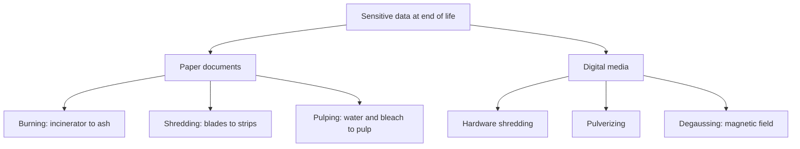
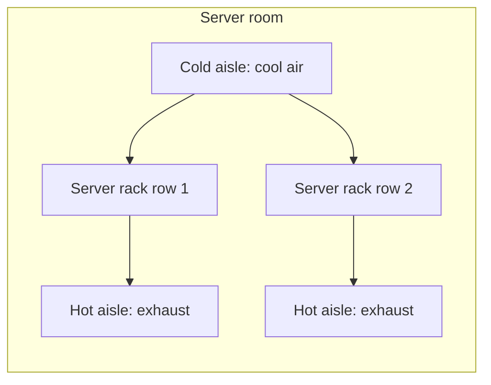
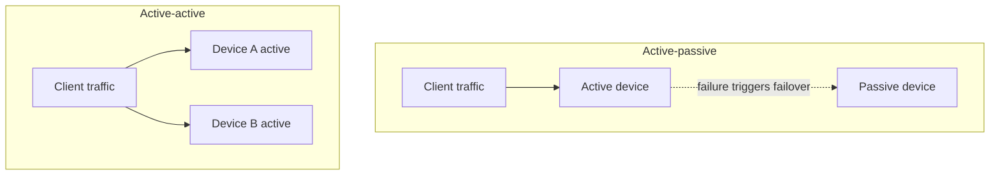
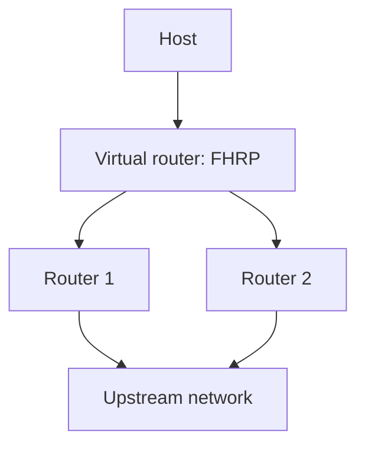
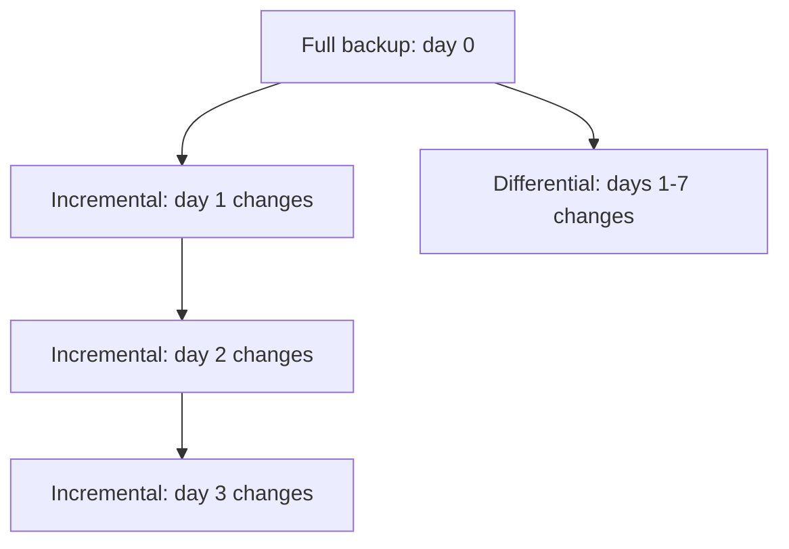

# Chapter 12: Physical Security and Cybersecurity Resilience

## Abstract

Physical security protects buildings, equipment, and media from unauthorized access and environmental damage. Secure destruction of paper and digital data prevents theft of sensitive information at end of life. Access controls such as fences, lighting, cameras, locks, and vestibules keep intruders out, while air gaps, data blockers, Faraday cages, and cooling systems protect equipment. High availability removes single points of failure through resilience, redundancy, diversity, and scalability. NIC teaming, first hop redundancy protocols, and redundant power equipment keep networks running during failures. Data protection covers onsite and offsite replication, four disaster recovery site types, three backup options, five RAID levels, and known-good device configurations.

## Content

### 1. Secure data destruction

Sensitive data on paper invites theft through dumpster diving, so paper documents need physical destruction. Three methods exist:

- Burning reduces paper to ash inside a high-temperature incinerator.
- Shredding cuts paper into small confetti-like strips with rotating blades.
- Pulping soaks paper in water and bleach until it breaks down into a soft pulp.

Digital data on retired hardware needs its own destruction procedures. Three methods exist:

- Hardware shredding cuts devices into small metal pieces with specialized blades.
- Pulverizing crushes hardware into tiny fragments or powder.
- Degaussing exposes magnetic media to a strong magnetic field that erases the stored data.

Figure 1. Paper documents and digital media each support three destruction methods.

### 2. Physical access controls

#### Outside security

Four measures stop intruders before they enter a building:

- A fence is a wood or wire barrier that encloses an area and forces an intruder to climb or pass through a gate.
- Lighting removes dark areas around parking lots, walkways, and entrances.
- A bollard is a short post that blocks vehicle access. A row of bollards leaves gaps too narrow for a vehicle to pass.
- Industrial camouflage hides a building's true purpose. A call center disguised as a warehouse keeps angry customers from locating the facility.

#### Cameras and motion sensors

A security camera monitors or records an area to raise security. A store's recordings, for example, can identify the person behind a theft. Two camera capabilities extend basic recording:

- Object detection identifies the presence or movement of specific items, such as a weapon or expensive equipment.
- Motion recognition activates the camera only when movement occurs. A Ring doorbell notifies the homeowner and stores recordings when motion triggers the sensor.

Three motion sensor technologies exist:

- An infrared (IR) sensor detects IR radiation from warm objects such as people.
- An ultrasonic sensor emits high-frequency sound waves and reads a change in return time as motion.
- A microwave sensor emits electromagnetic microwave signals that pass through barriers, so the sensor detects motion through walls.

Closed-circuit television (CCTV) shows camera feeds on a screen so security personnel watch entrances in real time. A guard assigned to CCTV can monitor every entrance of a building from one room.

#### Locks

Four lock types prevent unauthorized access to areas and objects:

- An electronic lock uses a computer system to authorize entry. An employee taps an ID badge on a proximity card reader and the door unlocks.
- A biometric lock authorizes access through a biometric identifier such as a fingerprint. An iPhone unlocks through facial recognition.
- A physical lock uses a conventional mechanism, such as a deadbolt opened with a key.
- A cable lock loops a cable through equipment. A bike lock passes through the frame and a bike rack to stop theft.

Locks work only when the surrounding material resists brute force. Solid door materials and reinforced door jambs raise the effectiveness of any installed lock.

#### Personnel and entry controls

A reception area sits between the building entrance and the secure areas. A receptionist checks employee access and authorizes or denies visitors. A visitor log records every visitor allowed into a secure area. A guard patrols an area or watches CCTV feeds for suspicious activity. A robot sentry patrols an area and uses facial recognition to flag unauthorized individuals.

Two controls protect sensitive areas and procedures:

- Two-person integrity requires authorization from 2 individuals before anyone accesses a secure area or changes an environment.
- An access control vestibule is a small room between the secure area and the outside area. The door to the outside must close before the door to the secure area opens.

Figure 2. An access control vestibule holds one closed door between the outside area and the secure area at all times.

### 3. Equipment protection

#### Physical device protection

- An air gap removes all connections between a device and any network. A backup server air-gapped from the network survives a ransomware attack, and the organization restores encrypted data from that backup.
- A USB data blocker sits between a USB connector and a power source and blocks data transfer. A traveler places a data blocker on the phone charger before using a public airport charging station.

#### Physical network protection

- Protected cable distribution encloses network cables against tampering. A cable mounted inside a metal enclosure resists unauthorized access.
- A Faraday cage is a mesh enclosure that blocks electromagnetic fields such as wifi signals. A Faraday cage built into a server rack shields the servers from outside eavesdropping.

#### Secure areas

- A vault is a secure room that stores critical equipment such as servers, either unused or operational. A secure server room is a vault.
- A safe is a small movable secure container for items such as backup media. An organization can issue each employee a safe for removable media such as USB drives.

#### Equipment cooling

Servers generate heat during operation, and a rack of servers builds up enough heat to cause damage. A hot aisle/cold aisle layout alternates hot and cold aisles in a server room to manage airflow and cool the equipment.

Figure 3. Facing rack rows draw cool air from a shared cold aisle and push exhaust into hot aisles behind the racks.

### 4. High availability and restoration

#### HA concepts

High availability (HA) is the ability of a business resource to stay available through failure, disaster, or peak demand. HA removes the single point of failure. A single point of failure (SPOF) is a critical resource with no redundancy and no diversity. Four concepts support HA:

- Resilience keeps computing infrastructure functional during service degradation or disruption.
- Redundancy duplicates a business resource so one failure cannot stop service.
- Diversity mixes technologies, vendors, cryptographies, and controls so no shared weakness fails everything at once.
- Scalability measures how well a system handles rising demand.

#### HA configurations

Two configuration categories exist:

- Load balancing spreads network traffic across multiple devices to improve performance and prevent overload.
- Failover switches automatically from a failed device to a working device so service continues.

Each HA device runs as active or passive. An active device delivers a service now. A passive device stays dormant until an active device fails. Two pairing options exist:

- Active-active: both paired devices deliver service at the same time.
- Active-passive: one device delivers service and one waits as a standby.

Figure 4. In an active-passive pair, failover moves service to the passive device when the active device fails. In an active-active pair, both devices share the load.

#### Scalability

Modern services scale across many servers rather than relying on one larger server. Two scalability categories exist:

- Vertical scalability moves the workload to a larger system. Applications with a large memory footprint that cannot run on a smaller system require vertical scaling, and cost varies with the application.
- Horizontal scalability adds or removes smaller systems to match demand. This approach opens opportunities for upgrades and incident response.

Cloud adoption and virtualization simplify scaling. Software-defined services scale on demand, support safer patching, and replace a failed system with an identical one.

#### Replication, recovery, and restoration

Three network operations protect data integrity and resource availability during incidents and disasters:

- Replication maintains at least one copy of data or configuration, known as a backup.
- Recovery uses a backup to come back from an event.
- Restoration returns network operations to normal after an event.

Geographic dispersity places replication, recovery, and restoration resources such as backups across multiple geographic locations. A functional recovery plan (FRP) documents the organization's recovery and restoration processes. A restoration order, one FRP process, ranks each network service by restoration priority.

### 5. Redundancy

#### Network redundancy and resilience

Redundant and resilient designs share common elements:

- Geographic dispersal of systems, with a suggested distance of 90 miles between systems, so one disaster, attack, or failure cannot disable everything.
- Separation of servers and devices inside data centers.
- Multipath solutions that give traffic multiple network paths, so a severed cable or failed device cannot cut connectivity.
- Redundant network devices such as multiple routers, firewalls, and intrusion prevention systems, removing single points of failure.
- Power protection through uninterruptible power supply systems that provide short-term battery or backup power.
- System and storage redundancy so failed disks and servers cause no outage.
- Technology diversity that builds resilience into the infrastructure.

#### NIC teaming and first hop redundancy

Path diversity, also called path diversification, is a multipath configuration that picks the most optimal path for reliable data flow. Multipath designs rely on network resources with multiple adapters. NIC bonding, also called NIC teaming, aggregates multiple physical NICs into one logical NIC. Red Hat Enterprise Linux offers both teaming and bonding, and each configuration offers features the other lacks.

Routers gain default gateway HA through a first hop redundancy protocol (FHRP). FHRP aggregates multiple routers into a single virtual router to raise the default gateway's availability. Two FHRP types exist:

- Virtual router redundancy protocol (VRRP), a non-proprietary protocol available across router vendors.
- Hot standby router protocol (HSRP), a Cisco-proprietary protocol for Cisco routers.

Figure 5. FHRP groups 2 routers into one virtual router, so the default gateway survives the failure of either physical router.

#### Power and environmental redundancy

Consistent power keeps a business operational. HA power equipment includes:

- A power supply unit (PSU) converts and supplies electrical power to computing hardware.
- Dual PSU pairs two PSUs so the failure of one causes no outage.
- A power distribution unit (PDU) is a power strip that distributes power to multiple devices and PSUs.
- A managed PDU adds features such as remote power monitoring and configuration.
- An uninterruptible power supply (UPS) is a PDU with battery backup.
- A generator supplies long-term power during a utility failure.

Two more systems protect HA from environmental factors and disasters:

- Heating, ventilation, and air conditioning (HVAC) controls temperature and humidity.
- Fire suppression detects and extinguishes fires.

### 6. Data protection

#### Onsite and offsite replication

Replication creates and maintains identical copies of data or configurations to guarantee redundancy and availability. Two replication methods exist:

- Onsite replication stores duplicate copies in the same physical location, such as a server room or data center, for local redundancy.
- Offsite replication stores duplicate copies in a separate location, such as a remote data center, public cloud, or disaster recovery site, for geographic redundancy.

Offsite replication preserves data availability and business continuity through local disasters, system failures, and primary site outages. Four disaster recovery site types exist:

- A cold site is an empty facility ready to receive business continuity resources. Activation demands advance planning for the human resources needed to operate it.
- A warm site holds some business continuity resources and scales up quickly with minimal additional resources.
- A hot site holds all necessary resources and receives continuous management so operations can switch over immediately.
- A cloud site uses a cloud service provider's resources for disaster recovery. Service level agreements (SLAs) align the provider's availability, scalability, and data security with the organization's needs.

Figure 6. The 4 disaster recovery site types range from an empty cold site to a provider-managed cloud site. Readiness and management effort rise from left to right.

Capacity planning estimates and prepares the resources each disaster recovery site needs for emergencies. The planning matches each site's resources to the demands of various disaster scenarios, which keeps transitions efficient and downtime low. Continuity of operations planning (COOP) keeps critical business functions running during emergencies by maintaining or rapidly reinstating those functions after a disruption. COOP integrates physical and technological resources and trains personnel to execute recovery protocols.

#### Full, differential, and incremental backups

A data backup copies data from a primary location to a secondary location, protecting the data from malicious action and disaster. A backup is a preventive control. Three backup options exist:

- A full backup replicates all data.
- A differential backup replicates all data created or changed since the last full backup.
- An incremental backup replicates all data created or changed since the last full or incremental backup.

Backup journaling records and tracks every change made to data during backup operations. The journal supports reversion to a previous state after system failure or data corruption, which preserves data consistency and cuts recovery time.

A replication strategy combines all three options:

- A full backup runs during system deployment to capture all initial data.
- A daily incremental backup runs automatically during off-hours.
- A weekly differential backup runs automatically during off-hours.
- A monthly full backup replaces the previous full backup.

Figure 7. Incremental backups capture changes since the last backup of any type, while differential backups capture all changes since the last full backup.

#### Backup media

Backup media selection is one step in building a backup process. Storage options include:

- Disk storage through platters in a hard disk drive (HDD) or integrated memory modules in a solid-state drive (SSD).
- Optical discs such as a digital video disc (DVD) or Blu-ray disc (BD).
- A tape drive that writes to magnetic tape.
- A boot disk, also called live boot media, a portable disk or optical disc holding a bootable operating system.

Redundant array of inexpensive disks (RAID) combines multiple disks into one logical unit for redundancy and replication.

| Level | Name | Minimum disks | Description |
| --- | --- | --- | --- |
| 0 | Striping | 2 | Data spreads, or stripes, across drives |
| 1 | Mirroring | 2 | Data copies, or mirrors, to other drives |
| 5 | Striping with parity | 3 | Striping with 1 parity drive for error detection |
| 6 | Striping with double parity | 4 | RAID 5 with 2 parity drives |
| 10 | Mirroring and striping | 4 | Combination of RAID 1 and RAID 0 |

Table 1. RAID levels 0, 1, 5, 6, and 10 trade redundancy against disk count. RAID 0 requires 2 disks and offers no redundancy, while RAID 10 requires 4 disks and combines mirroring with striping.

#### Storage options

Traditional backups use onsite options such as tape drives, storage area networks (SANs), and network attached storage (NAS) devices. Cloud and third-party offsite backups keep growing in use. Four considerations apply to cloud and offsite backup:

- Bandwidth: low bandwidth makes timely restoration unlikely. Offsite storage still protects against total data loss even when quick restoration is out of reach.
- Retrieval time and cost: Amazon Glacier offers low-cost storage with higher retrieval costs and slower retrieval times. Administrators must weigh storage tiering for speed and cost when planning third-party backup use.
- Reliability: many cloud providers advertise reliability rates that beat the expected durability of local tape or disk.
- Security model: third-party services call for account separation, added controls, and encryption of remotely stored data.

A SAN provides block-level access and appears as a physical drive. A NAS presents data as files. The line blurs as devices gain both capabilities, and some organizations use SAN for large devices and NAS for smaller ones. A SAN costs more and delivers faster access and higher bandwidth than a NAS.

#### Device configuration

A device stores its configuration in 2 storage locations:

- Non-persistent storage loses data when power fails.
- Persistent storage keeps data through power loss.

Two configurations follow from these locations:

- A startup configuration lives in persistent storage.
- A running configuration lives in non-persistent storage.

Saving a running configuration to persistent storage turns it into the new startup configuration or into a device state. A device state is a persistent point-in-time configuration that provides configuration replication. A device state confirmed as operational becomes a known state or known-good configuration. Three known-good configurations exist:

- A last known good configuration, created automatically by Microsoft Windows.
- A snapshot, created manually and commonly used for a VM.
- An image, created manually and commonly used for a PC or server.

## Summary

- Paper destruction uses 3 methods: burning, shredding, and pulping. Digital destruction uses 3 methods: hardware shredding, pulverizing, and degaussing of magnetic media.
- Outside security combines 4 measures: fences, lighting, bollards, and industrial camouflage.
- Three motion sensor technologies exist: infrared sensors read heat, ultrasonic sensors read sound wave return times, and microwave sensors detect motion through walls.
- Four lock types exist: electronic locks such as badge readers, biometric locks such as iPhone facial recognition, physical locks such as deadbolts, and cable locks such as bike locks.
- Two controls protect sensitive areas: two-person integrity requires 2 authorizations, and an access control vestibule keeps one closed door between the outside and the secure area.
- An air-gapped backup server survives ransomware, and a USB data blocker protects a phone at a public airport charger.
- Hot aisle/cold aisle layouts alternate aisles to cool server racks and prevent heat damage.
- HA removes the single point of failure through 4 concepts: resilience, redundancy, diversity, and scalability. Load balancing and failover are the 2 configuration categories, and devices pair as active-active or active-passive.
- Vertical scalability moves work to a larger system, while horizontal scalability adds or removes smaller systems.
- Three network operations protect availability: replication, recovery, and restoration. A functional recovery plan documents the processes, and a restoration order ranks services by priority.
- Geographic dispersal suggests 90 miles between systems. NIC teaming aggregates multiple NICs into one logical NIC, and FHRP groups routers into a virtual router through VRRP or Cisco's HSRP.
- Power redundancy uses PSUs, dual PSUs, PDUs, managed PDUs, UPS battery backup, and generators. HVAC and fire suppression handle environmental threats.
- Four disaster recovery site types exist: cold, warm, hot, and cloud. Capacity planning and COOP keep critical functions running through disruptions.
- Three backup options exist: full, differential, and incremental. A typical strategy runs a full backup at deployment, daily incrementals, a weekly differential, and a monthly full replacement.
- Five RAID levels exist: RAID 0 and RAID 1 need 2 disks each, RAID 5 needs 3 disks, and RAID 6 and RAID 10 need 4 disks each.
- A SAN gives block-level access with faster access and higher bandwidth at a higher cost, while a NAS presents data as files. Cloud backup planning must weigh bandwidth, retrieval cost, reliability, and a new security model.
- Devices hold a startup configuration in persistent storage and a running configuration in non-persistent storage. Three known-good configurations exist: the Windows last known good configuration, the VM snapshot, and the PC or server image.

## Useful References and Resources

- NIST Special Publication 800-88, "Guidelines for Media Sanitization," the standard reference for data destruction methods such as degaussing and destruction of digital media. <https://csrc.nist.gov/publications/detail/sp/800-88/rev-1/final>
- NIST Special Publication 800-34, "Contingency Planning Guide for Federal Information Systems," covering disaster recovery sites, COOP, and recovery planning. <https://csrc.nist.gov/publications/detail/sp/800-34/rev-1/final>
- IETF RFC 5798, "Virtual Router Redundancy Protocol (VRRP) Version 3." <https://datatracker.ietf.org/doc/html/rfc5798>
- Cisco. First Hop Redundancy Protocols Configuration Guide, covering HSRP. <https://www.cisco.com/c/en/us/td/docs/ios-xml/ios/ipapp_fhrp/configuration/xe-16/fhp-xe-16-book.html>
- Red Hat. Configuring NIC teaming and network bonding in Red Hat Enterprise Linux. <https://docs.redhat.com/en/documentation/red_hat_enterprise_linux/>
- Amazon Web Services. Amazon S3 Glacier storage classes and retrieval pricing. <https://aws.amazon.com/s3/storage-classes/glacier/>
- SNIA. Storage Networking Industry Association resources on SAN and NAS. <https://www.snia.org/>
