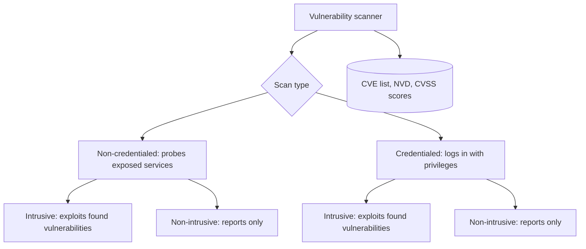
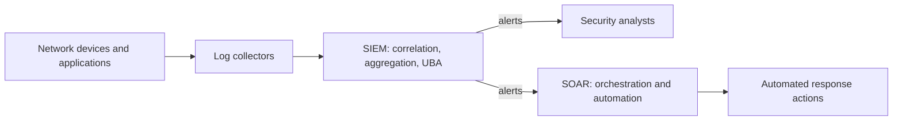
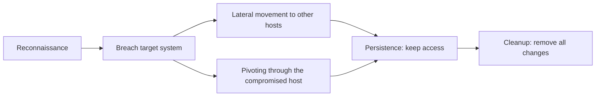
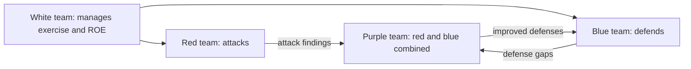
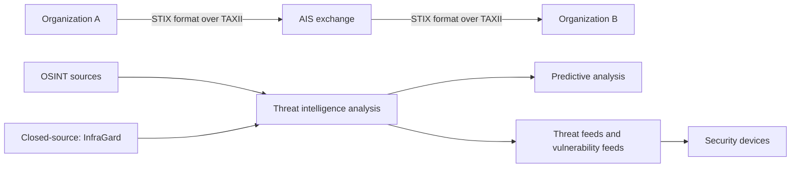

# Chapter 13: Security Assessment

## Abstract

Security assessment tests whether a system's controls work as intended. Vulnerability scanners such as Nessus and OpenVAS identify and rank weaknesses using the CVE list, the NVD repository, and CVSS scores from 0 to 10. Event management combines SIM log collection with SEM pattern analysis in SIEM systems, and SOAR adds automated response. Penetration testing authorizes simulated attacks across unknown, partially known, and known environments, guided by rules of engagement. Four security teams (red, blue, purple, white) run exercises, and decoys such as honeypots reveal attacker tactics, techniques, and procedures. Threat intelligence flows through AIS, STIX, and TAXII, while indicators of attack and indicators of compromise signal threats before and after a breach. Automation covers access management, resource configuration, and incident response, and vulnerability management runs a 6-phase cycle from identification to reporting.

## Content

### 1. Vulnerability scans

#### Vulnerability scanners

Security assessment is the testing and evaluation of a system's security controls. A system can be a computer, network, native application, or web app. The assessment verifies that controls are implemented correctly and operating as intended.

A vulnerability scanner is a program that scans a system for known vulnerabilities. Nessus and OpenVAS are vulnerability scanners. A scanner identifies vulnerabilities, prioritizes them by severity, and recommends remediation. OpenVAS, for example, can find an unpatched vulnerability on a Windows 11 device, rank it by severity, and supply patching guidelines.

#### Vulnerability databases

Three resources give scanners their knowledge base:

- Common Vulnerabilities and Exposures (CVE) is a list of publicly disclosed vulnerabilities, maintained by the MITRE Corporation with US Department of Homeland Security funding. Each record carries a unique CVE ID with the year and a 4 or 5 digit number. CVE-2022-0001 was the 1st vulnerability made public in 2022, and CVE-2023-33974 was the 33,974th vulnerability made public in 2023.
- The National Vulnerability Database (NVD) is the US government repository of standards-based vulnerability management data, maintained by NIST. The NVD stores security checklist references, software flaws, misconfigurations, product names, and impact metrics.
- The Common Vulnerability Scoring System (CVSS) is an open industry standard that scores vulnerability severity from metrics of exploitation ease and impact. A CVSS score ranges from 0 to 10, where 10 is the most severe. The NVD uses CVSS to rate each CVE record.

#### Vulnerability scan types

Two scan types exist:

- A non-credentialed scan, also called unauthenticated, probes the network services a system exposes. Such a scan identifies open ports and the vulnerable services behind them.
- A credentialed scan, also called authenticated, runs with system privileges. The scanner logs in and reads components and configurations directly, so it finds more vulnerabilities, such as software misconfigurations and missing operating system patches.

Either scan type runs as intrusive or non-intrusive. An intrusive scan attempts to exploit the vulnerabilities it finds, such as installing malware through an SMB vulnerability on TCP port 445. A non-intrusive scan only identifies and reports vulnerabilities, such as a weak hashing algorithm in a web server's SSL certificate.

|  | Credentialed | Non-credentialed |
| --- | --- | --- |
| Authentication | Required | Not required |
| System impact | Low | High |
| Scan speed | Slow | Fast |
| Accuracy of results | High | Low |
| Primary user | System owner | Attacker |

Table 1. Credentialed scans trade speed for accuracy, while non-credentialed scans run fast from an attacker's viewpoint.

#### Vulnerability scan errors

Two error types occur in scans:

- A false positive, or Type I error, flags a state as vulnerable when no vulnerability exists. Flagging a database server for missing authentication when the server authenticates all users is a false positive. Non-credentialed scans produce false positives often, because the scanner sees only a subset of the needed information.
- A false negative, or Type II error, misses a real vulnerability. Missing a misconfigured web server that allows SQL injection is a false negative. Every zero-day vulnerability is a false negative, because scanners know only known vulnerabilities.

False negatives carry more damage potential than false positives, because undetected vulnerabilities stay exploitable.

|  | False positive | False negative |
| --- | --- | --- |
| Error | Type I | Type II |
| Vulnerability | Does not exist | Exists |
| Root cause | Insufficient information during a scan | Outdated vulnerability databases, zero-day vulnerabilities |

Table 2. False positives flag nonexistent vulnerabilities, and false negatives leave real vulnerabilities undetected and exploitable.

#### SCAP

Security Content Automation Protocol (SCAP) is a collection of open standards from NIST that automates the securing of IT systems. SCAP standardizes vulnerability management, measurement, and policy compliance evaluation across platforms. SCAP integrates individual standards such as CVE and Common Configuration Enumeration (CCE), so organizations can scan for vulnerabilities and check configurations against benchmarks, the standardized sets of best practices and configuration settings.

Figure 1. A scanner draws on the CVE, NVD, and CVSS databases and runs in credentialed or non-credentialed mode, each as intrusive or non-intrusive.

### 2. Event management

#### SIM and SEM

Two practices turn log data into assessment results:

- Security information management (SIM) collects, stores, and manages log data from network devices and software applications. Log data is a timestamped record of an event, such as a VPN server recording a username and a login attempt time. A SIM system offers search, aggregation, and visualization.
- Security event management (SEM) monitors, identifies, and reports security-related events. A SEM system applies statistical analysis to find relationships and patterns in log data. A SEM system can detect an IoT device's malware infection by correlating firewall, router, and IPS logs.

#### SIEM

Security information and event management (SIEM) combines SIM and SEM in one system. A SIEM system collects and analyzes log data, correlates events in real time, detects threats, and generates alerts. SIEM systems ingest syslog data, a message logging standard, and use network packet captures for added insight.

A log collector is a process or agent that gathers log data from various systems. Log aggregation combines similar events to cut event volume, using parameters such as source IP address, destination IP address, or event ID. Aggregating all log data with destination IP address 74.158.57.62 is one example. Monitoring runs agent-based, with software installed on targets for detailed collection, or agentless, through existing network protocols.

Correlation rules define how a SIEM system generates alerts. A simple rule pairs one event type with a response, such as a ZIP file attached to an email. A composite rule combines 2 or more simple rules, such as 6 failed VPN authentication attempts from one IP address within 5 minutes.

User behavior analytics (UBA) applies behavioral analytics and machine learning to flag abnormal user behavior. UBA catches insider threats and attacks using compromised insider credentials by spotting deviations from normal behavior.

#### SOAR

Two processes automate assessment and prioritization:

- Security orchestration integrates and analyzes data from separate security systems, such as a network intrusion detection system, a host-based firewall, and a wireless intrusion prevention system.
- Security automation executes security operations tasks without human intervention, such as automated vulnerability scans and log analysis.

Security orchestration, automation, and response (SOAR) combines both to respond to security events with limited or no human intervention. SOAR automates vulnerability scanning, log analysis, auditing, and incident handling. Automated reports and dashboards visualize data in real time, and threat intelligence feeds in dashboards raise situational awareness. Attestation adds third-party verification of compliance and control effectiveness, and an audit committee oversees the process. Internal compliance work and self-assessments prepare the organization for external audits.

|  | SIEM | SOAR |
| --- | --- | --- |
| Data sources | Log and event data | Security alerts and threat intelligence |
| Notifications | Generates alerts | Ingests alerts from SIEM and other sources |
| Primary tasks | Analyzes and correlates data to identify potential threats | Enriches and correlates alerts to determine risk |
| Threat response | Notifies security analysts | Automatically orchestrates actions across integrated tools |

Table 3. SIEM analyzes and alerts, while SOAR ingests alerts and acts.

Figure 2. SIEM correlates log data into alerts, and SOAR turns alerts into automated responses.

#### Threat hunting

Threat hunting is the proactive search for undetected threats on a network, aimed at incidents that detection systems such as SIEM missed. Threat hunting assumes a breach has already happened and works to contain attacks before damage. Hunters draw on security advisories and bulletins, threat feeds, user behavior analytics, and vulnerability databases.

### 3. Penetration testing

#### Testing types and rules of engagement

Penetration testing, also called pentesting or ethical hacking, is an authorized attack on a system that evaluates security by using attacker tools and techniques. Four testing types exist:

- Physical penetration testing evaluates locks and access controls.
- Offensive penetration testing attacks security measures from an attacker's perspective.
- Defensive penetration testing measures how well defensive mechanisms resist unauthorized access.
- Integrated penetration testing combines offensive and defensive testing into one assessment.

A rules of engagement (ROE) document defines the conditions and limitations of the test. The organization establishes the ROE before testing starts, giving pentesters authority for defined activities without further permissions. The ROE covers testing type, scope, and procedures for handling sensitive data.

#### Pentesting environments

Three environments exist. In an unknown environment, or closed-box testing, the pentester receives no information about target systems. In a partially known environment, the pentester receives limited information about some targets. In a known environment, or open-box testing, the pentester receives full privileges and information on all targets.

|  | Unknown environment | Partially known environment | Known environment |
| --- | --- | --- | --- |
| Objective | Mimic a true attack | Evaluate vulnerability to insider threats | Simulate an attacker with a privileged account |
| Access level | No access | Limited access | Full access |
| Advantages | Most realistic, from the attacker's point of view | Most efficient in time and money | Most comprehensive, least likely to miss a vulnerability |
| Disadvantages | Time consuming, more likely to miss a vulnerability | May miss vulnerabilities on undocumented systems | More information disclosed to pentesters |

Table 4. Realism falls and coverage rises as the pentester receives more information.

#### Reconnaissance

Reconnaissance, also called footprinting, discovers a target system's potential vulnerabilities before the attack. Two types exist:

- Active reconnaissance collects information through direct interaction, such as a port scan on a web server. Active reconnaissance returns actionable results quickly but is noisy and detectable.
- Passive reconnaissance collects information without direct interaction, such as open-source intelligence (OSINT) on a company's employees. Passive reconnaissance runs slower but carries a lower detection risk.

Two passive techniques search for wireless networks. War driving searches from a moving vehicle. War flying searches from a flying object such as a drone, helicopter, or airplane. Pentesters combine both types, for example war driving to locate a wireless network and then pinging a wireless access point on that network.

#### Penetration testing techniques

Pentesters find and exploit vulnerabilities across as many systems as possible:

- Lateral movement moves from one compromised host to another host on the same network, such as moving from an application server to a database server. Lateral movement also covers privilege escalation on the same host, such as gaining administrator or root access on a compromised database server.
- Pivoting uses a compromised system as a launch platform for attacks on other systems, bypassing controls such as firewalls that block direct access to internal systems.
- Persistence keeps access through changed credentials, restarts, and other disruptions. Techniques include adding startup scripts, creating privileged accounts, and scheduling system tasks.
- Cleanup removes all changes made during an attack, such as deleting created accounts, reverting configuration changes, and removing log files.

Figure 3. A penetration test moves from reconnaissance through breach, lateral movement or pivoting, persistence, and cleanup.

#### Responsible disclosure

A responsible disclosure program provides a framework for reporting and resolving vulnerabilities in a controlled, ethical way. A bug bounty program is a responsible disclosure component where a vendor rewards individuals for finding and reporting vulnerabilities in software or a website, with recognition or compensation. Bug bounties engage a broad community of security researchers and speed early detection.

### 4. Security teams and TTP analysis

#### Security teams

A security exercise tests an organization's security posture through simulated attacks and incident response. Four teams participate:

- A red team attacks the organization. Members can be internal or external.
- A blue team defends the organization by finding and removing vulnerabilities and verifying control effectiveness.
- A purple team temporarily combines red and blue teams so the blue team improves defenses through collaboration.
- A white team manages red and blue operations and establishes the rules of engagement for the red team.

Figure 4. The white team manages the exercise, the red team attacks, the blue team defends, and the purple team merges both sides to improve defenses.

#### TTP analysis and decoys

Tactics, techniques, and procedures (TTPs) are the activity patterns and methods tied to a specific attacker or group, such as phishing emails from one domain. TTP analysis helps security teams detect and mitigate attacks by understanding how attackers operate. Decoys lure attackers into a controlled environment for monitoring. Four decoy types exist:

- A honeyfile is a fake file placed to detect an attacker. Names are chosen to attract attackers, such as password.txt.
- A honeytoken is a decoy data element or resource, such as a fake database record that triggers an alert when accessed.
- A honeypot is a single service or networked computer placed in an isolated, monitored environment, typically a DMZ, to study attacks.
- A honeynet is a network of honeypots built with intentional vulnerabilities. Fake telemetry from network devices gives attackers extra targets.

Honeypots, honeynets, and honeyfiles also divert malicious traffic away from real systems, networks, and files. The term honeypot comes from espionage, where a fake romantic relationship baits a target into handing over secrets.

### 5. Threat intelligence and research sources

#### Threat intelligence sharing

Organizations share threat intelligence to reduce the impact of new threats and to automate defenses, such as blocking a malicious IP address that another organization identified. Automated indicator sharing (AIS) is a US government capability for real-time threat intelligence exchange. AIS moves threat indicators through 2 standards:

- Structured threat information expression (STIX) is a standardized markup language for expressing threat intelligence.
- Trusted automated exchange of intelligence information (TAXII) is an application protocol for sharing threat intelligence.

#### Threat intelligence sources

A threat intelligence source is a public or private information resource on threats, attacks, and attackers. Open-source intelligence (OSINT) comes from publicly available information, such as data on an employee's LinkedIn profile. Closed-source intelligence stays private to a specified group. InfraGard, maintained by the US Federal Bureau of Investigation, restricts its intelligence to members of critical infrastructure industries such as energy and healthcare. Predictive analysis applies intelligence to estimate the likelihood of future security events.

#### Commercial services and feeds

Commercial threat intelligence services gather and analyze intelligence for clients that lack the resources to do so. The IntSights service integrates with an organization's Active Directory, and when IntSights finds compromised credentials on the dark web, it locks the account and prompts the user to reset the credentials.

Intelligence flows through continuously updated feeds. Threat feeds describe known threats and threat actors so organizations can defend against known TTPs. CrowdStrike Falcon Intelligence includes threat feeds that security devices read and interpret. Vulnerability feeds track current risks. A vulnerability database stores and disseminates vulnerability information through feeds. The US government maintains the NVD at no cost and offers JSON vulnerability feeds.

Figure 5. AIS exchanges STIX-formatted indicators over TAXII between organizations, while OSINT and closed-source intelligence feed analysis, prediction, and device-readable feeds.

### 6. Indicators of attack and compromise

#### IoA versus IoC

An indicator of attack (IoA) is an abnormal or suspicious sign of a potential security incident, detected through network traffic, system logs, or security data analysis. Frequent failed login attempts over a short timeframe indicate a brute-force attack. IDS and SIEM tools use IoAs to identify and address security issues.

An indicator of compromise (IoC) is a specific data point or artifact that proves a past breach. A system file whose cryptographic hash matches a known malware hash indicates compromise. IoCs support threat investigation and response.

| Aspect | IoA | IoC |
| --- | --- | --- |
| Characteristics | Patterns indicating suspicious activity | Clear signs of security breaches |
| Purpose | Detect and respond to emerging or active threats | Investigate and respond to confirmed breaches |
| Detection | Monitor network traffic and analyze system logs | Identify specific artifacts such as malware signatures |
| Focus | Identify potential attack methods and strategies | Determine the extent and impact of breaches |
| Outcomes | Prevent potential incidents, minimize current threats | Remediate breaches, refine policy |
| Examples | Unusual network traffic, repeated failed logins, firewall activity spikes | Unauthorized registry changes, unexpected account creation, file tampering evidence |

Table 5. IoAs signal attacks in progress, and IoCs confirm breaches that already happened.

#### Common IoAs

IoAs expose attacker TTPs through behavior patterns and anomalies. Account lockouts from repeated failed logins and concurrent sessions from multiple locations suggest brute force attacks and account compromise. Impossible travel alerts, triggered by logins from distant locations in a short timeframe, indicate credential misuse. Frequent content blocks by firewalls and spikes in CPU or memory usage indicate malware or unauthorized processes. Missing logs and unusual login times suggest attackers covering their tracks.

| IoA | Likely attack type | Impacted security principle |
| --- | --- | --- |
| Account lockout | Brute force | Availability |
| Resource consumption | DDoS, malware |  |
| Resource inaccessibility | Ransomware, network |  |
| Published vulnerability exploitation | Targeted exploits | Availability, Integrity |
| Impossible travel | Credential fraud | Confidentiality |
| Concurrent session | Account hijacking | Confidentiality, Integrity |
| Blocked content | Malware, phishing |  |
| Out-of-cycle logging | Unauthorized access |  |
| Missing logs | Tampering | Integrity |

Table 6. Nine common IoAs, their likely attack types, and the security principles at risk.

#### Common IoCs

IoCs supply evidence that a breach occurred. IoCs range from malware signatures found by antivirus scans to unusual outbound traffic that suggests data exfiltration. File integrity changes indicate unauthorized access or tampering. Sudden file encryption and ransom notes signal ransomware. Deleted or modified system logs show hidden malicious activity. Early IoC recognition enables rapid forensic analysis and containment, which limits breach damage.

| IoC | Likely attack type | Impacted security principle |
| --- | --- | --- |
| Sudden file encryption | Ransomware | Availability |
| Unusual outbound traffic | Data exfiltration | Confidentiality |
| Unauthorized user activities | Unauthorized access |  |
| Suspicious network connections | Command and control communication |  |
| Unexplained user accounts | Privilege escalation |  |
| Malware signatures | Malware infection | Integrity |
| File integrity changes | Tampering |  |
| Deleted or modified system logs | Obfuscation, covering tracks |  |
| Anomalous database read/write | SQL injection, database breach |  |

Table 7. Nine common IoCs, their likely attack types, and the security principles at risk.

Combining IoAs and IoCs with OSINT and the STIX and TAXII sharing standards builds a complete security strategy. OSINT data linked to known IoAs and IoCs improves prediction and response.

### 7. Security automation and orchestration

#### User access management

Three components automate secure access management:

- Automated user provisioning manages the account lifecycle across IT systems, creating, updating, and removing accounts under the principle of least privilege.
- Automated security group management creates, modifies, and manages security groups, cutting manual overhead and errors.
- Automated access control for services adjusts access rights when a user's role changes or access is no longer needed, preventing unauthorized access.

Configuration enforcement is the automated application and verification of security settings against defined standards. In access management, configuration enforcement keeps provisioning and access control aligned with security policy.

| Component | Objective | Process | Benefit |
| --- | --- | --- | --- |
| Automated user provisioning | Align access with user roles | Create, update, remove accounts, assign permissions | Secure role-based access, fewer unauthorized access risks |
| Automated security group management | Manage permissions efficiently | Group users by access needs, assign group permissions | Simpler access control, higher administrative efficiency |
| Automated access control | Match access to current roles | Activate or deactivate access on role changes | Access stays aligned with current roles |

Table 8. Three access management automation components.

#### Resource management and configuration

Two processes automate resource management:

- Automated resource provisioning allocates and manages computing resources such as virtual machines, networks, and storage under best practices that prevent unauthorized access.
- Automated guard rails maintain compliance with security policies through checks that block misconfigurations and hold deployments to organizational standards.

Configuration enforcement keeps provisioning and guard rails consistent with security standards, reducing misconfiguration risk.

#### Incident response and security operations

Four automated processes structure incident management:

- Automated ticket creation starts incident response when potential issues appear, ensuring timely documentation and reducing human error.
- Automated escalation raises an incident's priority and informs the relevant management levels or specialized teams.
- Automated security testing catches vulnerabilities early by integrating security measures throughout the development lifecycle.
- Automated system integration connects security tools through application programming interfaces (APIs), enabling shared information and unified response.

#### Playbooks

A playbook is a predefined set of rules, procedures, and actions that automates responses to security events or implements configuration changes. Playbooks follow best practices and organizational policies to keep responses consistent, fast, and effective. Integration with security tools coordinates detection, investigation, and remediation across environments, cutting human error and response time.

### 8. Vulnerability management

#### Response and remediation

Vulnerability management is the process of identifying, assessing, prioritizing, remediating, verifying, and reporting security vulnerabilities in an IT environment. The goal is the confidentiality, integrity, and availability of information assets. Regular operating system patching reduces exploitation risk. Cybersecurity insurance covers post-breach recovery costs. Network segmentation limits lateral movement by partitioning the network into isolated segments.

Compensating controls mitigate vulnerability risk when direct remediation is impossible. Examples include enhanced monitoring for unusual activity and limits on USB drive use to prevent malware infections and data leakage.

| Phase | Description | Example |
| --- | --- | --- |
| Identification | Detect vulnerabilities with tools and techniques | Scan for network devices using default passwords |
| Assessment | Evaluate severity and impact with metrics such as CVSS | Assess the severity of an SQL injection vulnerability |
| Prioritization | Rank by severity, exploitability, and impact within risk tolerance | Prioritize a critical remote code execution flaw |
| Remediation | Fix through patches, configurations, or other measures | Patch a security flaw in an application |
| Verification | Confirm resolution without new issues | Rescan to confirm a patch's effectiveness |
| Reporting | Document findings, actions, and outcomes | Generate an audit compliance report |

Table 9. The 6 vulnerability management phases.

Figure 6. Vulnerability management cycles through 6 phases, and failed verification returns work to remediation.

#### Exemptions and exceptions

Two practices keep protection in place when standard protocols fall short:

- An exemption grants formal permission to bypass a specific policy or control when compliance is impossible or impractical. An outdated but critical application can run without the latest patch when the patch would disable essential functionality.
- An exception grants a temporary deviation from policy under specific conditions for a limited time while a permanent solution is developed. Less secure access methods can run temporarily during an emergency, with a deadline to revert.

| Aspect | Exemption | Exception |
| --- | --- | --- |
| Purpose | Compliance is not possible or practical | Address specific conditions or emergencies |
| Duration | Typically long-term | Temporary, with a defined timeframe |
| Compliance requirement | Not feasible or practical | Actively working toward lasting compliance |
| Potential risks | Increased vulnerability from missing updates or controls | Temporary weakening of security posture |
| Example | A critical medical device runs without the latest update due to compatibility issues | Critical system access from untrusted locations during a natural disaster |

Table 10. An exemption is long-term, and an exception is temporary with a deadline.

#### Validation of remediation

Validation confirms that remediation worked through 3 processes. Rescanning checks that patches applied correctly, such as a post-update firewall scan confirming the closure of vulnerable ports. Internal and external audits review policy adherence and control effectiveness, such as checking user accounts for compliance with stricter password policies. Verification confirms that remediation actions mitigated the identified risks. Reporting documents discovery, remediation, and validation so stakeholders can plan future security investments. A quarterly report might record 15 vulnerabilities found and 12 fixed, with an effective SQL injection patch highlighted.

#### The dark web

The dark web is an encrypted part of the Internet that conventional search engines do not index, accessible only through specialized tools. Anonymity on the dark web supports illicit transactions and the exchange of exploitation tools and zero-day vulnerabilities. Monitoring dark web activity detects threats early and shifts vulnerability management from reactive to proactive.

## Summary

- Security assessment verifies that controls are implemented correctly and operating as intended. Vulnerability scanners such as Nessus and OpenVAS identify, prioritize, and recommend remediation for known vulnerabilities.
- CVE records carry IDs with the year and a 4 or 5 digit number, such as CVE-2022-0001 for the 1st disclosure of 2022. The NIST-maintained NVD scores each CVE with CVSS, on a scale from 0 to 10.
- Credentialed scans log in with privileges and deliver high accuracy at slow speed, while non-credentialed scans probe exposed services quickly with low accuracy. Intrusive scans exploit found vulnerabilities, and non-intrusive scans only report.
- False positives (Type I) flag nonexistent vulnerabilities, and false negatives (Type II) miss real ones. All zero-day vulnerabilities are false negatives, and false negatives carry the higher damage potential.
- SCAP integrates standards such as CVE and CCE to automate vulnerability management and benchmark compliance checks.
- SIM collects and stores log data, and SEM finds threat patterns in that data. SIEM combines both with real-time correlation, log aggregation, and UBA. A composite rule example triggers on 6 failed VPN attempts from one IP address in 5 minutes.
- SOAR combines security orchestration and automation to respond with limited or no human intervention. SIEM notifies analysts, while SOAR orchestrates actions across integrated tools.
- Penetration testing runs 4 types (physical, offensive, defensive, integrated) under a rules of engagement document. Unknown, partially known, and known environments trade realism against coverage.
- Active reconnaissance such as port scans is fast and noisy, and passive reconnaissance such as OSINT, war driving, and war flying is slow and quiet. Lateral movement, pivoting, persistence, and cleanup structure the attack phase.
- Four security teams run exercises: red attacks, blue defends, purple combines both, and white manages operations and the ROE.
- Four decoys study attackers: honeyfiles such as password.txt, honeytokens such as fake database records, honeypots in a DMZ, and honeynets with intentional vulnerabilities.
- AIS exchanges threat intelligence in real time using STIX as the format and TAXII as the protocol. OSINT uses public data such as LinkedIn profiles, while closed-source intelligence such as InfraGard stays limited to critical infrastructure members.
- IoAs such as repeated failed logins signal active threats, and IoCs such as a file hash matching known malware confirm past breaches. Tables 6 and 7 list 9 IoAs and 9 IoCs with likely attack types.
- Automation covers 3 access management components, 2 resource management processes, and 4 incident response processes, with playbooks defining automated responses.
- Vulnerability management runs 6 phases: identification, assessment, prioritization, remediation, verification, and reporting. Compensating controls such as enhanced monitoring and USB limits apply when direct remediation is impossible.
- An exemption bypasses policy long-term, such as an unpatched critical medical device, and an exception deviates temporarily with a deadline, such as untrusted access during a natural disaster.
- Validation uses rescanning, audits, and verification. Dark web monitoring shifts vulnerability management from reactive to proactive.

## Useful References and Resources

- MITRE. CVE program, the list of publicly disclosed vulnerabilities. <https://www.cve.org/>
- NIST. National Vulnerability Database. <https://nvd.nist.gov/>
- FIRST. Common Vulnerability Scoring System (CVSS) specification. <https://www.first.org/cvss/>
- NIST. Security Content Automation Protocol (SCAP). <https://csrc.nist.gov/projects/security-content-automation-protocol>
- Tenable. Nessus vulnerability scanner. <https://www.tenable.com/products/nessus>
- OpenVAS. Open source vulnerability scanner. <https://www.openvas.org/>
- OASIS. STIX and TAXII standards for threat intelligence. <https://oasis-open.github.io/cti-documentation/>
- CISA. Automated Indicator Sharing (AIS). <https://www.cisa.gov/topics/cyber-threats-and-advisories/information-sharing/automated-indicator-sharing-ais>
- InfraGard. FBI partnership for critical infrastructure protection. <https://www.infragard.org/>
- CrowdStrike. Falcon Intelligence threat feeds. <https://www.crowdstrike.com/en-us/platform/threat-intelligence/>
- NIST Special Publication 800-40, "Guide to Enterprise Patch Management Planning," covering vulnerability remediation and preventive maintenance. <https://csrc.nist.gov/publications/detail/sp/800-40/rev-4/final>
