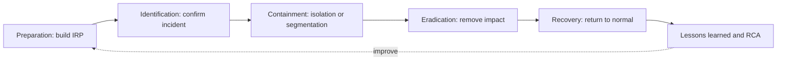
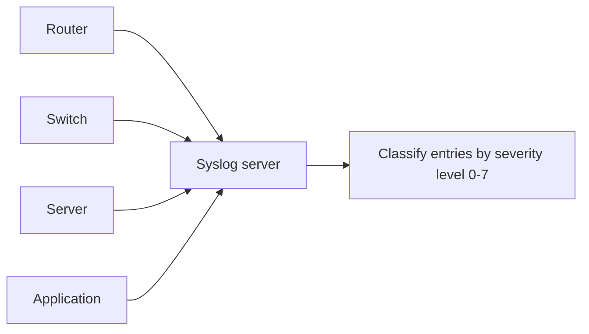
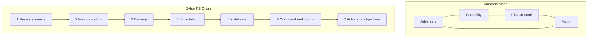
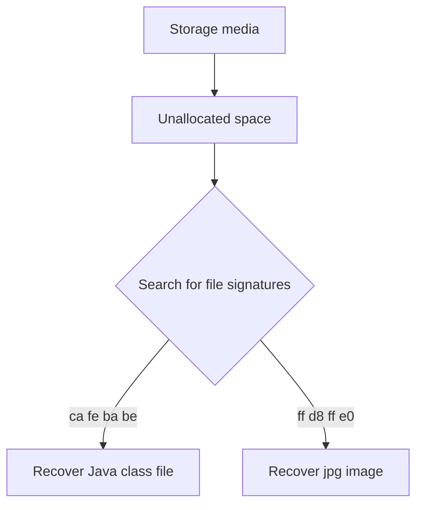

# Chapter 14: Incident Response and Digital Forensics

## Abstract

Incident response (IR) follows a sequence of preparation, identification, containment, eradication, recovery, and lessons learned, all documented in an incident response plan. Identification draws on software resources such as Netflow, sFlow, IPFIX, and protocol analyzers, plus metadata, basic logs, and syslog with 8 severity levels from emergency to debug. Containment uses quarantine, isolation, and segmentation, followed by endpoint reconfiguration and network configuration changes. Attack frameworks such as MITRE ATT&CK, the Diamond Model, and Cyber Kill Chain support IR exercises that run as tabletop, walkthrough, or simulation. Digital forensics collects, examines, analyzes, and reports on electronic evidence under chain of custody and provenance rules, acquires data in the RFC 3227 order of volatility, verifies integrity with cryptographic hashes, and recovers deleted files through file carving with magic numbers.

## Content

### 1. Incident response development

#### Preparation and identification

IR preparation starts with the IR team, a cross-functional group that develops the incident response plan. The team reuses existing plans, policies, and procedures during preparation. An IRP, for example, uses the organization's communication plan for stakeholder management and the retention policy for data loss prevention. An incident response plan (IRP) is the set of processes an organization follows to recognize, respond to, and recover from an incident.

Identification follows preparation and runs only when an incident is suspected. The goal of identification is to confirm whether an incident occurred.

#### Containment and eradication

Three containment strategies exist:

- Containment prevents an incident from reaching other network resources.
- Isolation limits an incident's impact to a single network resource.
- Segmentation limits an incident's impact to a small group of network resources.

Eradication follows containment by removing the incident's impact, such as using anti-malware software to remove malware from an infected computer. Containment and eradication can rely on a business continuity plan (BCP) when an impacted resource needs downtime. A BCP, for example, determines how to keep network connectivity while a router is replaced.

#### Recovery and lessons learned

Incident recovery is the return to normal operation after eradication. Recovery and lessons learned run only when eradication succeeds, because an ineradicable incident keeps damaging resources. Recovery can reference the BCP, such as using the replication information in a BCP when a server backup is required.

Lessons learned reviews a recent incident to find improvement opportunities, across project management, incident response, and disaster recovery. A lesson learned from a server recovery, for example, is scheduling more frequent backups to cut recovery time. Root cause analysis (RCA) is a systematic approach that determines an incident's root causes. A breach caused by a stolen password, for example, leads an organization to adopt two-factor authentication.

Figure 1. The IR lifecycle runs from preparation to lessons learned, and lessons learned feeds improvements back into preparation.

### 2. IR identification resources

#### Software resources

Software is accessed through 3 interface types:

- A command-line interface (CLI) executes text commands through a keyboard.
- A graphical user interface (GUI) uses menus and icons through a pointing device.
- A network platform is a proprietary CLI or GUI for a vendor-specific device.

Software resources that identify incidents include:

- A vulnerability scan, run by software to identify a device's vulnerabilities.
- A bandwidth monitor, which measures the data volume a connection transfers.
- Netflow, a Cisco-proprietary protocol that collects inbound and outbound traffic flows on Cisco devices.
- Sampled flow (sFlow), which randomly samples and collects network traffic.
- IP flow information export (IPFIX), an industry standard for collecting and visualizing IP flow.
- A protocol analyzer, which intercepts and classifies network traffic by protocol.

#### Metadata

Metadata is data that describes or identifies other data. Examples include a file's creation timestamp, a sending email server's information, a hosting web server's information, and the GPS coordinates of a photo from a mobile device. Metadata supports incident identification, such as finding an unauthorized file modification through the file's modification timestamp.

#### Basic logs

A device log is a text file of device events, kept on the local device by default. Two primary log types exist:

- A traffic log records incoming and outgoing network traffic events.
- An audit log records system events such as failed and successful login attempts.

Other device logs include a network device log for switch or router traffic, a system device log for server application and security events, a web log of client requests to a website, and a DNS log of resolution requests and responses.

#### System logging protocol

Syslog is a network protocol that sends log entries from a device or application to a syslog server, a node configured to receive logs from syslog-configured devices. Syslog classifies entries into 8 descending severity levels:

- Level 0, emergency: the system is unusable.
- Level 1, alert: an emergency event is likely.
- Level 2, critical: an alert event is likely.
- Level 3, error: a non-critical event occurred.
- Level 4, warning: an error event is likely.
- Level 5, notification: a normal event needs attention.
- Level 6, informational: a normal event needs no attention.
- Level 7, debug: a normally hidden background event.

| Level | Severity | Example |
| --- | --- | --- |
| 0 | Emergency | Loss of primary ISP connectivity |
| 1 | Alert | Loss of backup ISP connectivity |
| 2 | Critical | Port failure |
| 3 | Error | Network interface down |
| 4 | Warning | Hard drive with less than 1% available storage |
| 5 | Notification | Software license expiring in 30 days |
| 6 | Informational | Word processing application opened |
| 7 | Debug | FTP download progress |

Table 1. The 8 syslog severity levels, from level 0 emergency to level 7 debug.

Figure 2. Devices and applications send log entries to a central syslog server, which classifies each entry by severity.

#### Advanced logs

A basic log entry holds a timestamp and a brief event description. An advanced log entry carries more detail, such as a VoIP log entry with the authenticated user, protocol, and session information. Syslog collects advanced logs through a daemon, a background service process. Three syslog daemons exist:

- Syslogd, the legacy daemon on older Linux distributions.
- Syslog-ng (syslog next generation), a daemon with advanced features.
- Rsyslog, the daemon on most modern Linux distributions.

Advanced logs focus on an operating system or application. Examples include the journalctl log, the querying service for the Linux systemd system manager, a dump file that captures point-in-time system or application status in text, and a session initiation protocol (SIP) log of voice, video, and messaging session events.

### 3. IR containment and eradication techniques

#### Reconfigure endpoint security

Quarantine is the process of isolating a compromised endpoint or data to prevent further compromise. A quarantined resource rejoins the network once the incident's source is eradicated. Before reintegration, an endpoint may need security reconfiguration:

- Install required security updates through patch management.
- Install required anti-malware updates through malware protection.
- Configure a host-based firewall through host-based security.
- Deploy EDR or ETDR through endpoint hardening.
- Apply disk encryption through disk hardening.

Lessons learned may identify a compromised application as the incident source. An application approved list is a policy and configuration listing allowed applications. An application deny list, also called a blocklist, is a policy and configuration listing disallowed applications.

#### Configuration changes

Network-level configuration changes stop future incidents, such as blocking a malicious IP address with a firewall rule. Post-incident changes include updating firewall rules, converting existing firewalls to NGFWs, enhancing DLP techniques, updating content or URL filters, and updating or revoking certificates. An incident involving a mobile device can justify mobile device management (MDM), the hardware and software that centralize configuration, monitoring, and management of mobile devices.

#### SOAR in incident response

The 5W information gathering approach asks who, what, when, where, and why, and 5W1H adds how for problem solving. Security orchestration, automation and response (SOAR) coordinates, executes, and automates tasks between people and tools in one platform. Four SOAR components apply to IR:

- Security: the organization's commitment to secure data and operations.
- Orchestration: the coordination of all security efforts toward one goal.
- Automation: automatic processes that streamline security efforts.
- Response: the IR component ensuring every incident receives a response.

### 4. IR attack frameworks and exercises

#### Attack frameworks

An attack framework provides third-party guidelines, best practices, and policies focused on a specific attack type, such as an intrusion attack. Three attack frameworks exist:

- MITRE Adversarial Tactics, Techniques, and Common Knowledge (MITRE ATT&CK) is a database of attacks used in IR exercises to evaluate an IRP's effectiveness.
- The Diamond Model of Intrusion Analysis maps the relationships among an incident's core components, showing how an adversary's traits, capabilities, and infrastructure target specific victims.
- The Cyber Kill Chain lays out the steps an attacker must complete, with the goal of stopping the attacker's progress as early as possible.

Figure 3. The Diamond Model connects an incident's adversary, capability, infrastructure, and victim, while the Cyber Kill Chain orders the 7 steps an attacker must complete, from reconnaissance to actions on objectives.

#### IR exercises

An IR exercise combines an attack framework with the organization's IRP to evaluate IR efforts. Three exercise types exist:

- A tabletop exercise talks the IR team through each IRP step.
- A walkthrough exercise walks the IR team through each IRP step without taking action.
- A simulation exercise executes the IRP on a simulated incident.

Incident response can also involve failover, the automatic switch to redundant systems when a primary system fails, tested during simulation exercises. Parallel processing runs tasks across multiple computing resources at once, which raises efficiency in scenarios simulated during tabletop or walkthrough exercises.

### 5. Digital forensics

#### Digital forensics

Digital forensics is a branch of forensic science that collects, examines, analyzes, and reports on electronically stored or processed data. Uses include investigating digital crimes, identifying internal policy violations, recovering from system damage or data loss, and reconstructing security incidents. Investigations cover unauthorized access to a computer or a distributed denial-of-service (DDoS) attack against a web server. Sub-branches include computer forensics, network forensics, database forensics, and cloud forensics. Computer forensics, for example, covers data in a computer's volatile memory, registers, and storage media.

| Stage | Activities |
| --- | --- |
| Collection | Identify, label, record, and acquire data from all relevant sources |
| Examination | Process collected data with automated and manual methods, extract data of interest |
| Analysis | Derive useful information that answers the questions behind the collection |
| Reporting | Report results, describe actions taken, explain tool and procedure selection |

Table 2. The 4 digital forensic stages.

#### Digital evidence

Digital evidence is electronic data of value to an investigation that is stored on, processed, received, or transmitted by an electronic device. A video file on a mobile device is digital evidence when the file relates to an intellectual property theft case.

Forensic reports present digital evidence with event timelines and timestamps. A timestamp is a digital record of when an event occurred, tracking data creation, access, and modification. Operating systems, applications, and firmware can record timestamps in different time zones. A time offset is the difference between local time and Greenwich Mean Time (GMT). Eastern Standard Time runs 5 hours behind GMT, so EST timestamps carry an offset of -5 hours.

Physical devices holding digital evidence are tagged, labeled, and photographed for reports, such as a photo of a tagged SSD. Reports also include interview summaries, such as an interview with someone who witnessed an unauthorized person entering company premises.

#### Chain of custody and provenance

The chain of custody tracks evidence movement through collection, preservation, and analysis. The documentation records each handler, each transfer date and time, and the purpose of each transfer. The chain of custody preserves evidence integrity and holds handlers accountable, and maintaining it is required for admissibility in court.

Provenance records a piece of data's origin and history: where the data came from, how the data changed, and how the data moved. A file's provenance covers how and where the file was created and every action performed over the file's life span. Accurate provenance ensures evidence credibility, authenticity, and integrity.

Both practices document evidence history. Chain of custody covers the physical handling of evidence in investigations, while provenance establishes the complete history of the data itself.

#### Legal holds

A legal hold identifies and preserves all data potentially relevant to anticipated litigation against an organization. The legal team typically sends employees a notification instructing them not to delete information relevant to the case.

### 6. Digital evidence acquisition

#### Acquisition and forensic artifacts

Digital evidence acquisition collects investigation-relevant data while preserving data integrity, such as acquiring data from a server's memory without modifying it. Evidence can reside in memory, storage media, operating system logs, and network devices. A forensic artifact is any data that could serve as digital evidence, such as logs, registry keys, and file timestamps. An artifact becomes digital evidence only when relevant to an investigation. A file timestamp is a forensic artifact, and the same timestamp is digital evidence when it establishes the timeline of a network intrusion. A forensic snapshot captures a system's data at one point in time, such as a snapshot of a web server after a network intrusion that caused intellectual property theft.

#### Order of volatility

Data volatility measures how long data survives on a component without power. The order of volatility sequences acquisition from most volatile to least volatile. RAM loses data without power while an HDD retains data, so a laptop investigation acquires RAM before the HDD. Volatile data often holds time-sensitive evidence such as active network connections and running processes.

| Order | Data source |
| --- | --- |
| 1 | Registers, cache |
| 2 | Routing tables, ARP cache, process tables, kernel statistics, memory |
| 3 | Temporary file systems |
| 4 | Disks |
| 5 | Remote logging, monitoring data |
| 6 | Physical configurations, network topologies |
| 7 | Archival media |

Table 3. The 7-step order of volatility from IETF RFC 3227, starting with registers and cache and ending with archival media.

Figure 4. Investigators acquire the most volatile data first, moving from registers and cache to archival media.

Strategic intelligence and counterintelligence give investigators insight into the latest attacker TTPs. Threat intelligence focuses investigations on relevant data and speeds incident response and recovery.

### 7. Digital forensic investigations

#### On-premises versus cloud environments

Data location guides the investigation. On-premises data sits under the organization's direct control, so investigations run without a cloud provider. Cloud data access depends on agreements between the organization and the provider. Three concepts govern cloud forensics:

- Right-to-audit is a legal contract granting one party the right to audit another party's records, operations, or processes. Organizations place right-to-audit clauses in SLAs to verify that a cloud provider processes customer data securely.
- Data jurisdiction is the legal framework determining which laws govern data. Cloud data stored in data centers worldwide falls under different jurisdictions with varying privacy laws.
- Data breach notification informs individuals, organizations, or authorities when a breach may have exposed sensitive or personal information. Data location shapes each party's legal duties.

|  | On-premises | Cloud |
| --- | --- | --- |
| Right-to-audit | Direct access to systems and data enables regular audits | Data on cloud servers can delay and limit audits |
| Data jurisdiction | Organization selects the data's geographic location to meet regulations | Data spans multiple regions, and the provider handles regional compliance |
| Data breach notification | Organization bears full responsibility for notification laws | SLAs split notification duties between organization and provider |

Table 4. On-premises environments give organizations direct control, while cloud environments split duties with the provider.

#### Evidence integrity

Two mechanisms protect evidence integrity:

- A cryptographic hash function verifies integrity, supports digital signatures, and resists collisions.
- A checksum is a string derived from a data block that detects accidental errors and intentional modifications during storage or transmission. Checksums lack collision resistance, so modified evidence can produce the same checksum as the original. Checksums run fast because network protocols use them for error detection, such as TCP checksums.

Digital signatures, timestamps, and chain of custody establish integrity through non-repudiation, which prevents an individual from denying involvement in a communication and attributes actions on evidence to specific entities.

|  | Cryptographic hash functions | Checksums |
| --- | --- | --- |
| Purpose | Integrity verification, digital signatures, password storage | Error detection in transmission and storage |
| Collision resistance | Yes | No |
| Output length | Variable by hash algorithm | Fixed |
| Computation speed | Slow | Fast |
| Verification | Recipient compares received hash with sender's calculated hash | Recipient calculates the checksum and compares with the transmitted checksum |

Table 5. Hashes verify integrity and authenticity, while checksums only detect transmission errors.

#### Evidence recovery

File carving identifies and recovers files without filesystem metadata by analyzing file formats in a storage medium's unallocated space. A file signature, also called a magic number, is a byte sequence at a file's start that uniquely identifies the file type. Every Java class file begins with the hexadecimal value 'ca fe ba be', so a deleted Java class file can be located by searching unallocated space for 'ca fe ba be'. Every jpg file begins with 'ff d8 ff e0'.

Figure 5. File carving searches unallocated space for magic numbers to recover deleted files without filesystem metadata.

#### E-discovery

E-discovery, or electronic discovery, identifies, preserves, collects, and produces electronically stored information (ESI) for legal proceedings or investigations, such as a lawsuit over intellectual property theft or a regulatory compliance investigation. ESI covers emails, documents, audio and video files, social media content, and instant messages.

## Summary

- The IR lifecycle runs 6 processes: preparation, identification, containment, eradication, recovery, and lessons learned. The IR team builds the incident response plan during preparation.
- Three containment strategies exist: containment protects other resources, isolation limits impact to one resource, and segmentation limits impact to a small group. Eradication removes the incident's impact, and a BCP covers downtime.
- Recovery returns operations to normal, and lessons learned with root cause analysis drives changes such as adopting two-factor authentication after a stolen-password breach.
- Identification resources include Netflow on Cisco devices, sFlow random sampling, the IPFIX industry standard, and protocol analyzers. Metadata such as file timestamps and GPS coordinates helps confirm incidents.
- Syslog sends entries to a syslog server across 8 severity levels, from level 0 emergency (loss of primary ISP connectivity) to level 7 debug (FTP download progress). Three daemons exist: syslogd, syslog-ng, and rsyslog.
- Quarantine isolates compromised endpoints until eradication completes. Reconfiguration covers patches, anti-malware updates, host-based firewalls, EDR or ETDR, and disk encryption, plus application approved lists and deny lists.
- Post-incident configuration changes update firewall rules, convert to NGFWs, enhance DLP, update content or URL filters, and manage certificates. MDM centralizes mobile device management.
- Three attack frameworks exist: MITRE ATT&CK provides an attack database for IR exercises, the Diamond Model links adversary, capability, infrastructure, and victim, and the Cyber Kill Chain sequences attacker steps for early disruption.
- Three IR exercise types exist: tabletop (talk through), walkthrough (walk through without action), and simulation (execute on a simulated incident).
- Digital forensics runs 4 stages: collection, examination, analysis, and reporting. EST timestamps carry a -5 hour offset from GMT.
- Chain of custody tracks physical evidence handling for court admissibility, while provenance records a data item's complete origin and change history. Legal holds preserve data relevant to anticipated litigation.
- The RFC 3227 order of volatility spans 7 levels, acquiring registers and cache first and archival media last, so RAM precedes the HDD in a laptop investigation.
- Cloud investigations depend on right-to-audit clauses in SLAs, data jurisdiction across regions, and shared breach notification duties.
- Cryptographic hashes resist collisions and verify authenticity, while checksums run fast and detect only transmission errors, such as TCP checksums.
- File carving recovers deleted files from unallocated space through magic numbers: 'ca fe ba be' for Java class files and 'ff d8 ff e0' for jpg files. E-discovery produces ESI such as emails, documents, and social media content for legal proceedings.

## Useful References and Resources

- MITRE. ATT&CK knowledge base of adversary tactics and techniques. <https://attack.mitre.org/>
- Lockheed Martin. Cyber Kill Chain framework. <https://www.lockheedmartin.com/en-us/capabilities/cyber/cyber-kill-chain.html>
- The Diamond Model of Intrusion Analysis, original paper by Caltagirone, Pendergast, and Betz. <https://www.threatintel.academy/wp-content/uploads/2020/07/diamond-model.pdf>
- IETF RFC 3227, "Guidelines for Evidence Collection and Archiving," the source of the order of volatility. <https://datatracker.ietf.org/doc/html/rfc3227>
- IETF RFC 5424, "The Syslog Protocol." <https://datatracker.ietf.org/doc/html/rfc5424>
- IETF RFC 7011, IPFIX protocol specification. <https://datatracker.ietf.org/doc/html/rfc7011>
- NIST Special Publication 800-61, "Computer Security Incident Handling Guide," covering the incident response lifecycle. <https://csrc.nist.gov/publications/detail/sp/800-61/rev-2/final>
- NIST Special Publication 800-86, "Guide to Integrating Forensic Techniques into Incident Response." <https://csrc.nist.gov/publications/detail/sp/800-86/final>
- Cisco. Netflow documentation. <https://www.cisco.com/c/en/us/products/ios-nx-os-software/ios-netflow/>
- sFlow.org. Sampled flow specification. <https://sflow.org/>
